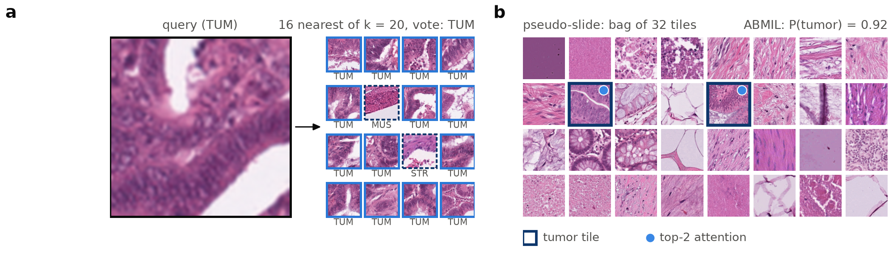
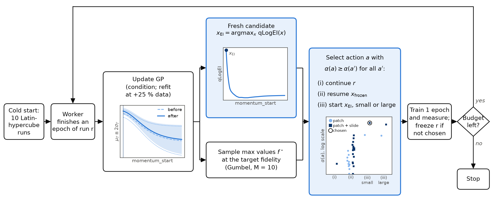
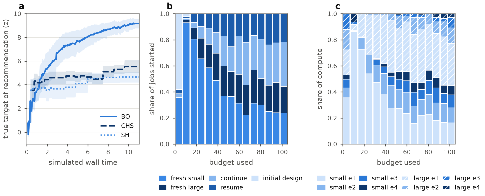

This started as a research proposal for a pathology foundation model: a vision transformer trained with DINOv2 whose features feed dozens of downstream diagnostic models. DINOv2 is sensitive to its hyperparameters and their schedules, and the next model will be much larger and trained much longer than the current one, under a fixed GPU budget. The question was how to choose its hyperparameters with that budget.

Two earlier generations of the model were tuned with standard schedules. A **chained search (CHS)** samples at random in stages of increasing model size and narrows the ranges after each stage, and **successive halving (SH)** trains a pool of configurations and keeps the better half at each checkpoint. Both are simple and robust, but they sample at random, pay for every run from scratch, and fix in advance how much compute goes to each fidelity. My proposal replaces the schedule with a model: a Gaussian process (GP) that learns how cheap measurements relate to the expensive one, and a search that asks, every time a worker frees up, which experiment is worth its cost.

## The Testbed

**Toy Model:** Comparing search methods at full scale is impossible, so I built a small stand-in: a DINOv2 implementation training a ViT on PathMNIST-64 colorectal H&E tiles, with 20 continuous and 3 categorical hyperparameters (learning rate and its schedule, weight decay, teacher and student temperatures, masking, crop scales, centering method, optimizer and so on). Two model sizes (0.15M and 0.52M parameters) and two evaluation tasks give four fidelities at every epoch. The **patch task** (cheap and noisy) is k-NN tissue classification in the model's feature space, and the **slide task** (expensive and closer to deployment) is an attention-MIL classifier on frozen features that detects whether a bag of 32 tiles contains tumor (Figure 1).

**Figure 1.** The two evaluation tasks. (a) Patch evaluation, the low fidelity: a tile is classified by a vote of its nearest neighbors in the model's feature space. (b) Slide evaluation, the high fidelity: an attention-MIL classifier on frozen features predicts whether a bag of tiles contains tumor.

**Calibration:** I trained 120 Latin-hypercube configurations at both sizes (288 runs, each measured after every epoch) and fitted a cheap toy model to them, so each search method could be simulated many times. The target is the large model's slide score at its final epoch. The real runs already show the structure a search has to exploit: the patch task is a weak proxy (rank correlation with the target of about 0.3 to 0.4), the small model's slide score is a good one (about 0.8), and later epochs predict better than earlier ones.

## The Model

Every measurement is indexed by $z = (x, s, t, v)$: hyperparameters $x$, log model size $s$, epoch $t$ and task $v$. One GP covers all of them, with a kernel built from pieces that each encode one belief:

$$
k(z, z') = \sigma_A^2\, k_{\mathcal X}(x, x') \big[ B_1(v, v') + B_3(v, v')\, s\, s' \big] + \sigma_D^2\, k'_{\mathcal X}(x, x')\, k_{\mathrm{FT}}(t, t') \big[ B_2(v, v') + B_4(v, v')\, s\, s' \big]
$$

1. **Converged Score Plus a Transient:** The first term is the score a run converges to and the second is a learning curve that decays with epochs, using the freeze-thaw kernel $k_{\mathrm{FT}}(t, t') = \beta^\alpha / (t + t' + \beta)^\alpha$ (the covariance of exponentially decaying curves). This lets the search stop or pause a run partway through and still reason about where it would have ended up.
2. **Mixed Hyperparameters:** $k_{\mathcal X}$ mixes a Matérn kernel on the continuous hyperparameters with an overlap kernel on the categorical ones (CoCaBO), so categorical choices share one surface rather than each combination getting its own GP.
3. **Tasks and Sizes:** $B_1$ and $B_2$ are 2×2 coregionalization matrices that learn how patch and slide scores correlate, and the $s\, s'$ terms give every configuration its own slope in log model size, so the GP learns which hyperparameters transfer from small models and which do not.
4. **Measurement-Dependent Noise:** The mean and the log noise variance each have a baseline, a patch offset and a term in $1/t$, so the GP learns on its own that patch scores are noisier.

## The Search

**Figure 2.** The decision loop, with the GP-driven steps in blue and examples taken from a real run of the search.

Ten simulated workers run asynchronously, and the unit of work is one epoch of one run followed by an evaluation. Whenever a worker finishes an epoch the search does three things:

1. **Update the GP:** Add the new measurements, and refit the GP's hyperparameters once the data has grown by 25%.
2. **Propose a Fresh Configuration:** Use expected improvement at the target (BoTorch's qLogEI), treating what the other workers are training as pending so that they do not duplicate each other.
3. **Pick the Action:** Continue the run that just finished, resume one of the most promising paused runs, or start the fresh configuration as a small or a large model, and measure either the patch task alone or both tasks. Every option is scored by the information it gives about the best achievable target score per unit cost (multi-fidelity max-value entropy search, computed with the GIBBON bound). *This single score is what puts "one more epoch of this run" and "a new small model" on the same scale.*

## Results

**Performance:** On the toy, with the same 10 workers and budget (the cost of 100 full target runs), the search found configurations with a true target of 9.2 ± 0.4 (z-units), against 5.5 ± 0.5 for CHS and 4.7 ± 0.5 for SH, and matched their final results with 13–19% of the compute and wall time (Figure 3a).

**Figure 3.** (a) True target of each method's recommended configuration over simulated wall time, mean ± s.e. over 5 seeds. (b, c) How the search spends its budget: (b) the mix of decisions (fresh small or large models, continued runs, resumed runs and the initial design) and (c) the share of compute by model size and epoch trained.

**Allocation:** Nobody told the search how to schedule fidelities, so the allocation it learned is worth looking at (Figure 3b, c). It starts by screening many fresh small models for a single epoch (80–93% of early jobs), then shifts toward the large model (29% to 51% of compute) and toward longer training (compute beyond the first epoch rises from 20% to 45%). It also uses small runs to probe how configurations develop: about 33 small configurations per seed were trained to the last epoch, against 4 large ones.

## Scaling to the Real Budget

If the next model needs an order of magnitude more compute than the current one, a single training run costs about a quarter of the GPU allocation, so the search can never observe the deployed model directly. The proposal handles this with two relaxations of the same algorithm. Setting the target epoch to $t \to \infty$ makes the freeze-thaw term vanish, so the target is the converged score. Making model size a decision variable, with the target placed on the equal-compute line $t = C_{\text{final}} / c_{\text{epoch}}(s)$, means every candidate size uses exactly the final training budget. The search then returns the hyperparameters, the model size and the epoch count together, and spends the remaining three quarters of the allocation learning them from cheaper measurements.

## What I Took From It

1. **A Model Over a Schedule When Fidelities Are Uneven:** The GP is valuable because one quantity, information per unit cost, can compare actions that a schedule treats as separate stages.
2. **The Surrogate Is the Assumption:** Everything rests on the kernel's inductive biases matching real training, which is why the proposal validates on a toy calibrated to real runs and puts sensitivity checks before any large-scale use.
