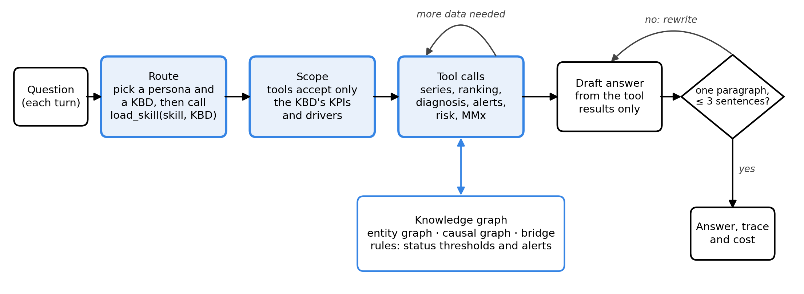
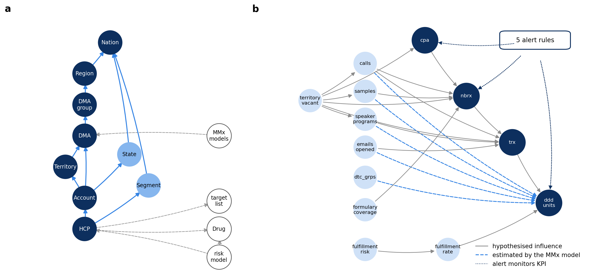
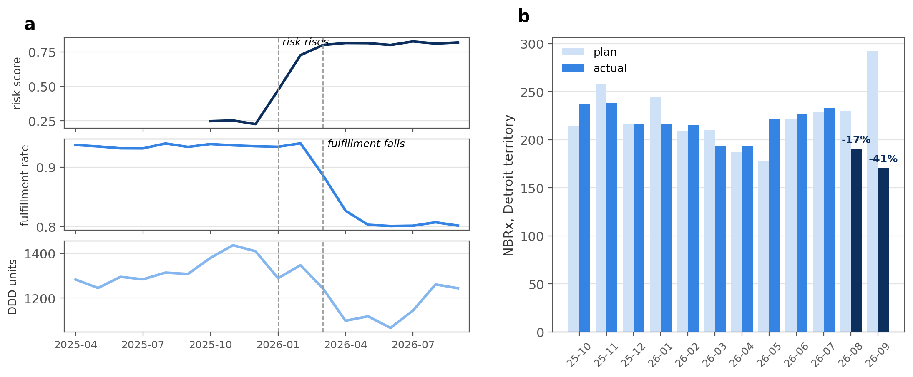
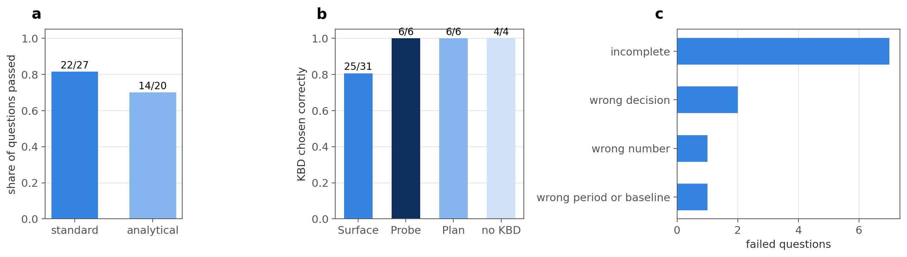

**Code:** private. I designed this at work for a pharmaceutical commercial analytics team, and rebuilt it here on synthetic data so it can be shown.

Analytics teams in pharma spend a lot of time answering variations of the same questions: is the brand on track against plan, where is it falling behind, why did a number move, and what should the field team or the marketing budget do about it. A language model can answer these, but letting it write SQL against the warehouse goes wrong in predictable ways. It averages ratios that should be summed first, splits a territory plan down to accounts, and double counts prescribers that sit in two overlapping groups. In this project the agent never writes queries. It calls tools over a knowledge graph that *knows which questions the data can answer*, and refuses the ones it can't. On two graded question sets the agent answered 22 of 27 and 14 of 20 questions correctly, at about 8 cents (judge included) and 9 seconds per question.

**Figure 1.** From a question to an answer. Steps driven by the knowledge graph are in blue. The agent first files the question under a persona and a key business decision (KBD), which limits the KPIs and drivers the tools will accept, then calls tools until it has what it needs. A draft that breaks the answer format is rewritten from the tool results only.

## The graph

The graph has three layers, each built from configuration files and CSV tables rather than code. **Entity graph:** the synthetic brand has 629 prescribers (HCPs) working at 72 accounts, covered by 36 territories in 18 DMAs (media markets), DMA groups, regions and the nation, plus 19 states and 3 prescriber value segments (Figure 2a). Edges that roll values up define the reporting levels and their order. **Causal graph:** 15 metrics, 4 of them KPIs (new and total prescriptions, units sold to accounts and call-plan adherence), joined by 22 influence edges (Figure 2b). Most are business hypotheses; 5 were estimated by a marketing-mix (MMx) model. **Bridge:** for every metric, the level and time grain it is recorded at, how it rolls up across entities and time, and where its plan is set.

**Figure 2.** (a) Entity types. Blue arrows roll values up; the light blue levels (state and segment) cut across the territory hierarchy, and the dashed links (target list, drug, the risk and MMx models) do not roll anything up. (b) The causal graph and its alert rules. KPIs are dark, drivers light; grey arrows are hypothesised influences, blue dashed arrows were estimated by the MMx model, and dotted arrows show which KPIs the alert rules watch.

**Reporting rules:** The most useful property of the graph is that it decides where a number can be reported. A metric recorded at one level can be reported at every level above it that each of its entities sits in exactly once, and this is checked against the data when the graph loads. An account sits in one state, so account sales roll up to states; a territory can span states, so territory metrics cannot, and the tool declines instead of splitting the value. *Values only roll up; they are never allocated down.* Time works the same way, from a calendar table: a plan set by territory and quarter can be compared by quarter or year, never by month. Because the levels, grains and reportable combinations are derived rather than listed, new groupings were added with a table and a few lines of configuration, with no code changes.

## Routing questions to decisions

Every question belongs to one of three personas. **Surface** asks what is happening, **Probe** asks why, and **Plan** asks what to do. Each persona has a few KBDs ("is performance on track", "why did a KPI move", "where should promotional spend move"), and each KBD lists the KPIs and drivers that matter for that decision. Before anything else the agent picks a KBD, and from then on the tools accept only that decision's metrics. A diagnosis under "why did a KPI move" ranks every driver the causal graph links to the KPI; the same question under "where should spend move" sees only the promotional channels and their MMx estimates. *The causal graph stays the same for every decision; a decision only limits what is in scope.* This made alignment with the business concrete: the team agrees, decision by decision, which KPIs and drivers belong, and every agreed pairing must already exist as an edge in the graph.

**Business rules:** When a KPI counts as a problem is a business judgement, so it lives in one rules file. Status thresholds decide when any comparison with the plan or with history is at risk or off track. Alert rules are standing watches built on those statuses: which comparison of which KPI to check, at what level, and for how long. On the synthetic data 20 alerts fire in September 2026, led by new prescriptions off track against plan in 10 territories (Figure 3b).

**Figure 3.** Two stories planted in the synthetic data. (a) Phoenix. A fulfillment risk model scores each prescriber monthly; its average risk in the Phoenix DMA rises from 0.23 in December 2025 to 0.80 by March 2026, fulfillment falls from 94% to 80% between February and May, and units sold fall from 1,347 to 1,066 by June. The diagnosis tool surfaces it under the "why" decision that allows access drivers, and an answer has to phrase it as consistent with the risk score, not caused by it. (b) Detroit. New prescriptions against plan in one territory; the alert fires because the gap is off track for two months running (17% under plan in August, 41% in September).

## Evaluation

Each question in the evaluation set has an expected behaviour and a label for the KBD a business user would file it under. An LLM judge (Claude Opus 5.5) grades the agent's (Claude Sonnet 5.5) final answer against the expected behaviour, using the tool calls only as evidence. Routing is measured separately in code and never decides the verdict, because two decisions can lead to the same correct answer.

**Figure 4.** Results from one graded run of each set. (a) Questions passed: 22 of 27 everyday business questions and 14 of 20 analytical edge cases (ratio roll-ups, plans at a different grain, multi-step diagnoses). (b) How often the agent picked the labelled KBD, by persona, across both sets. (c) Why the 11 failed questions failed, as categorised by the judge.

Two results changed the design. First, routing was perfect on the everyday questions but wrong on 6 of 13 Surface questions in the analytical set, almost always by filing a comparison under the monitoring decision. Answers passed 71% of the time when routing was right and 67% when it was wrong, so *the routing errors barely cost answers*: the three overlapping Surface decisions were really question styles, and my proposal for the next version merges them into one decision per business domain (sales, field execution, market access). Second, most failures were incomplete answers rather than wrong numbers, and 38 of 47 drafts broke the three-sentence limit and had to be rewritten, which suggests the format limit is too tight for the multi-part questions.

## Assumptions and limitations

1. **Synthetic data:** The tables are generated with planted stories, so the numbers show the mechanics, not any real brand. The architecture is what transfers.
2. **Draft business content:** The decisions, their metric lists, the causal edges and the alert rules are a first draft for alignment with a business team. Some questions fail today because no Surface decision allows the metric yet (fulfillment rate, for example), which is exactly what the alignment session is meant to fix.
3. **Hypothesised causes:** Most causal edges are beliefs, not estimates, so diagnoses only ever say a change is consistent with a driver. Only the MMx edges are estimated, and only for units sold.
4. **Uncalibrated judge:** The LLM judge has not been checked against human labels, and each set was run once, so the pass rates above carry real uncertainty at these sample sizes.
