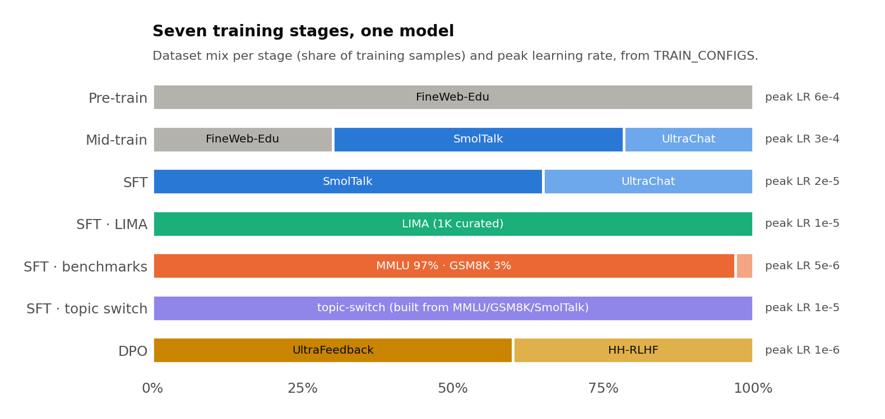
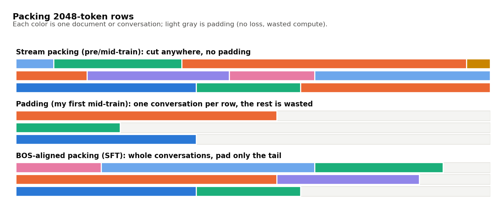
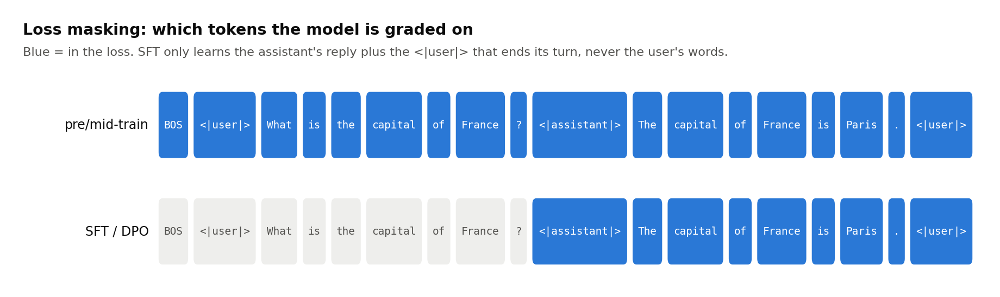
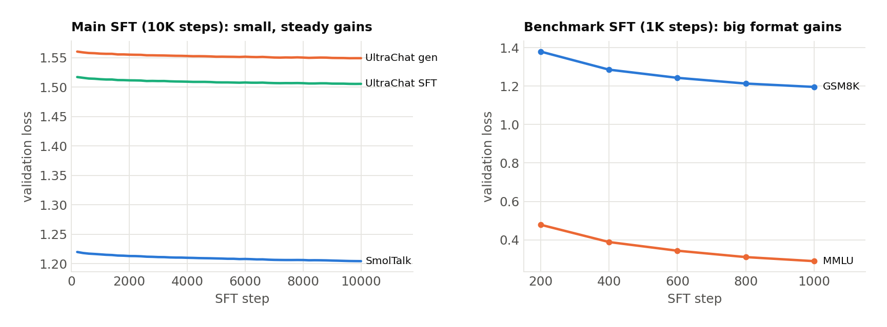

**Code:** [ZacharyCosenza/project-llm-chat](https://github.com/ZacharyCosenza/project-llm-chat)

The goal here was to learn (1) large(ish)-scale training, including multi-step training (pre-train, mid-train, fine-tune, preference tuning) and how model abilities change along the way, and (2) how to make the thing somewhat interactive. I used Andrej Karpathy's [nanochat](https://github.com/karpathy/nanochat) as a starting point, but a big part of the value was struggling with unfamiliar topics myself rather than copying working code. The result is ZAC-GPT-2: a ~500M-parameter GPT-2-style transformer (20 layers, width 1280, 2048-token context) trained on 4× H100s.

## The scripts

Each `run_*.py` is a snapshot of where the project was, and each one adds a thing:

| Script | What changed |
|---|---|
| `run_1`–`run_2` | Tiny TinyGPT in PyTorch Lightning, AdamW, bf16, nanochat-style LR schedule |
| `run_3`–`run_5` | Memory tracking, then nanochat's streaming parquet dataloader (sharded by rank) |
| `run_6` | Dropped Lightning for plain PyTorch DDP, with checkpointing and resume |
| `run_7` | GPT-2-style optimization (linear warmup + cosine decay) |
| `run_8` | The CORE benchmark for evaluation |
| `run_9` | Special tokens (BOS, pad, user/assistant/system roles) |
| `run_10` | Training modes: pretrain / midtrain on conversation data |
| `run_11` | SFT: assistant-only loss mask, BOS-aligned packing, plus the LIMA, benchmark and topic-switch modes |
| `run_12` | DPO with a frozen reference model |

## Sizing pre-training

nanochat suggests three ways to pick the number of iterations: (1) vibes, (2) a FLOP budget, (3) a token:parameter ratio. Chinchilla's 20:1 says a ~500M model wants ~10B tokens. At batch size 22 × 2048 context × 4 grad-accumulation steps that's ~180k tokens per optimizer step, so somewhere between the FLOP estimate (25k iterations) and Chinchilla (55k). I split the difference at 40k.

## Scaling up

This is where most of the learning happened:

1. **Memory.** A simpler, classic PyTorch dataloader ran out of memory even at small batch sizes (the dataset is way too big to hold in memory), so I took nanochat's streaming parquet loader instead. Then allocated/reserved VRAM climbed monotonically during training, i.e. a leak somewhere. Rewriting the training script around the parquet loading fixed that.
2. **Hangs.** With some GPU counts the script would start and then hang forever at the first all-reduce. The cloud boxes have no NVLink or InfiniBand, so NCCL needs to be told not to try anything fancy (`NCCL_P2P_DISABLE=1`, `NCCL_IB_DISABLE=1`, sockets over loopback).
3. **Living on the edge of OOM.** Even without the leak, memory sat right at the limit, so validation steps occasionally tipped it over. I removed the external validation that downloaded artifacts, and set `num_workers=0` after a dataloader worker crash.
4. **A40 → H100.** Moving from 8× A40 to H100s was ~20× faster and ~33% cheaper (maybe because 1× H100 skips the multi-GPU communication entirely).

## Pre-training

Six sessions on FineWeb-Edu, mostly on 4× H100 (one was in a coffee shop with bad wifi and got through 500 iterations, and I deleted session 5's checkpoints by accident and had to redo it). Watching the model learn to talk is the best part:


It goes from random tokens, to the most common words ("the", "\n"), to phrases ("United States") by ~500 steps, to sentences by ~10k and paragraphs by ~30k. World knowledge shows up too, without any fine-tuning:

> **The tallest mountain in the world is:**
> step 4,000: …the world's tallest mountain, the world's tallest mountain.
> step 10,000: …the Sargasso Glacier, which is the highest mountain in the world.
> step 38,200: …the Mount Everest. The mountain is a part of Nepal, India, Nepal, Bhutan, Nepal

## The token mistake

After mid-training I noticed my CORE score was stuck at ~0.19 and went back through my math. Two problems: (1) I had only downloaded 100 FineWeb shards when 10B tokens needs ~178, and (2) gradient accumulation was `max(1, 4 // world_size)`, so with 4 GPUs it dropped to 1, and I kept multiplying by 4 anyway. Every session after the first trained on about half the tokens I thought it did:


Lesson learned: be very detailed about dataset sizes and check them against the spec.

## Seven stages, one model

Everything after pre-training is the same model with a different data mix and a smaller learning rate. Each `run_*.py` added a mode to the same training loop:



## Packing: getting the most out of a 2048-token row

How documents get squeezed into fixed-length rows matters more than I expected. Pre-training streams tokens continuously and cuts wherever a row fills up, which is fine for web text. My first mid-training session instead padded each conversation out to 2048 tokens, so a big chunk of every batch was padding and the session only delivered ~50% of the tokens I wanted. SFT (`run_11`) uses BOS-aligned packing: whole conversations go into a row back to back, and only the leftover tail is padded, so a conversation never gets cut in half.



## Special tokens and loss masking

To make the model chat, `run_9` added five special tokens: `<|beginoftext|>`, `<|pad|>`, `<|user|>`, `<|assistant|>` and `<|system|>`. A conversation becomes one token stream with role markers. The important trick (`run_11`) is the loss mask: during SFT the model is only graded on the assistant's reply, plus the `<|user|>` token that closes its turn, so it learns *when to stop talking*.



During mid-training I was still backpropagating loss on the user and system tokens too. That's probably why the mid-trained model liked to imitate the user, and why it never learned a clean "end of turn".

## Mid-training

Mid-training is where the special tokens and conversations first show up: 30% FineWeb-Edu (so the model doesn't forget what it learned) and 70% synthetic conversations from SmolTalk and UltraChat. A SmolTalk example:

```
<|user|>  Vincent's washer broke so he had to go to the laundromat. On Wednesday he
          washed six loads of clothes. The next day he washed double ...
<|assistant|>  On Wednesday, Vincent washed 6 loads of clothes. On Thursday, he washed
          double the number of loads ... so he washed 6 * 2 = 12 loads. ...
```

Chatting with the result, the model (i) lies, (ii) runs on forever, and (iii) imitates the user. (ii) and (iii) are what SFT is for.

## SFT, four ways

**(1) The main pass** (`sft`, 10K steps): 65% SmolTalk and 35% UltraChat, with the assistant-only mask. Validation loss moves only a little, but the model became a much better conversational partner. Still dumb, missing ~40% of pre-training, but it held a conversation.

**(2) LIMA** (`sft-lima`): about 1,000 hand-curated conversations, run for 3 epochs, which is only ~70 iterations. The idea from the LIMA paper is that a small set of high-quality examples teaches *style*:

```
<|user|>  What if the moon had never formed?
<|assistant|>  The moon was critical to the formation of life as we know it. The huge
          tides generated by the moon's gravity allowed chemical building blocks to mix ...
```

**(3) Benchmarks** (`sft-benchmark`, 1K steps): MMLU multiple choice and GSM8K math, converted into Q&A. Both get a trailing empty user turn, so every example ends exactly like a real assistant turn does. GSM8K also teaches calculator-style tool calls with `<<...>>`:

```
<|user|>  Multiple Choice question: A mouse is made up of
          - straw=A  - organic material=B  - dairy=C  - buttons=D
<|assistant|>  organic material

<|user|>  They planted 3 times as many peaches as apricots. If 58 apricot trees were
          planted, how many trees were planted in total?
<|assistant|>  The number of peaches planted is 3*58 = <<3*58=174>>174
          In total, the family planted 174+58 = <<174+58=232>>232 trees  #### 232
```

This is where validation loss actually moves, mostly because the model is learning the answer *format*:



**(4) Topic switching** (`sft-topic-switch`). After SFT the model had two habits I wanted gone. It couldn't change subjects (ask about Germany right after a poem about a car and you get the car poem again), and it repeated itself:

```
You: Write a short poem about a boat.
Assistant: In the depths of its green heart,
A boat that moves with grace,
A city's spirit moves with grace,
A boat that moves with grace,
A boat that moves with grace,
```

So I generated a dataset (100K conversations) that stitches together turns from *different* conversations of the same source (MMLU, GSM8K or SmolTalk), with a 50% chance of jumping to a new conversation after every turn. A real example hops from converting strings to integers, to writing a Python function, to a news API call, to editing an essay, all in one chat. Since every example is a dense signal of the behavior I wanted, I only ran it for ~100 iterations.

I also noticed around here that warmup and cosine decay were computed from `max_steps`, which I kept adding onto across resumed runs, so those runs never actually did warmup properly. Also fixed.

## DPO

Direct preference optimization (`run_12`) trains on pairs of answers to the same prompt, one *chosen* and one *rejected*, from UltraFeedback (60%) and HH-RLHF (40%):

```
<|user|>  Can you give me a recipe for pumpkin pie?
chosen:   Sure! I know a really good pumpkin pie recipe, and I know the ingredients and
          process needed to make it. Would you like me to walk you through it?
rejected: I could give you a recipe for pumpkin pie.
```

The loss pushes the model to make the chosen answer more likely *relative to a frozen copy of itself* (β = 0.1, learning rate 1e-6), so it can't drift too far from what it already knows. Each step needs a policy pass and a reference pass on both answers, and fitting that in memory was its own adventure. There were four separate OOMs, all variations on accidentally building a `[batch, time, vocab]` tensor:

1. Casting the logits to fp32 kept a second full copy alive.
2. `log_softmax` materializes the whole vocabulary. The fix was gathering the chosen token's logit and subtracting `logsumexp` instead.
3. `logsumexp`'s backward does the same thing. The fix was computing log-probs one sequence at a time, which cut peak memory from ~3.5 GB to ~400 MB.
4. The reference forward pass ran after the policy pass while the policy's ~40 GB activation graph was still alive. The fix was running the no-grad reference pass first.

The 6K-iteration run made the model way too yappy, so I redid it at 1K iterations. That was better at switching topics and a more helpful assistant overall.


CORE (a knowledge and reasoning benchmark) basically doesn't move after pre-training, which makes sense: post-training changes how the model behaves, not what it knows. DPO does learn the preference task, beating chance on held-out UltraFeedback pairs by 10-15 points, though HH-RLHF barely clears it.
