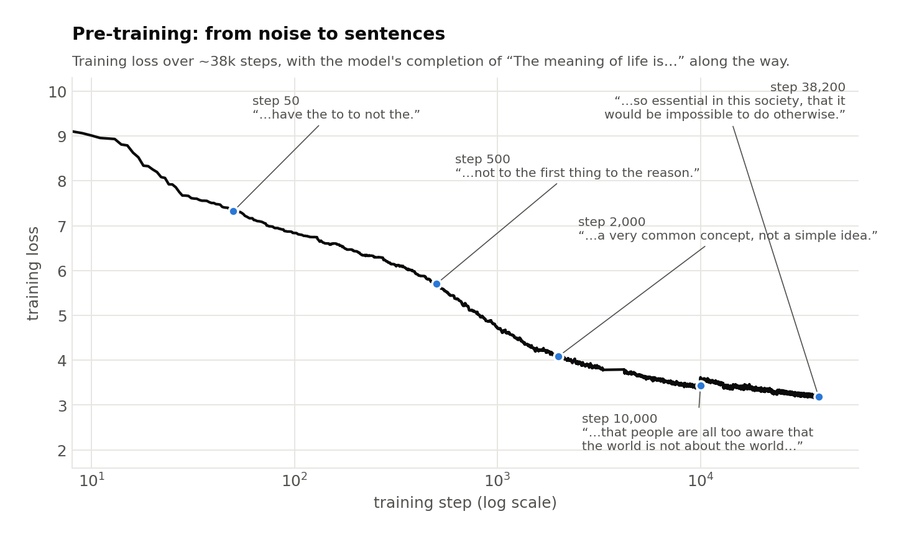
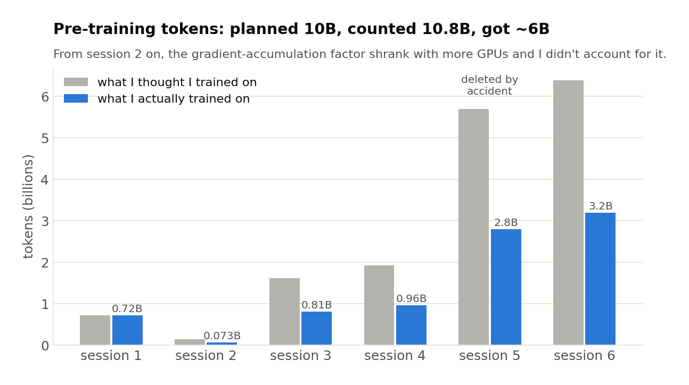
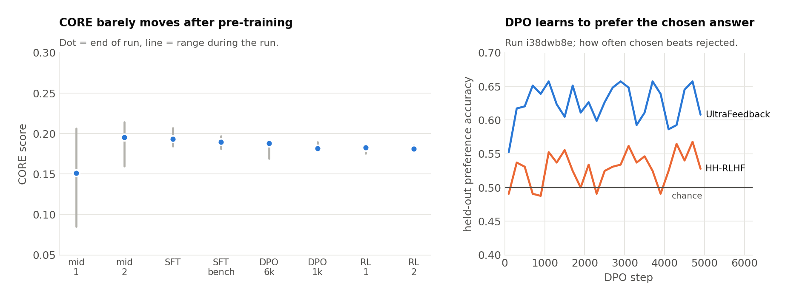

**Code:** [ZacharyCosenza/project-llm-chat](https://github.com/ZacharyCosenza/project-llm-chat)

The goal here was to learn (1) large(ish)-scale training, including multi-step training (pre/mid/fine-tune/RL) and how model abilities change along the way, and (2) how to make the thing somewhat interactive. I used Andrej Karpathy's [nanochat](https://github.com/karpathy/nanochat) as a starting point, but a big part of the value was struggling with unfamiliar topics myself rather than copying working code. The result is ZAC-GPT-2: a ~500M-parameter GPT-2-style transformer (20 layers, width 1280, 2048-token context) trained on 4× H100s.

## The scripts

Each `run_*.py` is a snapshot of where the project was, and each one adds a thing:

| Script | What changed |
|---|---|
| `run_1`–`run_2` | Tiny TinyGPT in PyTorch Lightning, AdamW, bf16, nanochat-style LR schedule |
| `run_3`–`run_5` | Memory tracking, then nanochat's streaming parquet dataloader (sharded by rank) |
| `run_6` | Dropped Lightning for plain PyTorch DDP, with checkpointing and resume |
| `run_7` | GPT-2-style optimization (linear warmup + cosine decay) |
| `run_8` | The CORE benchmark for evaluation |
| `run_9` | Special tokens (BOS, pad, user/assistant/system roles) |
| `run_10` | Training modes: pretrain / midtrain on conversation data |
| `run_11` | SFT: assistant-only loss mask, BOS-aligned packing |
| `run_12` | DPO with a frozen reference model |
| `run_13` | Code RL: online REINFORCE with a Python execution reward |

## Sizing pre-training

nanochat suggests three ways to pick the number of iterations: (1) vibes, (2) a FLOP budget, (3) a token:parameter ratio. Chinchilla's 20:1 says a ~500M model wants ~10B tokens. At batch size 22 × 2048 context × 4 grad-accumulation steps that's ~180k tokens per optimizer step, so somewhere between the FLOP estimate (25k iterations) and Chinchilla (55k). I split the difference at 40k.

## Scaling up

This is where most of the learning happened:

1. **Memory.** A simpler, classic PyTorch dataloader ran out of memory even at small batch sizes (the dataset is way too big to hold in memory), so I took nanochat's streaming parquet loader instead. Then allocated/reserved VRAM climbed monotonically during training, i.e. a leak somewhere. Rewriting the training script around the parquet loading fixed that.
2. **Hangs.** With some GPU counts the script would start and then hang forever at the first all-reduce. The cloud boxes have no NVLink or InfiniBand, so NCCL needs to be told not to try anything fancy (`NCCL_P2P_DISABLE=1`, `NCCL_IB_DISABLE=1`, sockets over loopback).
3. **Living on the edge of OOM.** Even without the leak, memory sat right at the limit, so validation steps occasionally tipped it over. I removed the external validation that downloaded artifacts, and set `num_workers=0` after a dataloader worker crash.
4. **A40 → H100.** Moving from 8× A40 to H100s was ~20× faster and ~33% cheaper (maybe because 1× H100 skips the multi-GPU communication entirely).

## Pre-training

Six sessions on FineWeb-Edu, mostly on 4× H100 (one was in a coffee shop with bad wifi and got through 500 iterations, and I deleted session 5's checkpoints by accident and had to redo it). Watching the model learn to talk is the best part:



It goes from random tokens, to the most common words ("the", "\n"), to phrases ("United States") by ~500 steps, to sentences by ~10k and paragraphs by ~30k. World knowledge shows up too, without any fine-tuning:

> **The tallest mountain in the world is:**
> step 4,000: …the world's tallest mountain, the world's tallest mountain.
> step 10,000: …the Sargasso Glacier, which is the highest mountain in the world.
> step 38,200: …the Mount Everest. The mountain is a part of Nepal, India, Nepal, Bhutan, Nepal

## The token mistake

After mid-training I noticed my CORE score was stuck at ~0.19 and went back through my math. Two problems: (1) I had only downloaded 100 FineWeb shards when 10B tokens needs ~178, and (2) gradient accumulation was `max(1, 4 // world_size)`, so with 4 GPUs it dropped to 1, and I kept multiplying by 4 anyway. Every session after the first trained on about half the tokens I thought it did:



Lesson learned: be very detailed about dataset sizes and check them against the spec.

## Mid-training

Mid-training introduces special tokens and conversation data: 30% FineWeb-Edu (so the model doesn't forget what it learned) and 70% SmolTalk/UltraChat. The first session's CORE was noisy and flat. It turned out (i) very few sequences made up the CORE score and (ii) I was padding each conversation instead of packing them together, so the session was really only ~50% of the tokens I wanted. Session 2 used packing.

Chatting with the result, the model (i) lies, (ii) runs on forever, and (iii) imitates the user. I was also backpropagating loss on user and system tokens, which probably explains (iii).

## SFT

SFT trains only on the assistant's tokens (an assistant-only loss mask) and packs each chunk starting at a conversation boundary. Three passes: SmolTalk/UltraChat for 10k iterations, a quick LIMA fine-tune, then MMLU + GSM8K converted to Q&A. After the first pass it was a much better conversational partner. It was still dumb (missing ~40% of pre-training), but it held a conversation. Two problems remained, (1) it couldn't switch topics and (2) it repeated itself:

```
You: Write a short poem about a boat.
Assistant: In the depths of its green heart,
A boat that moves with grace,
A city's spirit moves with grace,
A boat that moves with grace,
A boat that moves with grace,
A boat that moves with grace,
```

I built a small topic-switching dataset for (1). Around here I also noticed that the warmup/cosine schedule was computed from `max_steps`, which I kept adding onto across resumed runs, so those runs never actually did warmup properly. Also fixed.

## DPO

DPO uses UltraFeedback and HH-RLHF chosen/rejected pairs, with a frozen copy of the model as the reference. Getting it to fit in memory was its own adventure. There were four separate OOMs, all from accidentally materializing `[batch, time, vocab]` tensors (dtype casts, `log_softmax`, `logsumexp`'s backward), plus running the reference forward pass after the policy instead of before. The 6k-iteration run made the model way too yappy, so I redid it at 1k iterations, which was better at switching topics and a more helpful assistant overall.

## Code RL

Last up was online REINFORCE: generate code, run it, reward correct output (1/3 calculator problems, 1/3 HumanEval, 1/3 MBPP). Two short runs made no noticeable difference. There's only so much you can do with an undertrained dumb model.

## Post-training at a glance



CORE (a knowledge and reasoning benchmark) basically doesn't move after pre-training, which makes sense: post-training changes how the model behaves, not what it knows. DPO does learn the preference task, beating chance on held-out UltraFeedback pairs by 10-15 points, though HH-RLHF barely clears it.

## What I'd do differently

(1) Count tokens per step including world size and grad accumulation, and check shard counts before training. (2) Make the LR schedule resume-aware from day one. (3) Use proper row-level train/val splits for small post-training datasets instead of carrying over the "first shard is validation" trick from pre-training. (4) Track which shards have already been seen when resuming.
