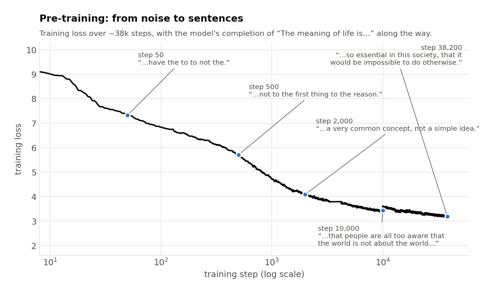
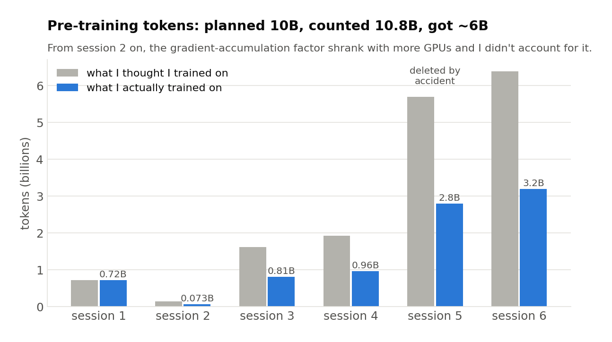
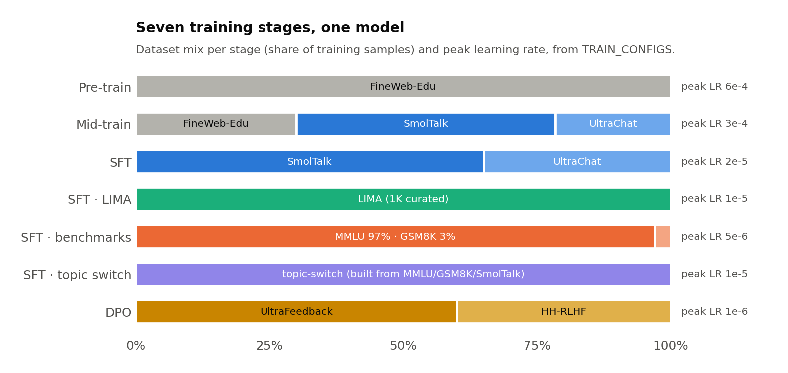
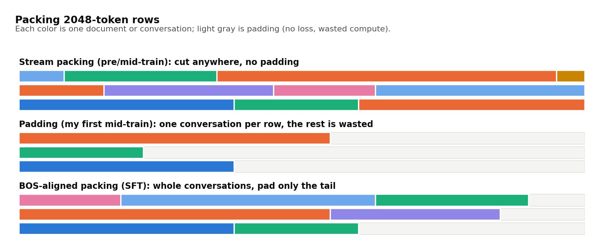
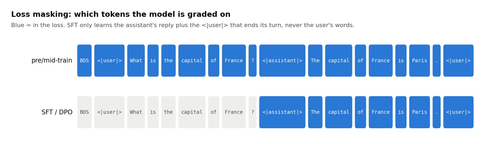
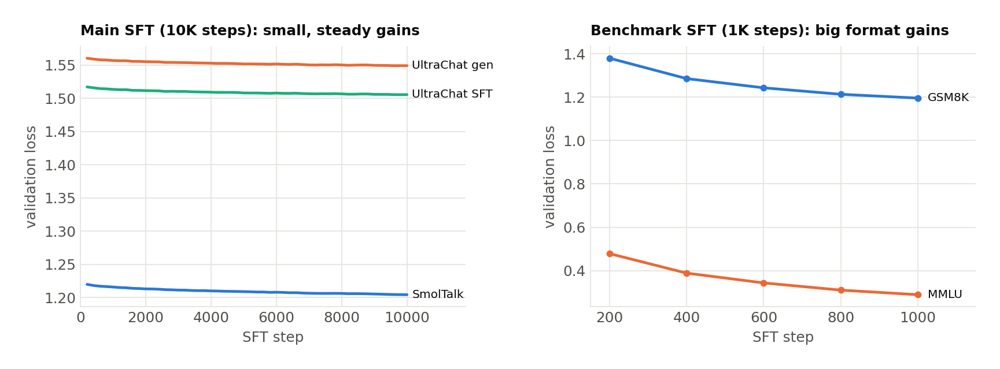
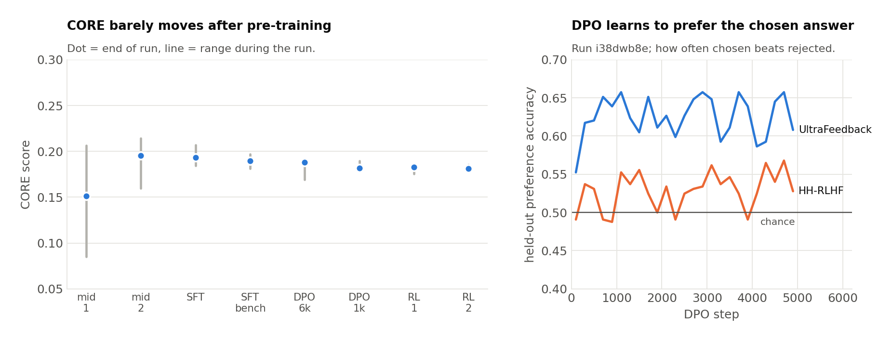

**Code:** [ZacharyCosenza/project-llm-chat](https://github.com/ZacharyCosenza/project-llm-chat)

The goal was to learn two things: training at large(ish) scale through every stage (pre-training, mid-training, fine-tuning and preference tuning), watching how the model's abilities change along the way, and making the result interactive. I used Andrej Karpathy's [nanochat](https://github.com/karpathy/nanochat) as a starting point, but much of the value came from working through unfamiliar topics myself rather than copying working code. The result is ZAC-GPT-2, a ~500M-parameter GPT-2-style transformer (20 layers, width 1280, 2,048-token context) trained on 4× H100s.

## The Scripts

Each `run_*.py` is a snapshot of where the project was, and each one adds something:

| Script | What changed |
|---|---|
| `run_1`–`run_2` | Tiny TinyGPT in PyTorch Lightning, AdamW, bf16, nanochat-style LR schedule |
| `run_3`–`run_5` | Memory tracking, then nanochat's streaming parquet dataloader (sharded by rank) |
| `run_6` | Dropped Lightning for plain PyTorch DDP, with checkpointing and resume |
| `run_7` | GPT-2-style optimization (linear warmup and cosine decay) |
| `run_8` | The CORE benchmark for evaluation |
| `run_9` | Special tokens (BOS, pad, user/assistant/system roles) |
| `run_10` | Training modes: pre-train and mid-train on conversation data |
| `run_11` | SFT: assistant-only loss mask, BOS-aligned packing, plus the LIMA, benchmark and topic-switch modes |
| `run_12` | DPO with a frozen reference model |

## Sizing Pre-Training

**Iterations:** nanochat suggests three ways to choose the number of iterations: intuition, a FLOP budget, or a token-to-parameter ratio. Chinchilla's 20:1 says a ~500M model wants about 10B tokens. At batch size 22 × 2,048 context × 4 gradient-accumulation steps, one optimizer step covers about 180k tokens, which puts the answer between the FLOP estimate (25k iterations) and Chinchilla (55k). I split the difference at 40k.

## Scaling Up

Most of the learning happened here:

1. **Memory:** A simpler, classic PyTorch dataloader ran out of memory even at small batch sizes (the dataset is far too large to hold in memory), so I took nanochat's streaming parquet loader instead. Allocated and reserved VRAM then climbed steadily during training, which pointed to a leak; rewriting the training script around the parquet loading fixed it.
2. **Hangs:** With some GPU counts the script started and then hung forever at the first all-reduce. The cloud machines have no NVLink or InfiniBand, so NCCL has to be told not to try them (`NCCL_P2P_DISABLE=1`, `NCCL_IB_DISABLE=1`, sockets over loopback).
3. **Memory at the Limit:** Even without the leak, memory sat right at the limit and validation steps occasionally tipped it over. I removed the external validation that downloaded artifacts, and set `num_workers=0` after a dataloader worker crash.
4. **A40 to H100:** Moving from 8× A40 to H100s was about 20× faster and about 33% cheaper (possibly because a single H100 avoids multi-GPU communication entirely).

## Pre-Training

**Sessions:** Pre-training ran in six sessions on FineWeb-Edu, mostly on 4× H100. One session ran from a coffee shop with bad wifi and only got through 500 iterations, and I deleted session 5's checkpoints by accident and had to redo it. The loss curve shows the model learning to write (Figure 1): from random tokens to the most common words ("the", "\n"), to phrases ("United States") by about step 500, to sentences by 10k and paragraphs by 30k.



**Figure 1.** Training loss over about 38,000 pre-training steps (log scale), with the model's completion of "The meaning of life is…" at steps 50, 500, 2,000, 10,000 and 38,200.

**World Knowledge:** Some knowledge appears without any fine-tuning:

> **The tallest mountain in the world is:**
> step 4,000: …the world's tallest mountain, the world's tallest mountain.
> step 10,000: …the Sargasso Glacier, which is the highest mountain in the world.
> step 38,200: …the Mount Everest. The mountain is a part of Nepal, India, Nepal, Bhutan, Nepal

## The Token Mistake

After mid-training I noticed my CORE score was stuck at about 0.19 and went back through my arithmetic. There were two problems. I had downloaded only 100 FineWeb shards when 10B tokens needs about 178, and gradient accumulation was `max(1, 4 // world_size)`, so with 4 GPUs it dropped to 1 while I kept multiplying by 4. Every session after the first trained on about half the tokens I thought it did (Figure 2). *Dataset sizes need to be checked against the plan, not assumed.*



**Figure 2.** Pre-training tokens per session, what I thought I trained on against what I actually trained on. From session 2 the gradient-accumulation factor shrank with more GPUs, and the total came to about 6B tokens against a planned 10B.

## Seven Stages, One Model

Everything after pre-training is the same model with a different data mix and a smaller learning rate. Each `run_*.py` added a mode to the same training loop (Figure 3).



**Figure 3.** The dataset mix (share of training samples) and peak learning rate for each of the seven training stages.

**Packing:** How documents are squeezed into fixed-length rows mattered more than I expected (Figure 4). Pre-training streams tokens continuously and cuts wherever a row fills up, which is fine for web text. My first mid-training session instead padded each conversation out to 2,048 tokens, so a large share of every batch was padding and the session delivered only about half the tokens I wanted. SFT (`run_11`) uses BOS-aligned packing: whole conversations go into a row back to back and only the leftover tail is padded, so a conversation is never cut in half.



**Figure 4.** Packing 2,048-token rows, with each colour one document or conversation and light grey padding: stream packing (pre- and mid-training) cuts anywhere with no padding, my first mid-training session put one conversation per row and wasted the rest, and BOS-aligned packing (SFT) keeps whole conversations and pads only the tail.

**Special Tokens and Loss Masking:** To make the model chat, `run_9` added five special tokens: `<|beginoftext|>`, `<|pad|>`, `<|user|>`, `<|assistant|>` and `<|system|>`, so a conversation becomes one token stream with role markers. The important change (`run_11`) is the loss mask: during SFT the model is graded only on the assistant's reply plus the `<|user|>` token that closes its turn, so *it learns when to stop talking* (Figure 5). During mid-training I was still back-propagating loss on the user and system tokens, which probably explains why the mid-trained model liked to imitate the user and never learned a clean end of turn.



**Figure 5.** The tokens in the loss (blue) for the same short conversation: every token in pre- and mid-training, and only the assistant's reply plus the closing `<|user|>` in SFT and DPO.

## Mid-Training

Mid-training is where the special tokens and conversations first appear: 30% FineWeb-Edu (so the model does not forget what it learned) and 70% synthetic conversations from SmolTalk and UltraChat. A SmolTalk example:

```
<|user|>  Vincent's washer broke so he had to go to the laundromat. On Wednesday he
          washed six loads of clothes. The next day he washed double ...
<|assistant|>  On Wednesday, Vincent washed 6 loads of clothes. On Thursday, he washed
          double the number of loads ... so he washed 6 * 2 = 12 loads. ...
```

In conversation, the mid-trained model made things up, ran on indefinitely, and imitated the user. The last two are what SFT is for.

## Supervised Fine-Tuning, Four Ways

1. **Main Pass** (`sft`, 10K steps): 65% SmolTalk and 35% UltraChat, with the assistant-only mask. Validation loss moved only a little, but the model became a much better conversational partner. It still lacked about 40% of its intended pre-training, but it could hold a conversation.

2. **LIMA** (`sft-lima`): About 1,000 hand-curated conversations for 3 epochs, only about 70 iterations. The idea from the LIMA paper is that a small set of high-quality examples teaches style:

```
<|user|>  What if the moon had never formed?
<|assistant|>  The moon was critical to the formation of life as we know it. The huge
          tides generated by the moon's gravity allowed chemical building blocks to mix ...
```

3. **Benchmarks** (`sft-benchmark`, 1K steps): MMLU multiple choice and GSM8K math converted into Q&A. Both get a trailing empty user turn, so every example ends the way a real assistant turn does, and GSM8K also teaches calculator-style tool calls with `<<...>>`:

```
<|user|>  Multiple Choice question: A mouse is made up of
          - straw=A  - organic material=B  - dairy=C  - buttons=D
<|assistant|>  organic material

<|user|>  They planted 3 times as many peaches as apricots. If 58 apricot trees were
          planted, how many trees were planted in total?
<|assistant|>  The number of peaches planted is 3*58 = <<3*58=174>>174
          In total, the family planted 174+58 = <<174+58=232>>232 trees  #### 232
```

This is where validation loss moved, mostly because the model was learning the answer format (Figure 6).



**Figure 6.** Validation loss during supervised fine-tuning: (a) small, steady gains over the 10K-step main pass on SmolTalk and UltraChat, and (b) larger drops on GSM8K and MMLU over the 1K-step benchmark pass, as the model learns the answer format.

4. **Topic Switching** (`sft-topic-switch`): After SFT the model had two habits I wanted gone. It could not change subjects (asking about Germany right after a poem about a car returned the car poem again), and it repeated itself:

```
You: Write a short poem about a boat.
Assistant: In the depths of its green heart,
A boat that moves with grace,
A city's spirit moves with grace,
A boat that moves with grace,
A boat that moves with grace,
```

I generated a dataset of 100K conversations that stitches together turns from different conversations of the same source (MMLU, GSM8K or SmolTalk), with a 50% chance of jumping to a new conversation after every turn. One example moves from converting strings to integers, to writing a Python function, to a news API call, to editing an essay, all in one chat. Since every example is a dense signal of the behavior I wanted, I ran it for only about 100 iterations. Around this point I also found that warmup and cosine decay were computed from `max_steps`, which I kept extending across resumed runs, so those runs never warmed up properly; I fixed that too.

## Preference Tuning With DPO

**Data:** Direct preference optimization (`run_12`) trains on pairs of answers to the same prompt, one chosen and one rejected, from UltraFeedback (60%) and HH-RLHF (40%):

```
<|user|>  Can you give me a recipe for pumpkin pie?
chosen:   Sure! I know a really good pumpkin pie recipe, and I know the ingredients and
          process needed to make it. Would you like me to walk you through it?
rejected: I could give you a recipe for pumpkin pie.
```

**Objective:** The loss makes the chosen answer more likely relative to a frozen copy of the model (β = 0.1, learning rate 1e-6), so it cannot drift far from what it already knows. Each step needs a policy pass and a reference pass on both answers, and fitting that in memory took four attempts, each failure a variation on accidentally building a `[batch, time, vocab]` tensor:

1. **Logit Precision:** Casting the logits to fp32 kept a second full copy alive.
2. **Softmax Over the Vocabulary:** `log_softmax` materializes the whole vocabulary; gathering the chosen token's logit and subtracting `logsumexp` avoids it.
3. **Its Backward Pass:** `logsumexp`'s backward does the same thing; computing log-probabilities one sequence at a time cut peak memory from about 3.5 GB to about 400 MB.
4. **Pass Order:** The reference forward pass ran after the policy pass while the policy's ~40 GB activation graph was still alive; running the no-gradient reference pass first fixed it.

**Results:** The 6K-iteration run made the model far too talkative, so I repeated it at 1K iterations, which switched topics better and was a more helpful assistant overall. The CORE benchmark (knowledge and reasoning) barely moves after pre-training, which makes sense: *post-training changes how the model behaves, not what it knows*. DPO does learn the preference task, beating chance on held-out UltraFeedback pairs by 10–15 points, though HH-RLHF barely clears it (Figure 7).



**Figure 7.** (a) CORE score at the end of each post-training run (dot) and its range during the run (line). (b) Held-out preference accuracy during DPO: how often the chosen answer beats the rejected one on UltraFeedback and HH-RLHF pairs.
