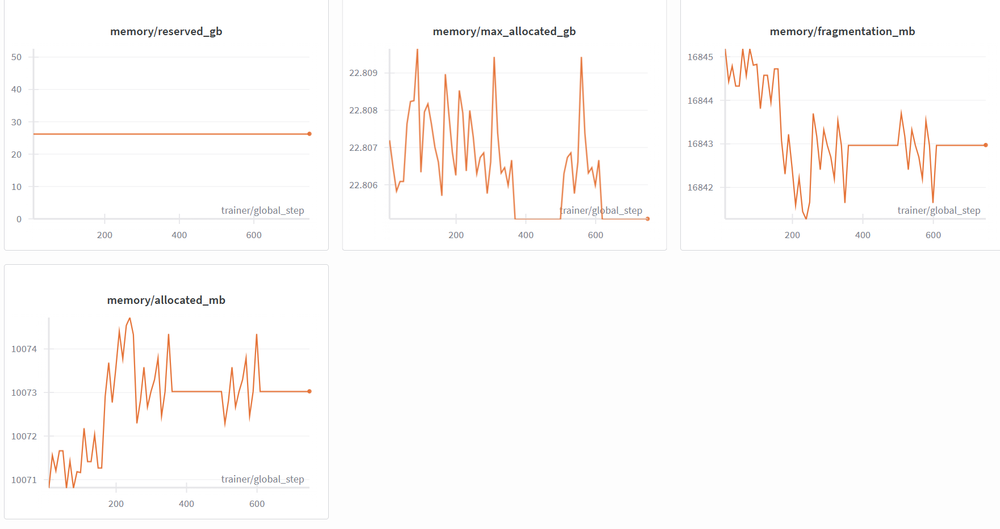

**Code:** [ZacharyCosenza/project-llm-chat](https://github.com/ZacharyCosenza/project-llm-chat)

## What it is

A full multi-stage LLM training pipeline, written as a learning project to understand large-scale
training, preference optimization and RL from feedback in practice. The model is a ~500M-parameter
GPT-2-style transformer (20 layers, width 1280, 2048-token context), trained with DDP on 4× H100/H200
GPUs.

## Training stages

| Stage | Data | Notes |
|---|---|---|
| Pre-train | FineWeb-Edu, ~10.8B tokens | linear stream-packing |
| Mid-train | FineWeb-Edu + SmolTalk + UltraChat | blends web text back in to avoid forgetting |
| SFT | SmolTalk, UltraChat, then LIMA, MMLU/GSM8K | assistant-only loss, BOS-aligned packing |
| DPO | UltraFeedback + HH-RLHF | frozen reference copy, memory-careful log-probs |
| Code RL | Calculator, HumanEval, MBPP | online REINFORCE with an execution reward (next stage) |

The chat interface loads the best conversational SFT checkpoint and holds multi-turn conversations using the special
`<|user|>` / `<|assistant|>` tokens the model was trained on.

## Lessons from DPO memory

DPO needs a policy forward pass and a reference forward pass on long sequences with a 50K-token
vocabulary, and it ran out of GPU memory in four different ways. The fixes:

- Never materialize the full `[batch, time, vocab]` log-softmax. Gather the token logits, then subtract
  `logsumexp`.
- Compute sequence log-probs one sequence at a time. This cut peak memory from ~3.5 GB to ~400 MB.
- Avoid dtype casts on large tensors, which silently keep both copies alive.
- Run the no-grad reference pass *before* the grad-tracked policy pass.

