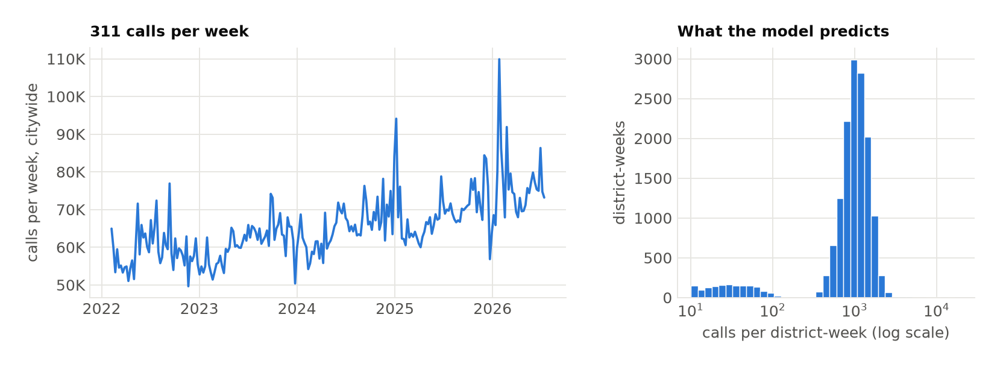
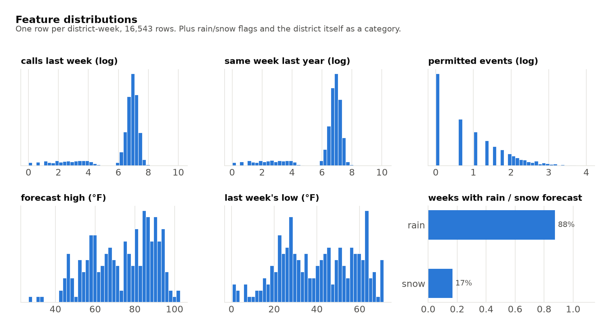
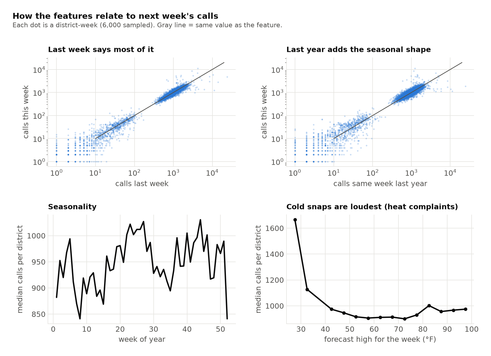
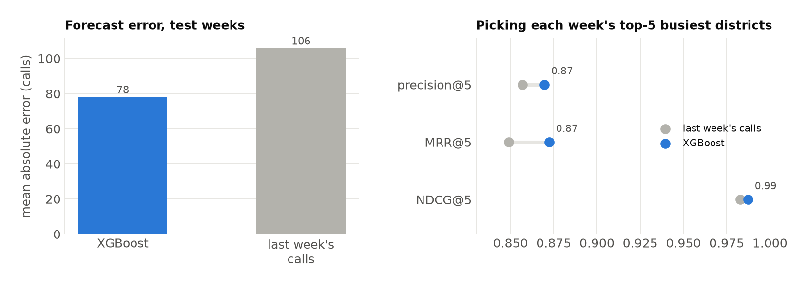

**Code:** [ZacharyCosenza/project-311](https://github.com/ZacharyCosenza/project-311) ·
**Dashboard:** [zacharycosenza.github.io/project-311](https://zacharycosenza.github.io/project-311/)

This one forecasts next week's 311 call volume for each of NYC's community districts and flags the districts expected to spike. Honestly, the model was the easy part. I mainly built it to practice deployment patterns I don't get to set up from scratch at work: CI/CD, container images, scheduled workflows on Kubernetes, experiment tracking and a public dashboard, all running on an always-on desktop at home.

## The target

Every row is one district-week: how many 311 calls came from that community district. Citywide that's 50–110K calls a week and slowly rising. Most districts land around 1,000 a week, plus a low cluster of "joint interest areas" (big parks and airports with almost no residents) that get tens.



## The features

Everything is built with Kedro pipelines (raw → target → features → modeling), with the lag windows computed in PySpark:

1. **Recent history.** Log calls for each of the last 6 weeks.
2. **Same time last year.** The same 6 weeks, 52 weeks back, so the model can separate a recent trend from normal seasonality.
3. **Calendar.** Week of year.
4. **Events.** Permitted street events that week (parades, street fairs, block parties, farmers markets...) from NYC Open Data.
5. **Weather.** Last week's actual highs, lows, rain and snow, plus the *forecast* for the coming week from Open-Meteo's historical-forecast archive. Using archived forecasts instead of what actually happened means training sees exactly what inference will see.
6. **The district itself**, as a categorical feature.





Last week explains most of it (points hug the diagonal). Last year adds the seasonal shape. Weather mostly matters at the cold end: the coldest weeks are the loudest because heat complaints pile up when building boilers fail.

## How it does

The model is XGBoost (200 trees, depth 4), tracked in MLflow, and scored on a random 20% of district-weeks (stratified by week, so every week shows up in train and test, which makes this a bit easier than a true future holdout). The baseline to beat is "same as last week". It cuts the average error by about a quarter (78 vs 106 calls per district), and is a little better at picking each week's five busiest districts.



## The deployment part

```{mermaid}
flowchart LR
    G["git push"] --> CI["GitHub Actions<br/>CI: pytest"]
    CI --> CD["CD: docker build<br/>→ GHCR"]
    CD --> K["k3d cluster on my desktop<br/>(Argo CronWorkflows)"]
    K --> T["train<br/>daily 7:00"]
    K --> I["inference<br/>Mondays 8:00"]
    I --> P["summary posts<br/>+ weekday deep dives"]
    I --> D["dashboard<br/>(GitHub Pages)"]
    T --> M["MLflow"]
```

- **CI/CD.** GitHub Actions runs the tests on every push, then builds the image and pushes it to GHCR.
- **Scheduling.** A single-node k3d (k3s-in-Docker) cluster on an always-on desktop runs Argo CronWorkflows: retraining every morning, inference every Monday, then the posts.
- **Networking.** Everything is reached over Tailscale, so there's no port forwarding or public IP. The Argo UI and MLflow are served privately over the tailnet.
- **Storage.** Pods write straight to the desktop's disk through a `hostPath` mount, with no object storage.
- **Output.** A public GitHub Pages dashboard plus scheduled summaries like *"NYC 311 forecast for the week of 2026-08-17: 12 MANHATTAN is expected to see the most call activity (~1,340 calls)…"*
