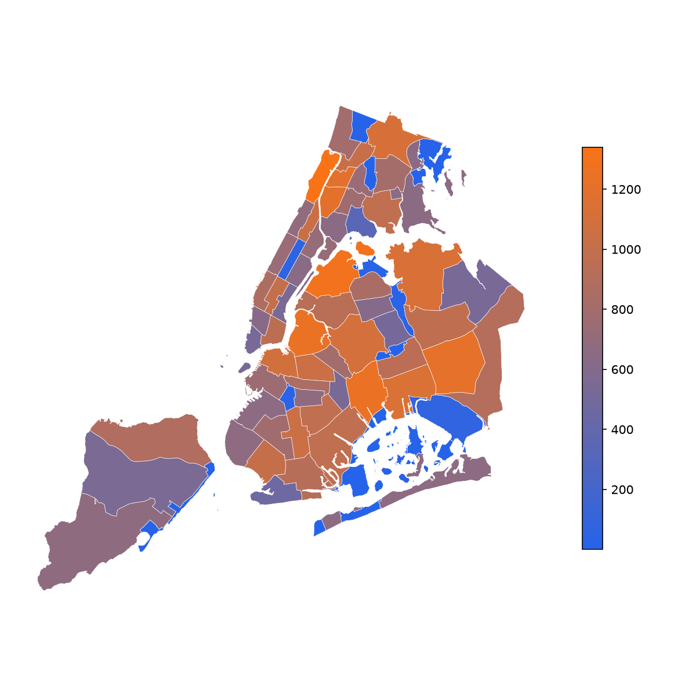
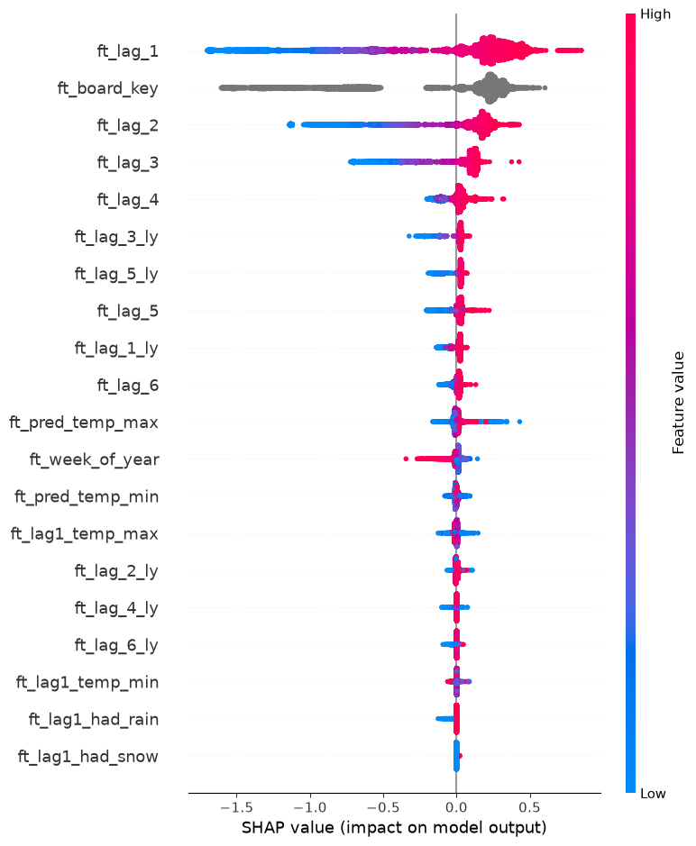

**Code:** [ZacharyCosenza/project-311](https://github.com/ZacharyCosenza/project-311) ·
**Dashboard:** [zacharycosenza.github.io/project-311](https://zacharycosenza.github.io/project-311/)

## What it does

The project forecasts next week's 311 complaint volume for each of NYC's community districts. It then
flags the districts expected to rise most against their own recent baseline.

{width=70%}

## How it works

- **Kedro pipelines:** raw data (calls, events, weather) → target → features → modeling → inference.
- **XGBoost** models, overall and per complaint-type group, with experiments tracked in **MLflow** and
  explained with **SHAP**.
- **Production:** a Docker image built by GitHub Actions and pushed to GHCR, run as Argo CronWorkflows on a
  single-node k3d cluster on an always-on desktop reached over Tailscale.
- **Output:** a public GitHub Pages dashboard, plus scheduled summary posts.

{width=80%}

## A detail I liked

The "biggest mover" alert compares each district's forecast with its own trailing 4-week average. That
window was chosen from a sweep over 1 to 26 weeks. One Bronx district topped the list in 58% of weeks
because of a recurring residential-noise reporting artifact. A plain magnitude cutoff couldn't separate
that from a real snowstorm week, but **isolation** could. The artifact spikes alone, while a storm lifts
many districts at once. The filter caps a district only when it is both an extreme outlier and
uncorroborated by other districts that week.
