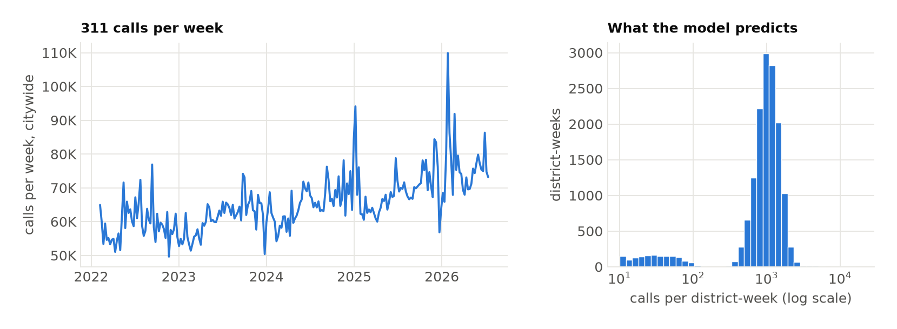
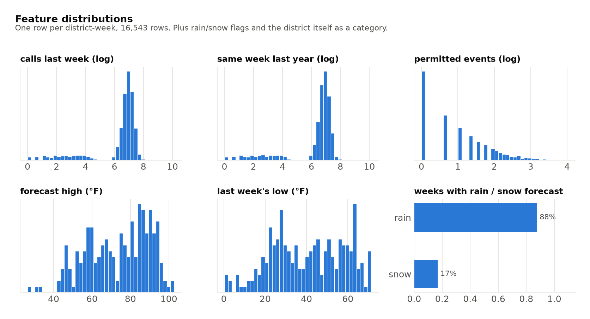
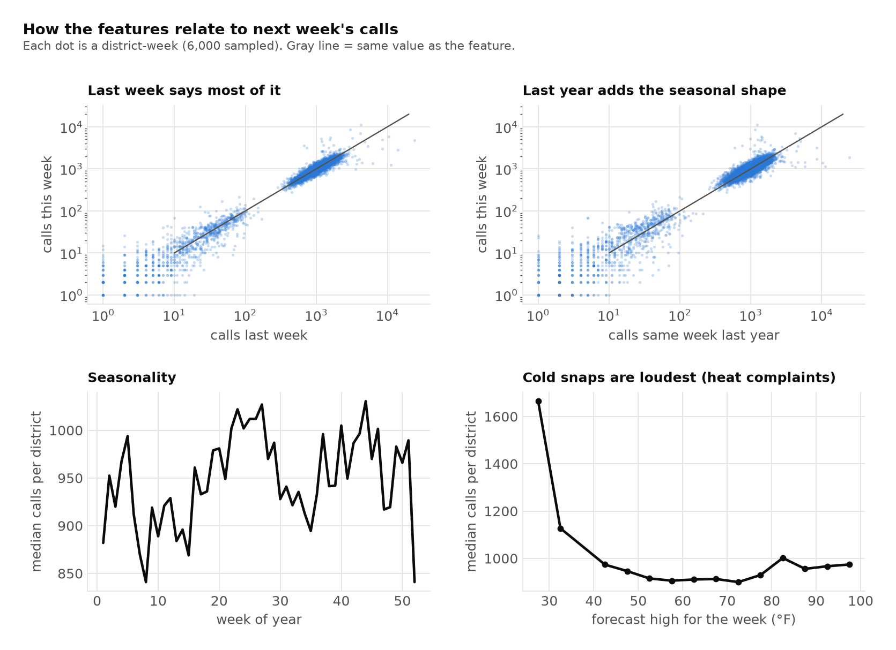
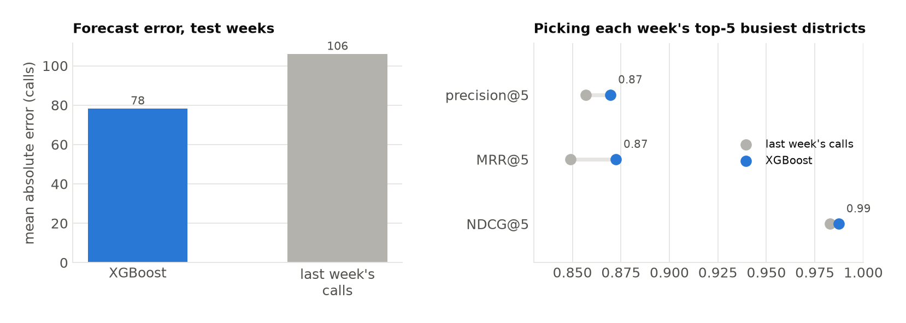
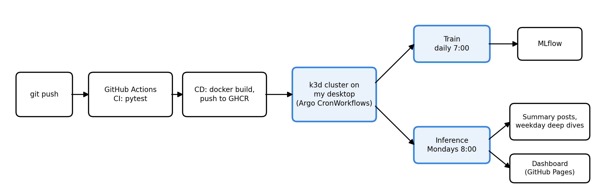

**Code:** [ZacharyCosenza/project-311](https://github.com/ZacharyCosenza/project-311) ·
**Dashboard:** [zacharycosenza.github.io/project-311](https://zacharycosenza.github.io/project-311/)

This project forecasts next week's 311 call volume for each of NYC's community districts and flags the districts expected to spike. The model was the easy part. I built it mainly to practice deployment patterns I rarely set up from scratch at work: CI/CD, container images, scheduled workflows on Kubernetes, experiment tracking and a public dashboard, all running on an always-on desktop at home. The forecast cuts the average error of a "same as last week" baseline by about a quarter.

## The Target

Every row is one district-week: the number of 311 calls from that community district. Citywide that is 50,000 to 110,000 calls a week and slowly rising. Most districts land around 1,000 a week, plus a low cluster of joint interest areas (large parks and airports with almost no residents) that get tens (Figure 1).

**Figure 1.** (a) Citywide 311 calls per week since 2022. (b) Calls per district-week on a log scale: most districts are near 1,000 a week, with a low cluster of parks and airports.

## The Features

Everything is built with Kedro pipelines (raw data, target, features, modeling), with the lag windows computed in PySpark:

1. **Recent History:** Log calls for each of the last 6 weeks.
2. **Same Time Last Year:** The same 6 weeks, 52 weeks back, so the model can separate a recent trend from normal seasonality.
3. **Calendar:** Week of the year.
4. **Events:** Permitted street events that week (parades, street fairs, block parties, farmers markets) from NYC Open Data.
5. **Weather:** Last week's actual highs, lows, rain and snow, plus the forecast for the coming week from Open-Meteo's historical-forecast archive. *Using archived forecasts instead of what actually happened means training sees exactly what inference will see.*
6. **District:** The community district itself, as a categorical feature.

**Figure 2.** Feature distributions over the 16,543 district-weeks: calls last week and in the same week last year (log), permitted events (log), the forecast high, last week's low, and the share of weeks with rain or snow in the forecast.

**Figure 3.** How the features relate to next week's calls (6,000 sampled district-weeks): calls against last week's and last year's same-week calls on log scales, with the identity line in grey; median calls per district by week of the year; and median calls against the week's forecast high.

**What Matters:** Last week explains most of the variation (the points sit close to the diagonal), last year adds the seasonal shape, and weather mostly matters at the cold end: the coldest weeks are the loudest, because heat complaints pile up when building boilers fail (Figure 3).

## Results

The model is XGBoost (200 trees, depth 4), tracked in MLflow and scored on a random 20% of district-weeks. The split is stratified by week, so every week appears in both training and test, which makes this somewhat easier than a true future holdout. Against the "same as last week" baseline it cuts the average error by about a quarter (78 against 106 calls per district), and it is slightly better at picking each week's five busiest districts (Figure 4).

**Figure 4.** (a) Mean absolute error on the test weeks, XGBoost against last week's calls. (b) Precision, MRR and NDCG at 5 for picking each week's five busiest districts, for the same two forecasts.

## Deployment

**Figure 5.** The deployment, with the scheduled workflows in blue. A push runs the tests and builds the image, and a cluster on my desktop retrains every morning and forecasts every Monday.

1. **CI/CD:** GitHub Actions runs the tests on every push, then builds the image and pushes it to GHCR.
2. **Scheduling:** A single-node k3d (k3s in Docker) cluster on an always-on desktop runs Argo CronWorkflows: retraining every morning at 7:00, inference every Monday at 8:00, then the posts.
3. **Networking:** Everything is reached over Tailscale, so there is no port forwarding or public IP. The Argo UI and MLflow are served privately on the tailnet.
4. **Storage:** Pods write straight to the desktop's disk through a `hostPath` mount, with no object storage.
5. **Output:** A public GitHub Pages dashboard, plus scheduled summaries such as *"NYC 311 forecast for the week of 2026-08-17: 12 MANHATTAN is expected to see the most call activity (~1,340 calls)…"* and weekday deep dives.
