Can a molecule's smell be predicted from its structure, and can we generate new molecules that smell similar? This project works through the classic cheminformatics toolkit (SMARTS patterns, RDKit descriptors and Morgan fingerprints into XGBoost), then learned representations (a graph neural network and a SMILES variational autoencoder), and ends by using the VAE to generate new molecules around a known fruity one. The target throughout is a single odor descriptor: **fruity or not**. The hand-built model and the graph network reach a ROC-AUC of 0.842 and 0.834, and the VAE produces valid, novel neighbors of a fruity ester far more reliably than random edits.

## The Data

**Sources:** Four labeled odor sources from [pyrfume-data](https://github.com/pyrfume/pyrfume-data) (MIT), merged by PubChem CID, give 5,930 unique molecules, each with several of 800 free-text descriptors. Fruity is the most common, at about a third of molecules (Figure 1).

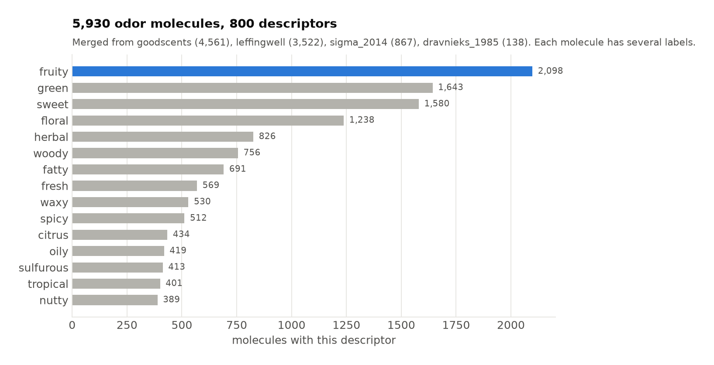

**Figure 1.** The 15 most common of the 800 descriptors across the 5,930 molecules, merged from goodscents, leffingwell, sigma_2014 and dravnieks_1985. Fruity is the most frequent, at 2,098 molecules.

## From SMILES to Chemistry Features

Every molecule starts as a SMILES string, for example `CCCCC=COC(=O)CCCCCCCC` (hexenyl nonanoate: fruity, green, waxy). RDKit parses it into a molecular graph, from which I built three kinds of features:

1. **SMARTS Functional Groups:** 20 substructure patterns (ester `C(=O)OC`, ketone, aldehyde, thiol and others) as binary flags (Figure 2).
2. **RDKit Descriptors:** Molecular weight, LogP, TPSA, hydrogen-bond donors and acceptors, and rotatable bonds.
3. **Morgan Fingerprints:** 2,048-bit radius-2 circular fingerprints, compressed to 10 principal components.

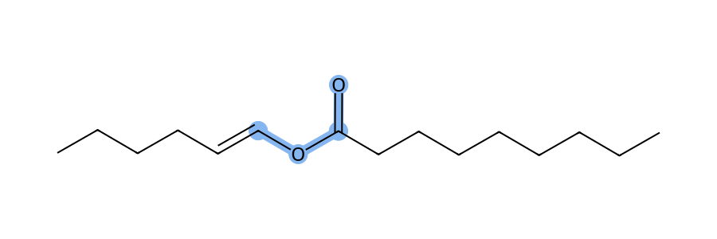

**Figure 2.** The ester SMARTS pattern `C(=O)OC` matched on a molecule.

**Functional Groups:** Even before any model, the groups tell a chemistry story: esters are fruity more than half the time, while sulfur and nitrogen groups rarely are (thiols 24%, amines 9%, disulfides 2%) (Figure 3). My `Acetate` pattern, `C(=O)[O]C`, turned out to match exactly the same molecules as `Ester`, so the two bars are identical.

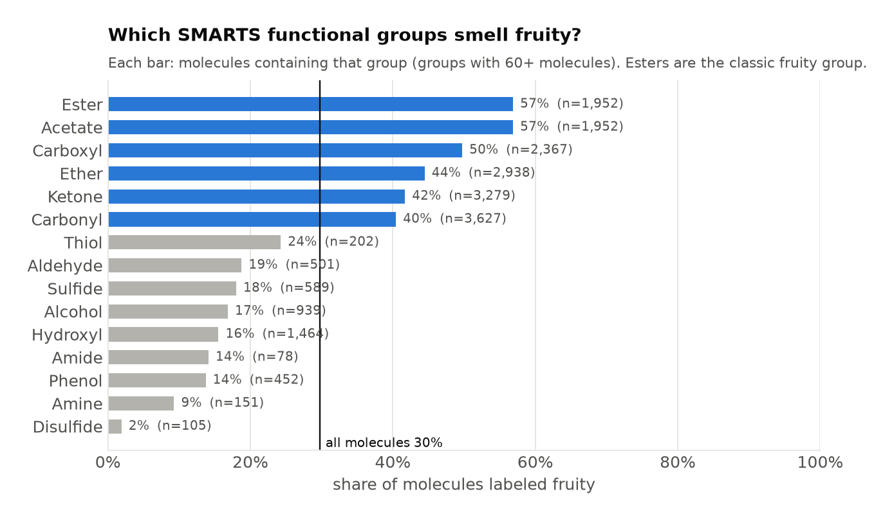

**Figure 3.** Share of molecules labeled fruity for each SMARTS functional group.

**Fingerprints:** The fingerprints are high-dimensional and sparse. The first two components already pull a fruity cluster to one side, but 10 components keep only 30% of the variance, so a lot of structural detail is lost (Figure 4).

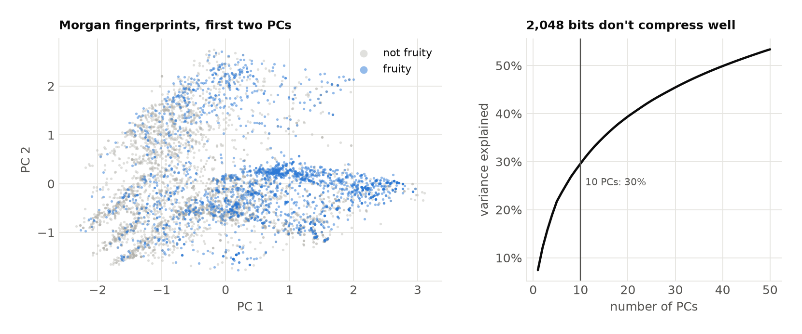

**Figure 4.** The first two principal components of the Morgan fingerprints, with fruity molecules marked.

## The Tabular Baseline

All 36 features (20 groups, 6 descriptors and 10 components) go into a small XGBoost classifier (100 trees, depth 3). It reaches **0.789 accuracy** against a 0.694 majority-class baseline, with a **ROC-AUC of 0.842**. Feature importance is dominated by the ester flag, with ketones, molecular weight and the first fingerprint component behind it (Figure 5). *The model has more or less rediscovered that esters smell fruity.*

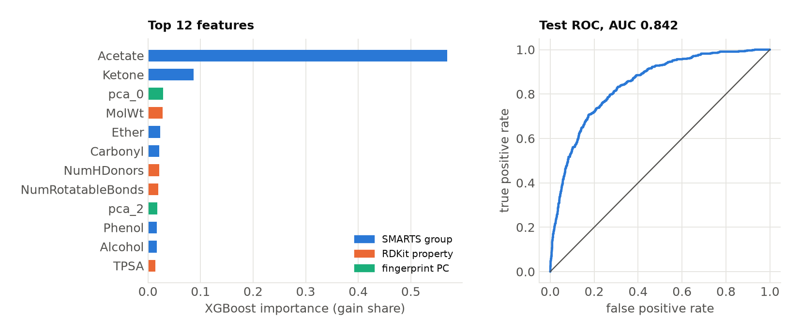

**Figure 5.** The XGBoost model on the 36 tabular features and its feature importance.

## Learned Representations

Hand-built features only see what I thought to encode, so the next two models learn their own representation from the molecule.

**Graph Neural Network:** Each atom is a node with 22 features (element, degree, hybridization, charge, aromaticity, ring membership and attached hydrogens), and each bond is an edge with 7 (bond type, conjugation and ring). Three residual message-passing layers update every atom from its bonded neighbors, mean pooling turns the atoms into one 64-dimensional molecule vector, and a small head predicts fruity. It uses no SMARTS patterns, descriptors or fingerprints.

**SMILES VAE:** A GRU encoder reads the canonical SMILES token by token into a 64-dimensional latent vector `z`, and a GRU decoder writes it back out. A small property head also predicts RDKit descriptors from `z`, which pushes chemically similar molecules close together in latent space (more below).

**Comparing the Spaces:** Projecting the three representations with t-SNE shows how they differ (Figure 6). The hand-built space is many small islands, one per combination of functional groups. The GNN places fruity molecules in one broad, continuous region, and the VAE gives woody molecules their own neighborhood.

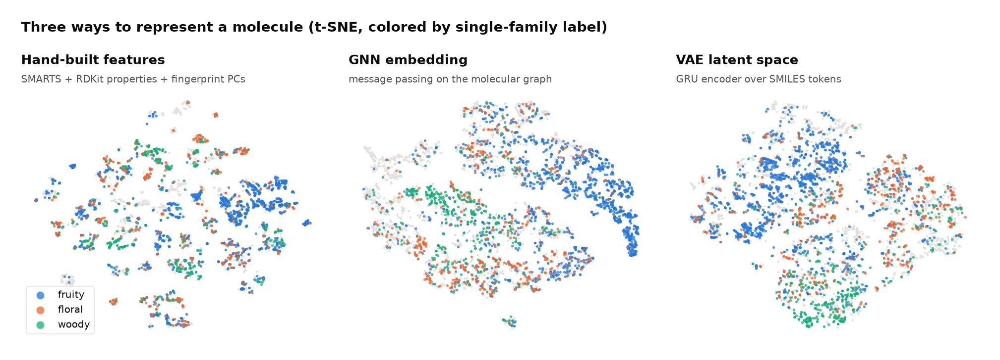

**Figure 6.** t-SNE projections of the hand-built features, the GNN's molecule vectors and the VAE latent space, coloured for molecules that are exactly one of fruity, floral or woody.

**Prediction:** On the prediction task, the GNN learned straight from the graph matches the hand-engineered model, with a ROC-AUC of 0.834 against 0.842 (Figure 7). The two use different splits (one row per source against one per unique molecule), so AUC is the fair comparison here and accuracy is not.

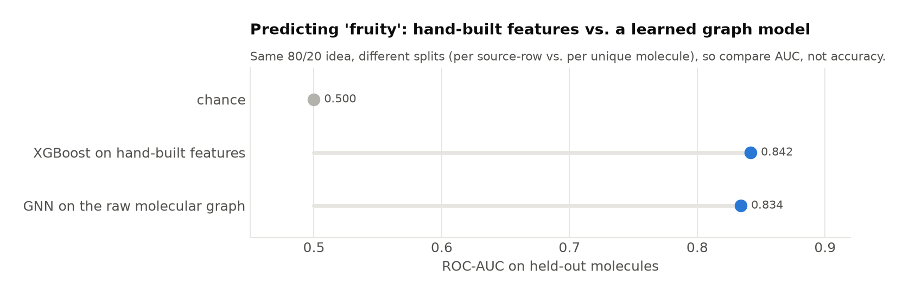

**Figure 7.** ROC-AUC on held-out molecules for chance (0.500), XGBoost on the hand-built features (0.842) and the GNN on the raw molecular graph (0.834).

## The Generative Model

The VAE has 611K parameters and was trained on 5,702 molecules (salts, rare elements and anything over 40 heavy atoms removed) with a 35-token SMILES vocabulary. Two details keep it from collapsing (Figure 8):

1. **KL Annealing:** The KL weight ramps up from 0 over the first 15 epochs, so reconstruction gets a head start and the decoder cannot learn to ignore `z`.
2. **Latent at Every Step:** `z` is concatenated to every decoder input token rather than only used as the initial state, so a long sequence cannot drift away from it.

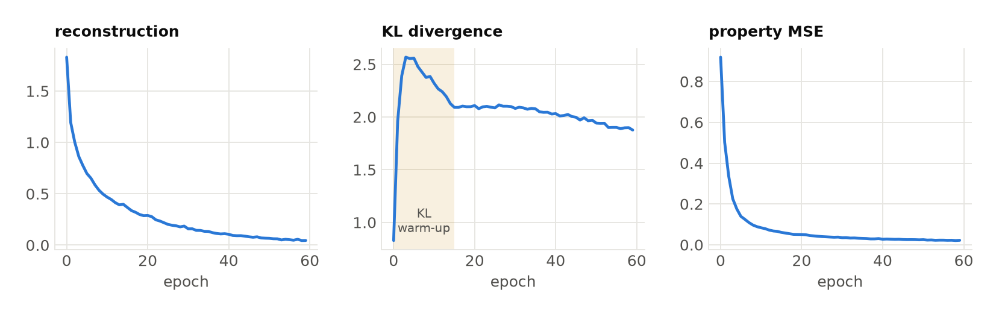

**Figure 8.** VAE training over 60 epochs: reconstruction loss, KL divergence (the KL warm-up is shaded) and the property head's error.

**Reconstruction and Properties:** The best checkpoint reconstructs 61% of held-out molecules exactly, and 92% of its decodes are valid SMILES. The property head makes the latent space chemically meaningful: molecular weight, LogP, TPSA and ring count can all be read from `z` with r ≈ 0.99 (Figure 9).

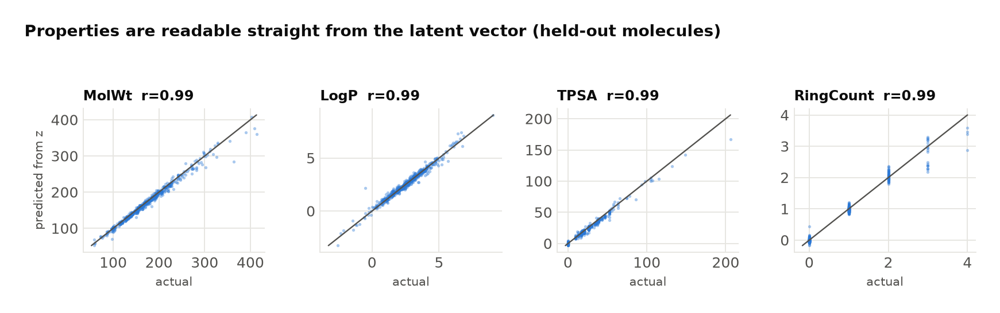

**Figure 9.** Molecular weight, LogP, TPSA and ring count predicted from the latent vector against their true values.

**Generation:** *A smooth latent space is what makes generation work.* I encode a fruity ester, add Gaussian noise of size σ to its latent vector, and decode. Small σ stays close and is almost always valid; large σ explores further and fails more often. A naive generator (random single-token SMILES edits) produces valid molecules 28% of the time, far less reliably than the VAE (Figure 10).

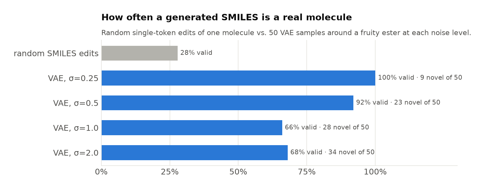

**Figure 10.** Share of valid molecules decoded after adding noise of size σ to a fruity ester's latent vector, compared with random single-token SMILES edits.

**Neighbors and Interpolation:** Novel neighbors at σ = 0.5 mostly keep the ester core (one drops the carbonyl to an ether) and vary chain length, branching and double-bond position, the kind of variation a perfumer would explore around a fruity note (Figure 11). Walking the straight line from that ester to a woody cyclohexenyl acetate shows what lies between them: the chain gradually turns into a ring, with a few invalid decodes where the latent space is sparse (Figure 12).

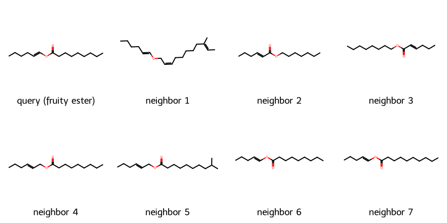

**Figure 11.** Novel molecules decoded near the fruity ester at σ = 0.5.

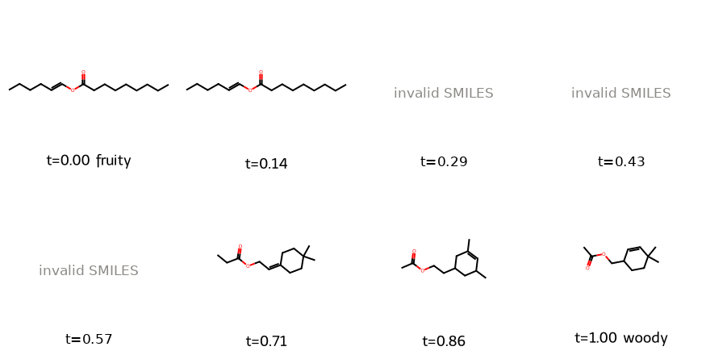

**Figure 12.** Decodes along the straight line in latent space from the fruity ester to a woody cyclohexenyl acetate.
