Can you predict what a molecule smells like from its structure, and then generate new molecules that smell similar? This project walks from the classic cheminformatics toolkit (SMARTS patterns, RDKit descriptors, Morgan fingerprints into XGBoost) to learned representations (a graph neural network and a SMILES variational autoencoder), and ends by using the VAE to generate new molecules around a known fruity one. The target throughout is a single odor descriptor: **fruity or not**.

## The data

Four labeled odor sources from [pyrfume-data](https://github.com/pyrfume/pyrfume-data) (MIT), merged by PubChem CID: 5,930 unique molecules, each with several of 800 free-text descriptors. "Fruity" is the most common, at about a third of molecules.

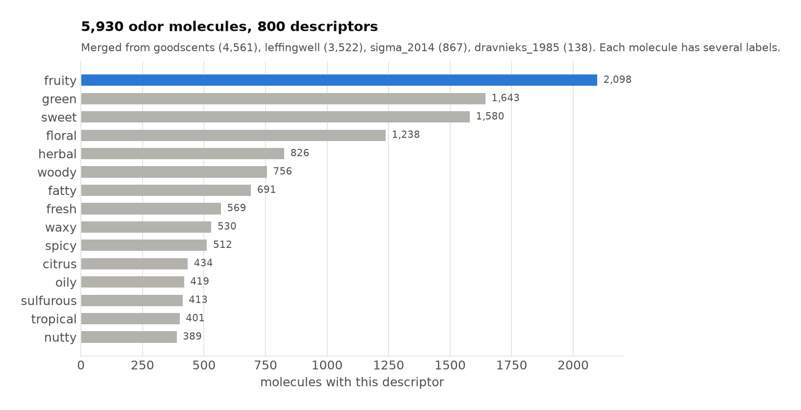

## From SMILES to chemistry features

Every molecule starts as a SMILES string, e.g. `CCCCC=COC(=O)CCCCCCCC` (hexenyl nonanoate, fruity, green, waxy). RDKit parses that into a molecular graph, and from there I built three kinds of features:

1. **SMARTS functional groups.** 20 substructure patterns (ester `C(=O)OC`, ketone, aldehyde, thiol...) as binary flags. Here's the ester match highlighted:

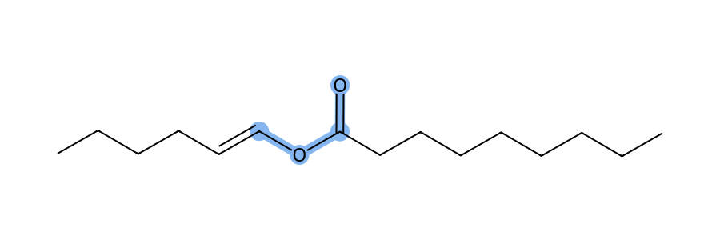

2. **RDKit descriptors.** Molecular weight, LogP, TPSA, H-bond donors/acceptors and rotatable bonds.
3. **Morgan fingerprints.** 2,048-bit radius-2 circular fingerprints, compressed to 10 principal components.

Even before any model, the functional groups tell a chemistry story: esters are fruity more than half the time, while sulfur and nitrogen groups rarely are (thiols 24%, amines 9%, disulfides 2%). (My `Acetate` pattern, `C(=O)[O]C`, turns out to match exactly the same molecules as `Ester`, so the two bars are identical.)

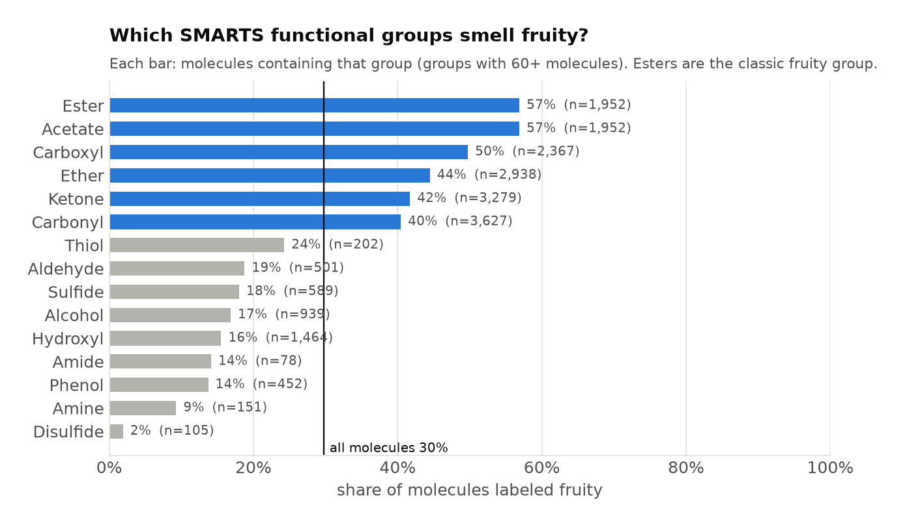

The fingerprints are high-dimensional and sparse. The first two PCs already pull a fruity cluster to the right, but 10 PCs only keep 30% of the variance, so a lot of structural detail is thrown away.

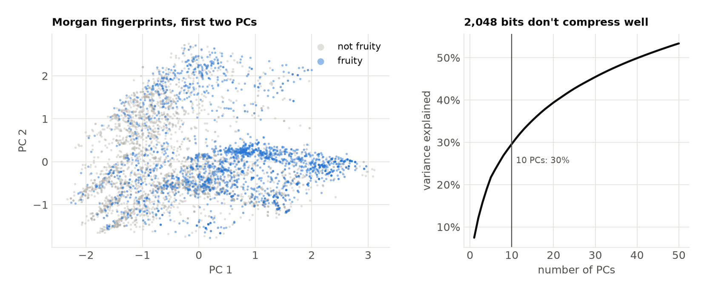

## The tabular baseline: XGBoost

All 36 features (20 groups + 6 descriptors + 10 PCs) go into a small XGBoost classifier (100 trees, depth 3). It reaches **0.789 accuracy** against a 0.694 majority-class baseline, with a **ROC-AUC of 0.842**. Feature importance is dominated by the ester flag, with ketones, molecular weight and the first fingerprint PC behind it: a model that has more or less rediscovered "esters smell fruity".

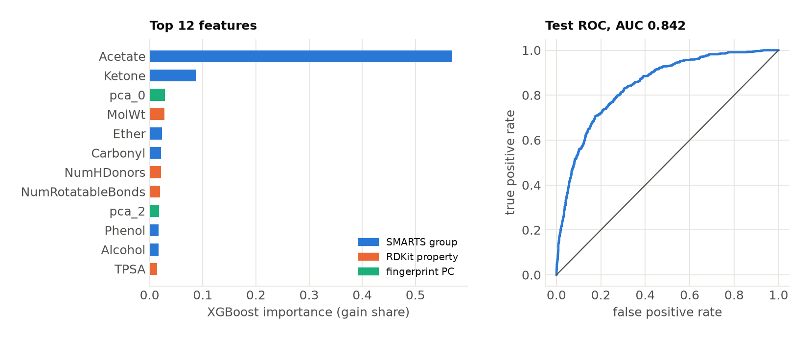

## Learned representations

Hand-built features only see what I thought to encode. The next two models learn their own representation directly from the molecule.

**Graph neural network.** Each atom is a node with 22 features (element, degree, hybridization, charge, aromaticity, ring membership, attached hydrogens), and each bond is an edge with 7 (bond type, conjugation, ring). Three residual message-passing layers update every atom from its bonded neighbors, mean pooling turns the atoms into one 64-dim molecule vector, and a small head predicts fruity. No SMARTS, no descriptors, no fingerprints.

**SMILES VAE.** A GRU encoder reads the canonical SMILES token by token into a 64-dim latent vector `z`, and a GRU decoder writes it back out. A small property head also predicts RDKit descriptors from `z`, which pushes chemically similar molecules close together in latent space (details below).

Projecting all three representations with t-SNE (each molecule colored if it's exactly one of fruity, floral or woody) shows the difference. The hand-built space is lots of small islands, one per functional-group combination. The GNN puts fruity molecules in one broad continuous region, and the VAE separates woody molecules into their own neighborhood.

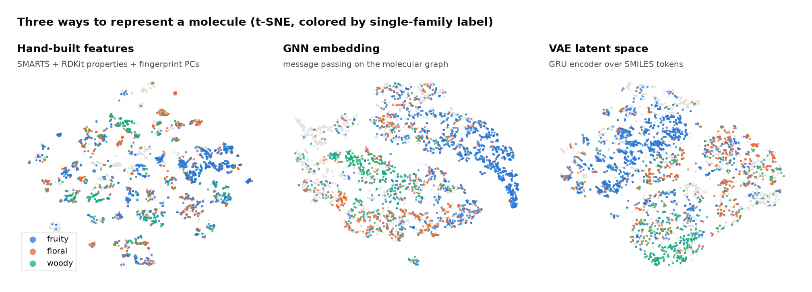

On the actual prediction task, the GNN learned straight from the graph matches the hand-engineered model (ROC-AUC 0.834 vs 0.842). The two use different splits (one row per source vs. one per unique molecule), so AUC is the fair comparison here, not accuracy.

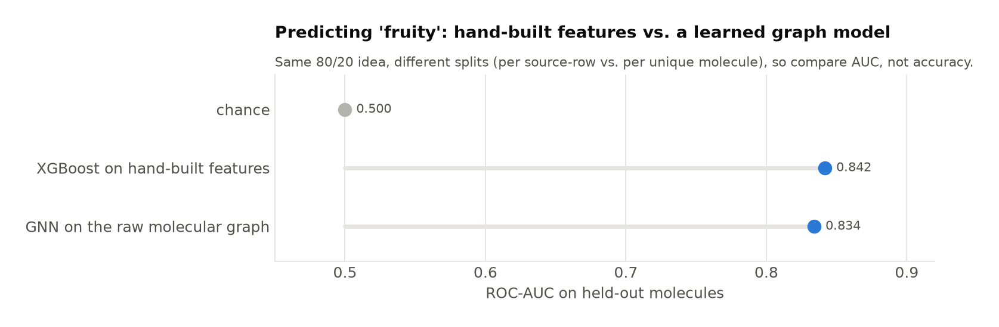

## The generative model

The VAE has 611K parameters, trained on 5,702 molecules (salts, rare elements and anything over 40 heavy atoms filtered out) with a 35-token SMILES vocabulary. Two details keep it from collapsing:

- **KL annealing.** The KL weight ramps from 0 over the first 15 epochs, so reconstruction gets a head start and the decoder can't just ignore `z`.
- **`z` at every decoder step.** The latent vector is concatenated to every input token, not just used as the initial state, so a long sequence can't drift away from it.

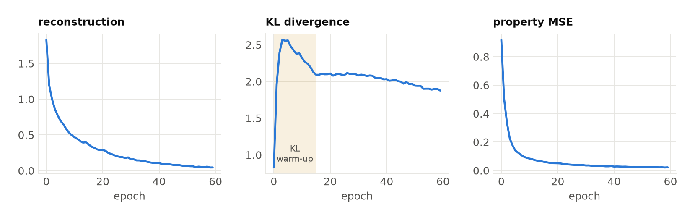

The best checkpoint reconstructs 61% of held-out molecules exactly, and 92% of its decodes are valid SMILES. The property head makes the latent space chemically meaningful: molecular weight, LogP, TPSA and ring count can all be read straight off `z` with r ≈ 0.99.

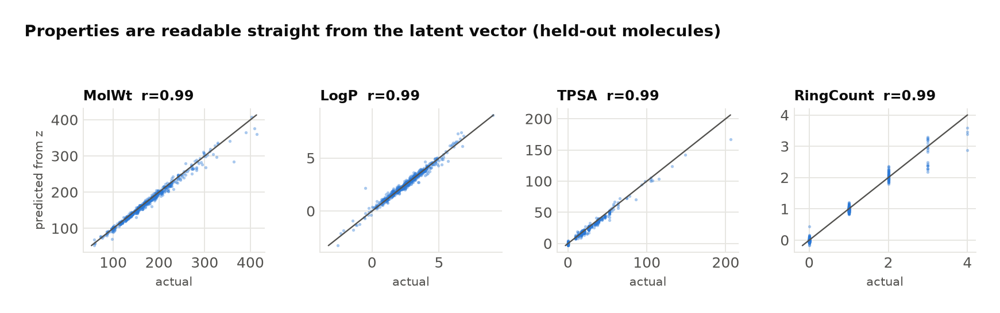

That smoothness is what makes generation work. Encode a fruity ester, add Gaussian noise of size σ to its latent vector, and decode. Small σ stays close and almost always valid; large σ explores further and breaks more often. Compared to a naive generator (random single-token SMILES edits, 28% valid), the VAE is far more reliable at producing real molecules.

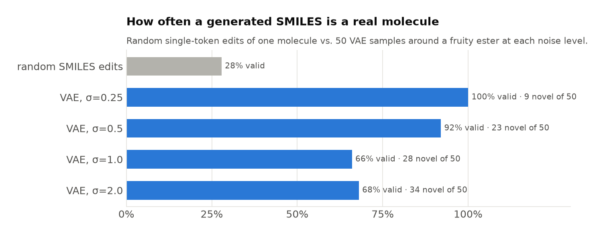

Novel neighbors at σ = 0.5 mostly keep the ester core (one drops the carbonyl to an ether) and play with chain length, branching and double-bond position, which is exactly the kind of variation a perfumer would explore around a fruity note:

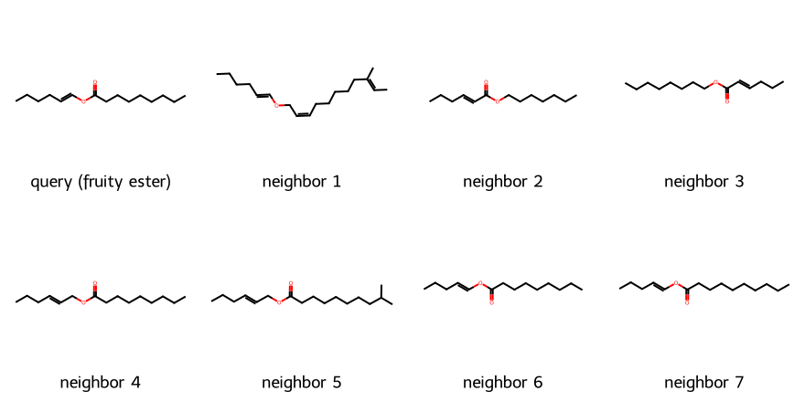

Walking the straight line from that fruity ester to a woody cyclohexenyl acetate shows what lives in between: the chain gradually turns into a ring, with a few invalid decodes along the way where the latent space gets sparse.

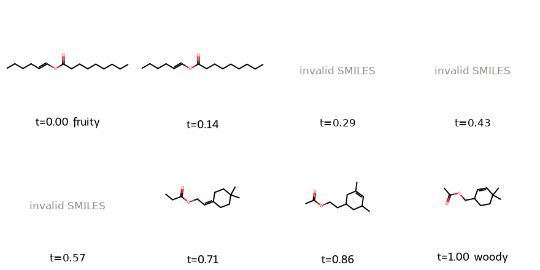
