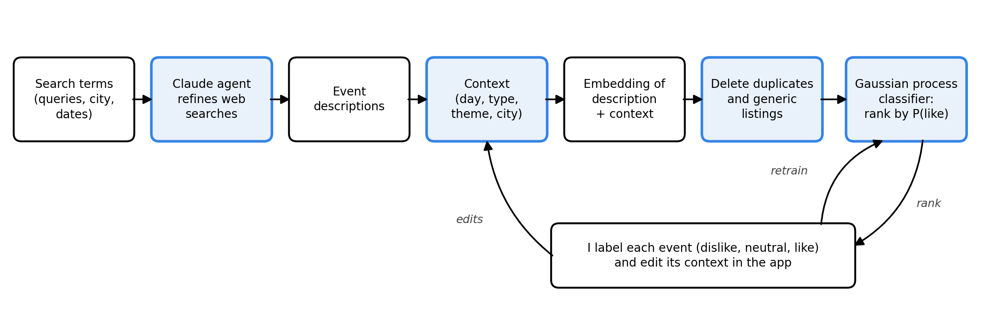
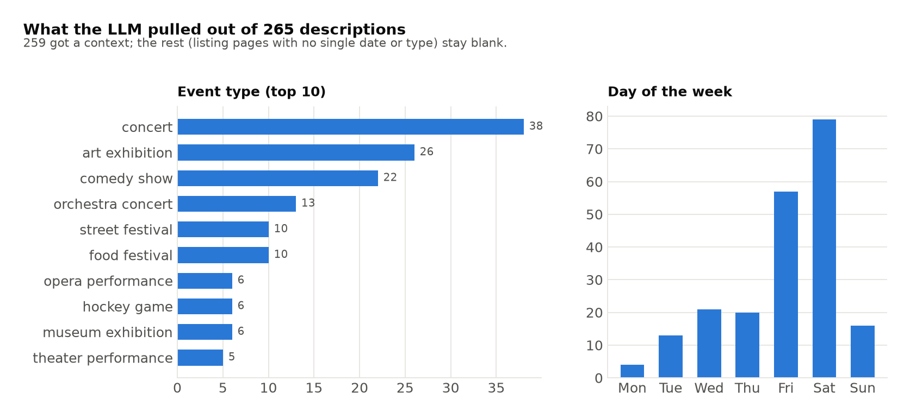
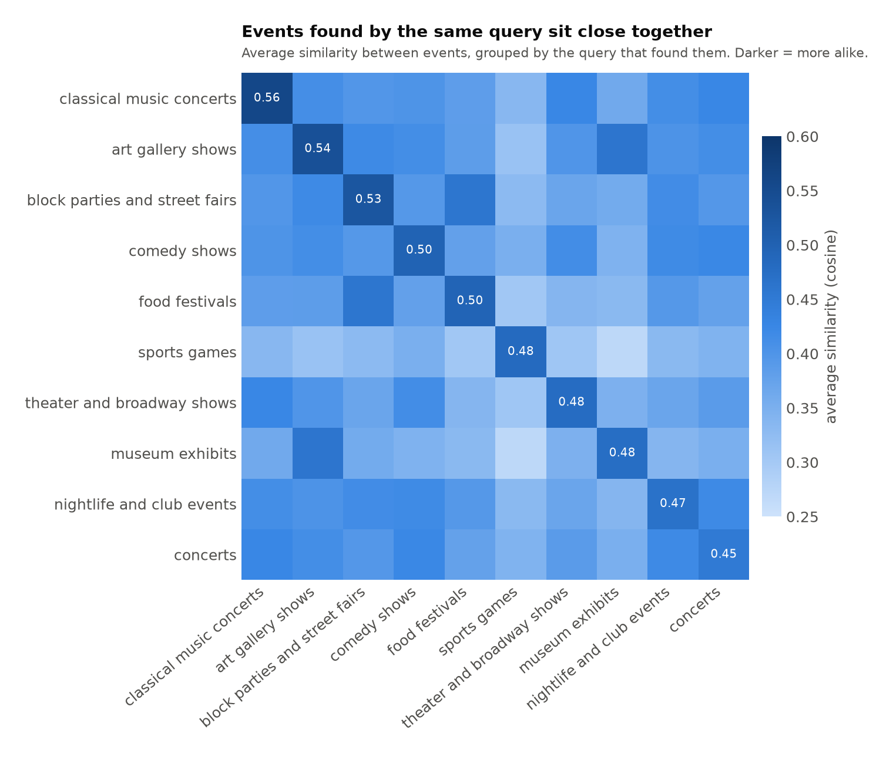
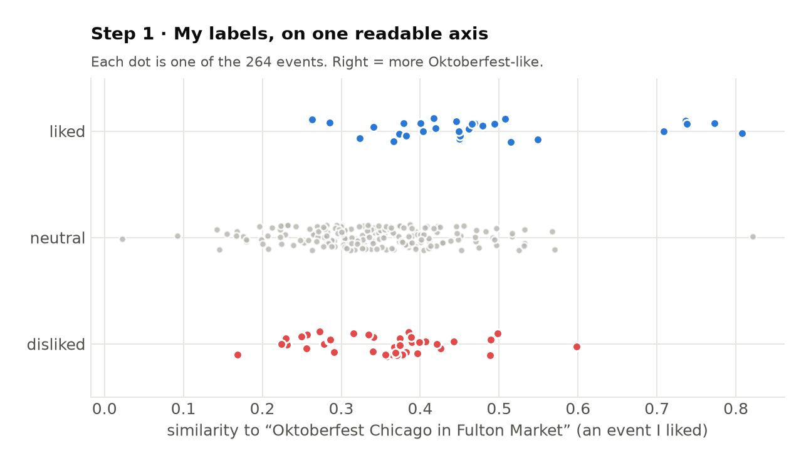
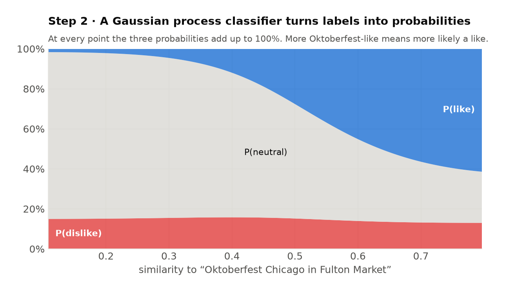
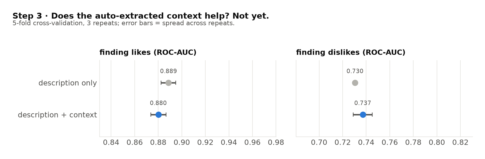
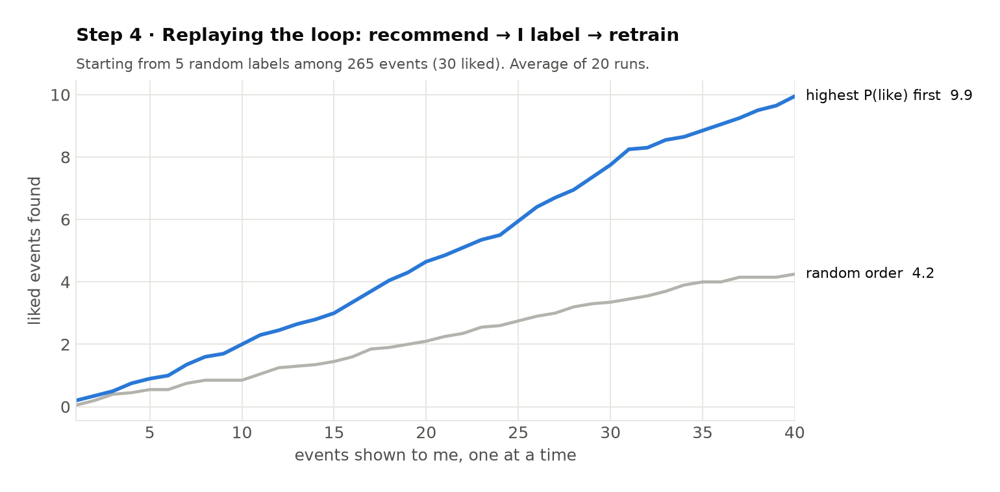
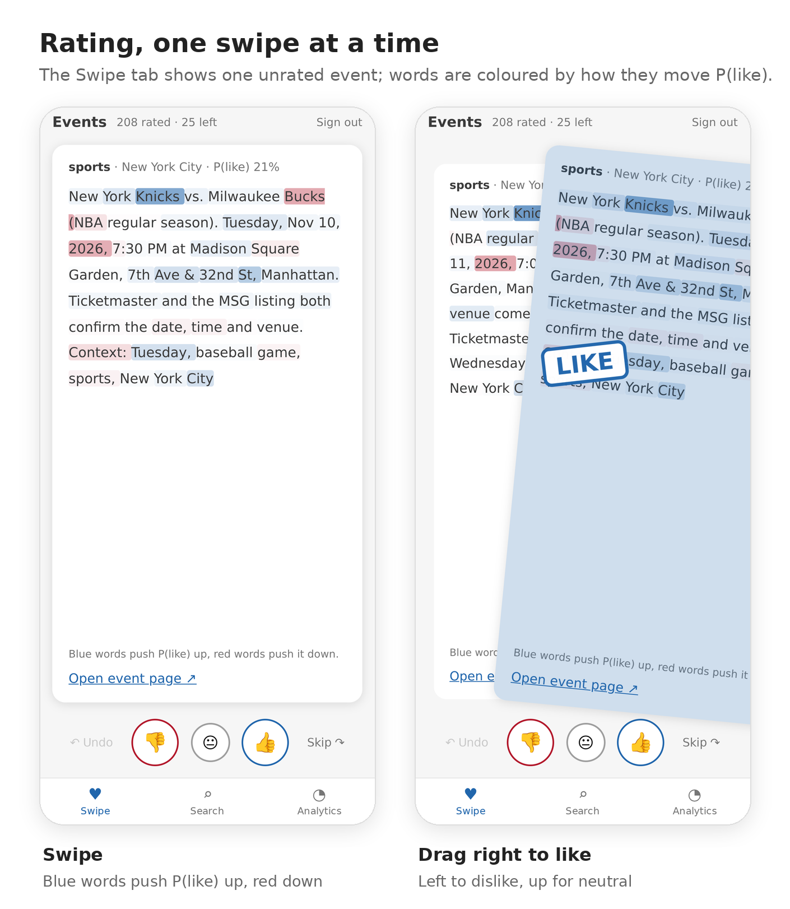
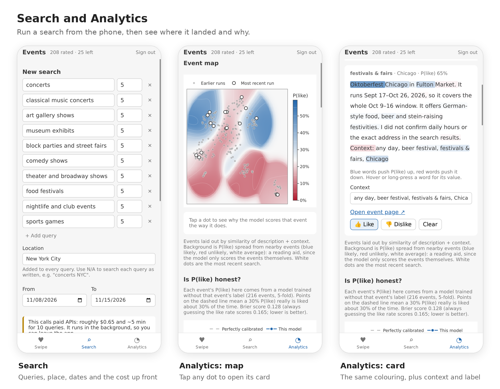
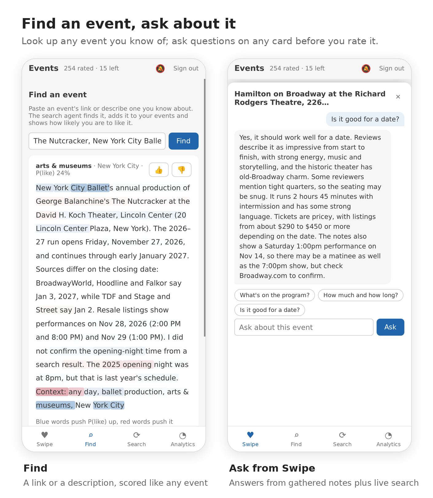

**Code:** [ZacharyCosenza/project-recommendation](https://github.com/ZacharyCosenza/project-recommendation)

Every week I want to know what is happening near me that I would actually like. The listings exist, but they are scattered across venue sites, ticketing pages and SEO filler, and none of them know my taste. This project does two things: an agent builds a catalog of events from web search, and a small model learns my taste from a handful of labels and picks what to show me next (Figure 1). Everything below uses the real data behind the app: 265 events from 14 searches across Chicago, New York, Monterrey, Reno and Philadelphia.



**Figure 1.** The pipeline, with model-driven steps in blue. An agent turns search terms into event descriptions, a second pass adds a short context, and the embedding of description and context goes to a Gaussian process classifier that ranks events by P(like). My labels retrain the classifier, and my edits to an event's context change its embedding.

## Building Features With an Agent

**Search Agent:** A search API returns pages, not events. Asking for "comedy shows in Chicago this weekend" mostly returns "47 best things to do" listicles. Claude gets one tool (`brave_search`) and one instruction: start broad, and if the results are vague, search again with sharper keywords (a date, a venue, a series name it just learned) until it finds specific events. The output is a description per event:

```json
{
  "https://www.choosechicago.com/event/jerry-seinfeld-live-2/":
    "Jerry Seinfeld Live! at The Chicago Theatre (175 N. State St.). Fri Oct 9, 2026, 7:00 PM. His tour site and Ticketmaster also list two shows on Sat Oct 10, at 5:00 PM and 8:00 PM."
}
```

That description is the main feature the model sees, so *prompting the agent is effectively feature engineering*. It costs about 1.5¢ of Claude tokens per event.

**Search Logging:** Every search is logged with the prompt the agent was given, each query it ran in order, and which query surfaced each event (the agent reports it, and the link is kept only if it matches a query it actually ran). For example, "comedy shows" in New York became "comedy shows in New York City November 9, 2026" and then "Stand Up for Heroes David Geffen Hall November 9 2026 New York Comedy Festival". Linking queries to the events I end up liking is groundwork for learning better searches than the same ten defaults every day.

**Context:** On top of the description, each event gets a short context. A cheap second pass (Claude Haiku, batches of 20 descriptions, about 5¢ per thousand events) pulls out the event's first date, what kind of event it is, a theme from a fixed list (music, comedy, theater and so on) and the city. Python turns the date into a weekday, which is more reliable than asking the LLM for one, and anything it cannot find stays blank. The Seinfeld show above becomes `Friday, comedy show, comedy, Chicago`. Theme and city used to come from the search form, which broke as soon as a query looked like "concerts NYC" or the location was "N/A"; they now come from the description itself, with the search location only a hint. I can also edit any context in the app to add what the description cannot know, such as "date night" or "too far from home", and the app remembers the last extracted context so that a re-extraction never overwrites my edits (Figure 2).



**Figure 2.** What the context pass pulled out of 265 descriptions: counts by theme, day of the week and city (top 6). Any part the LLM cannot find stays blank.

**Embedding:** A small local model (`all-MiniLM-L6-v2`) turns `description + " Context: " + context` into a 384-dimensional embedding. Even on the description alone, events with the same theme sit nearer each other than events with different themes (Figure 3), which is what makes learning taste possible: if I like one event, its neighbors are good guesses.



**Figure 3.** Average cosine similarity between description-only embeddings, grouped by the theme the LLM assigned. The theme word is not in the embedded text, yet the diagonal (same theme) is the highest in every row.

**Cleaning Up:** Web search returns the same event many times (the venue's page, two ticket sellers, a news story) and many pages that are not one event at all (venue calendars, roundups, Facebook pages). The embeddings make duplicates cheap to shortlist: any two events with cosine similarity of 0.70 or more are candidates. Similarity cannot make the call alone, though. "Blackhawks vs Penguins" and "Blackhawks vs Hurricanes" score 0.93 and are different games, while the same hockey game on the venue's page and in a news story scores only 0.78. So Haiku reviews each candidate group, decides which listings are the same event, and keeps one (the organizer's or venue's own page if there is one). On the live data this deleted 26 duplicate listings of 17 events, five of them for the Great Italian Festival alone, and it matters for the model too: before the cleanup, 10 of those events had different labels on different copies. The same Haiku pass also flags generic listings, which are deleted before they are stored. The flag is strict and occasionally catches a real show, a trade I accept for a cleaner catalog.

## Recommending With a Gaussian Process Classifier

I have only labeled a few dozen events, far too few for the recommenders behind large apps. A Gaussian process classifier suits this: it learns from a handful of labels, returns probabilities, and becomes less confident about events unlike anything I have labeled. The real model works in all 384 dimensions; to make it visible, the figures below squeeze everything onto one axis, similarity to "Oktoberfest Chicago in Fulton Market", an event I liked.

**Step 1, Labels:** Each event has a label: like (+1), neutral (0, the default) or dislike (−1). There is a pattern but it is noisy: in the least Oktoberfest-like third, dislikes outnumber likes 12 to 2, and in the most Oktoberfest-like third, likes lead 21 to 12 (Figure 4).



**Figure 4.** Each event's label against its similarity to the Oktoberfest event.

**Step 2, Probabilities:** The labels are categories, so rather than regressing on −1, 0 and 1, the model is a classifier: one Gaussian process per class (one-vs-rest), combined into P(dislike), P(neutral) and P(like) for every event. On this axis P(like) climbs from about 2% to 61% as events become more Oktoberfest-like, while P(dislike) barely moves (13–16%). My dislikes are not about this direction at all, which is why the real model needs all 384 dimensions (Figure 5).



**Figure 5.** Class probabilities from the one-vs-rest classifier along the same axis.

**Step 3, Context:** To check whether the context helps, I cross-validated the classifier on embeddings of the description alone and of description plus context (Figure 6). It helps a little, for dislikes. Likes are found about equally well either way (ROC-AUC 0.89 against 0.88, within noise), dislikes improve from 0.73 to 0.75, and log loss drops from 0.647 to 0.640. My guess is the city: putting it in the text makes "too far away" easier to pick up. The extracted context is pulled from the description, so most of it repeats what is already there; where it should really pay off is my own edits.



**Figure 6.** ROC-AUC for finding likes and dislikes with the description alone and with description plus context, from 5-fold cross-validation repeated 3 times (error bars show the spread across repeats).

**Step 4, Closing the Loop:** The app ranks every event by P(like): it shows the most likely like, I rate it, the model retrains, and the cycle repeats. To check this works I replayed it on all 265 events (30 liked), hiding each rating until the model showed me that event. Starting from 5 random labels, ranking by P(like) found 10 likes in 40 picks against 4.2 for random order, about 2.4 times as many (Figure 7). The top unrated picks are currently the Chicago Tribune's Oktoberfest guide (54%), Don Giovanni at the Lyric Opera (47%) and the second Seinfeld show (37%).



**Figure 7.** Liked events found as events are shown one at a time, starting from 5 random labels among 265 events (30 liked) and averaged over 20 runs: 9.9 likes in 40 picks when ranking by P(like), against 4.2 in random order.

## The App

The model only improves if I keep rating, so the app is built to make rating quick. It is a private web app that installs on my Android phone, with four tabs (Figures 8 to 10):

1. **Swipe:** One unrated event at a time. Right is like, left is dislike, up is neutral, with undo and skip. Each card shows P(like) and the description with words coloured by whether they push P(like) up (blue) or down (red). Because neutral is also the default label, the app tracks which neutrals I chose, so an explicit neutral leaves the queue and an untouched event stays in it. "Ask about it" opens a Q&A about the event: the first question gathers background with a few searches, later answers come from those notes plus a live search when needed, and the Q&As are kept as material for feedback richer than a label.
2. **Find:** Paste a link or describe an event I already know about ("Hamilton on Broadway this weekend"). The same search agent locates that event (it can only search, not open pages, so a URL becomes a few searches) and it goes through the same pipeline as everything the daily search finds, in about 20 to 30 seconds.
3. **Search:** Run a new search (queries, location and dates, with a cost estimate), follow it live, and see past runs.
4. **Analytics:** The event map (similar events sit together over a P(like) heat map, and tapping one opens its card with an editable context), the calibration plot, and a table of every event for going back and fixing labels or context. Editing a context re-embeds that event immediately.



**Figure 8.** The Swipe tab. Each card shows P(like) and the description with words coloured by how they move it (blue up, red down); dragging right likes the event, left dislikes it and up marks it neutral.



**Figure 9.** The Search tab (queries, place, dates and the cost up front) and the Analytics tab: the event map, with events laid out by similarity over a P(like) background, and an event card with its context and label.



**Figure 10.** The Find tab, locating a single event from a description.

**Daily Refresh:** Once a day the app retrains on my latest ratings, searches the default queries for the next week in New York, and pre-computes the word colouring for every new card, so a fresh stack is waiting each morning and a push notification says so. A second notification warns me whenever my estimated Anthropic credit drops under $5.
