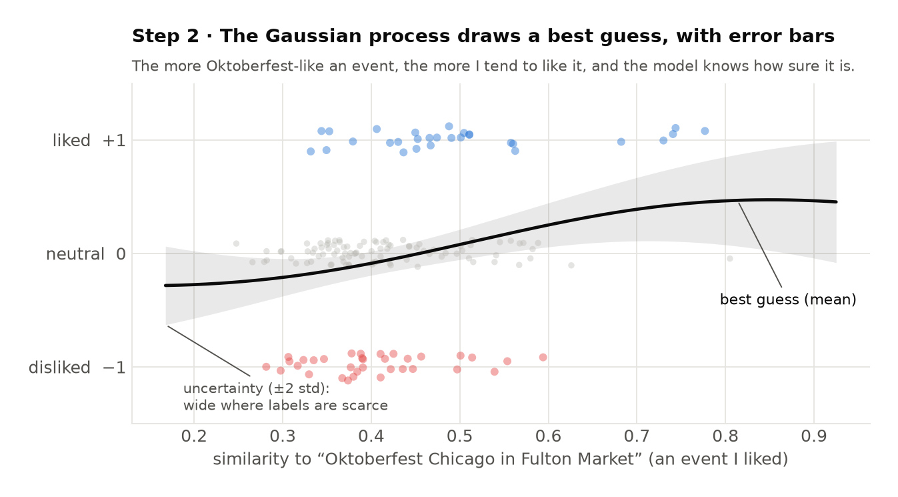
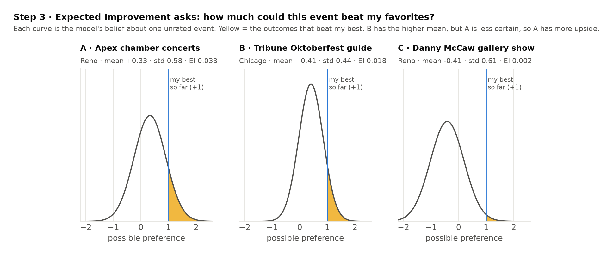
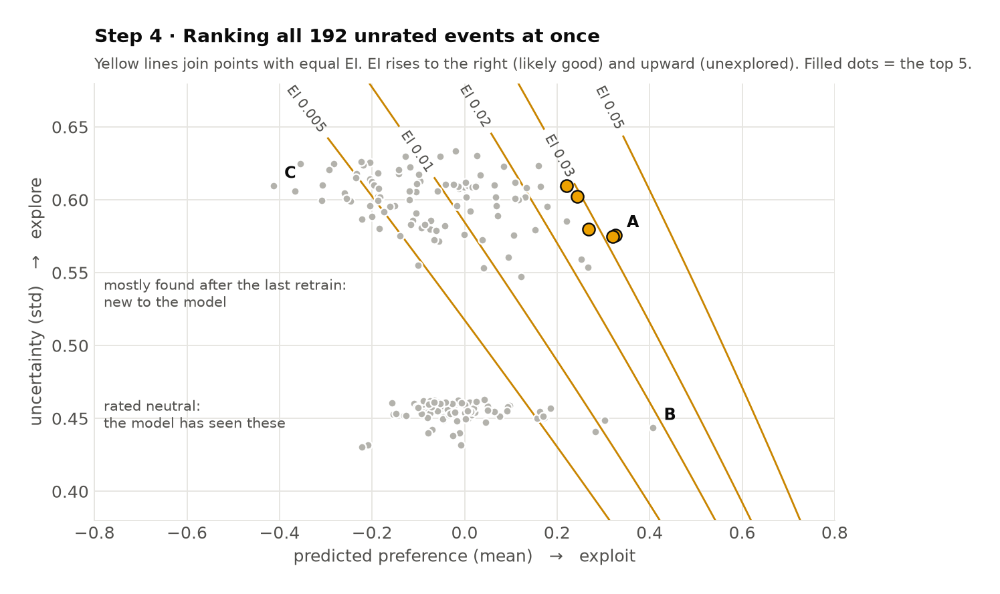
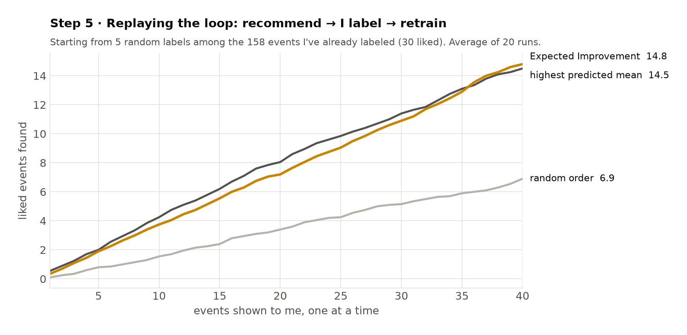

**Code:** [ZacharyCosenza/project-recommendation](https://github.com/ZacharyCosenza/project-recommendation) ·
**Live app:** [event-recommender.fly.dev](https://event-recommender.fly.dev) (read-only; it sleeps when idle,
so the first load takes a few seconds)

Every week I want to know what's going on near me that I'd actually like. The listings are out there but scattered across venue sites, ticketing pages and SEO junk, and none of them know my taste. So this project does two things: (1) an agent builds a catalog of events from web search, and (2) a small model learns my taste from a handful of 👍/👎 labels and picks what to show me next.

```{mermaid}
flowchart LR
    S["queries + city + dates"] --> A["Claude agent<br/>refines web searches"]
    A --> D["event descriptions"]
    D --> E["embedding"]
    E --> GP["Gaussian process"]
    GP --> EI["rank by Expected Improvement"]
    EI --> U["I label 👍 / 👎"]
    U --> GP
```

Everything below uses the real data behind the live app: 256 events from 13 searches across Chicago, New York, Monterrey, Reno and Philadelphia.

## Building features with an agent

A search API gives you pages, not events. Ask for "comedy shows in Chicago this weekend" and you mostly get "47 best things to do" listicles. So Claude gets one tool (`brave_search`) and one instruction: start broad, and if the results are vague, search again with sharper keywords (a date, a venue, a series name it just learned) until it finds specific events. Out comes a description per event:

```json
{
  "https://www.choosechicago.com/event/jerry-seinfeld-live-2/":
    "Jerry Seinfeld Live! at The Chicago Theatre (175 N. State St.). Fri Oct 9, 2026, 7:00 PM. His tour site and Ticketmaster also list two shows on Sat Oct 10, at 5:00 PM and 8:00 PM."
}
```

That description is the only feature the model ever sees, so prompting the agent is basically feature engineering. It costs ~1.5¢ of Claude tokens per event. A small local model (`all-MiniLM-L6-v2`) turns each description into a 384-number embedding. The model is never told which search found an event, but events from the same search still land near each other, which is what makes learning taste possible (like one event, its neighbors are good guesses).


## Recommending with Bayesian optimization

I've only labeled a few dozen events, way too little for the recommenders behind big apps. Instead we use a model that knows how sure it is, plus a rule for which event is most worth showing next. Every label I give makes the next pick better. This is called active learning. The real model works in all 384 dimensions, so to make it visible I squeeze everything onto one axis: similarity to "Oktoberfest Chicago in Fulton Market", an event I liked.

**Step 1: labels.** Each dot is an event I've rated. There's a pattern but it's noisy: below 0.4 dislikes beat likes 19 to 5, above 0.5 it flips to 12 to 5.


**Step 2: a best guess with error bars.** A Gaussian process fits a smooth curve through the labels (black, rising from −0.28 to +0.47) and, more importantly, an uncertainty band (gray) that's wide where it has few labels. The model knowing what it doesn't know is what everything after this relies on.



**Step 3: Expected Improvement.** For any unrated event the model gives a mean and a std, so picture a bell curve of possible outcomes. My best rating is +1. EI asks how far past +1 this event could land, averaged over the curve (yellow). Three real unrated events:



B (a Chicago Oktoberfest guide) has the highest mean but the model is fairly sure about it, so little of the curve gets past +1 (EI 0.018). A (chamber music in Reno) has a lower mean, but the model has never seen anything from Reno, so the curve is wider (EI 0.033, the top unrated event). C is predicted to be a dislike (EI 0.002). So EI picks A over B: "probably good and I'd learn a lot" beats "probably good and I already know roughly how good".

**Step 4: rank everything.** Every unrated event by mean (right = exploit) and std (up = explore), with lines of equal EI. The bottom group is events I rated neutral, which the model has already learned from. The top group is mostly new. All five top picks are classical music or opera, four of them in Reno and Monterrey where I haven't rated anything. I like classical in Chicago, so the model bets I'll like it elsewhere but isn't sure, and that uncertainty is what pushes them up.



**Step 5: close the loop.** Show the top-EI event, I rate it, retrain, repeat. To check this works I replayed it on the 158 events the model was trained on (30 liked), hiding each rating until the model "showed" me that event. Starting from 5 random labels, EI found 14.8 likes in 40 picks vs 6.9 for random order. Honestly, just picking the highest mean does about as well here (14.5), since this replay only measures finding likes among events I've already rated. Where EI should earn its keep is spending some picks on unfamiliar stuff (like a new city) so the model doesn't get stuck. This replay can't measure that, and it reuses the full model's fitted kernel so it's a bit optimistic for all three.



## The app

The app shows the same thing in 2D: events laid out by similarity (UMAP) over a heat map of EI. Clicking an event opens a card that highlights which words in its description push the prediction up (blue) or down (red), and the table lists every event with its EI, mean and std.

{width=70%}
