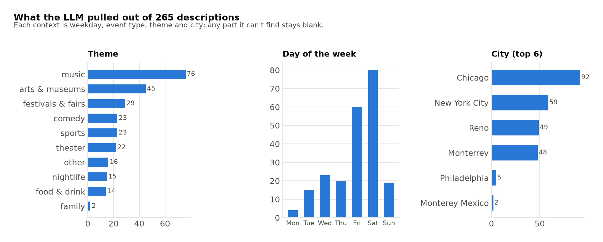
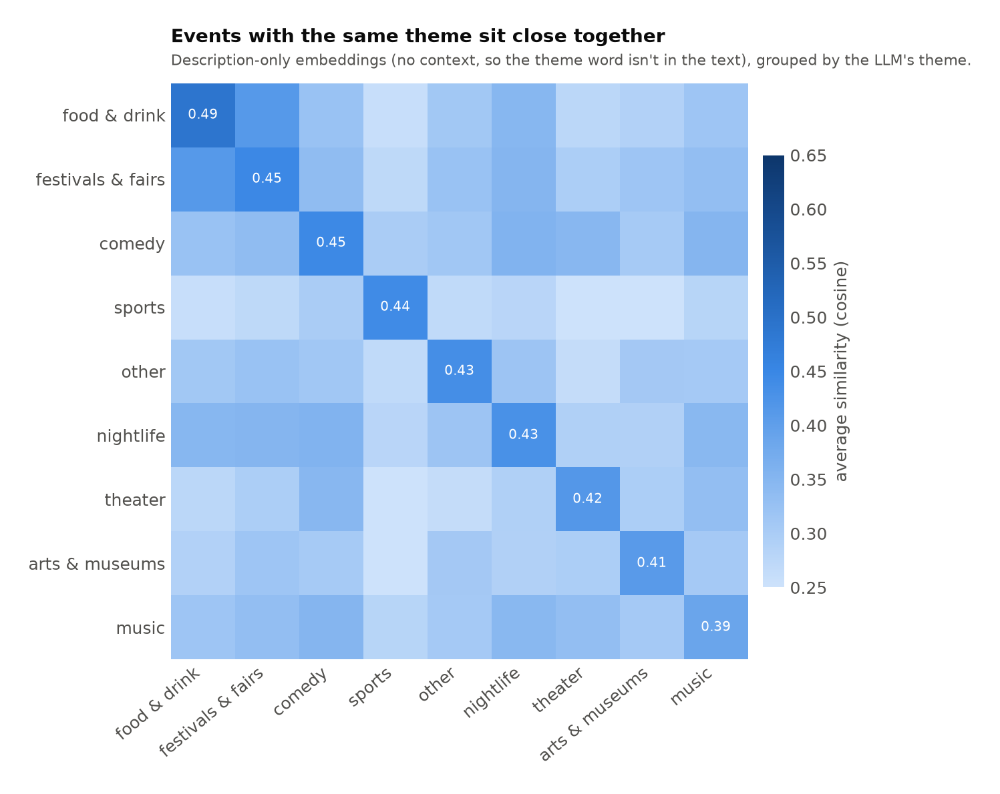
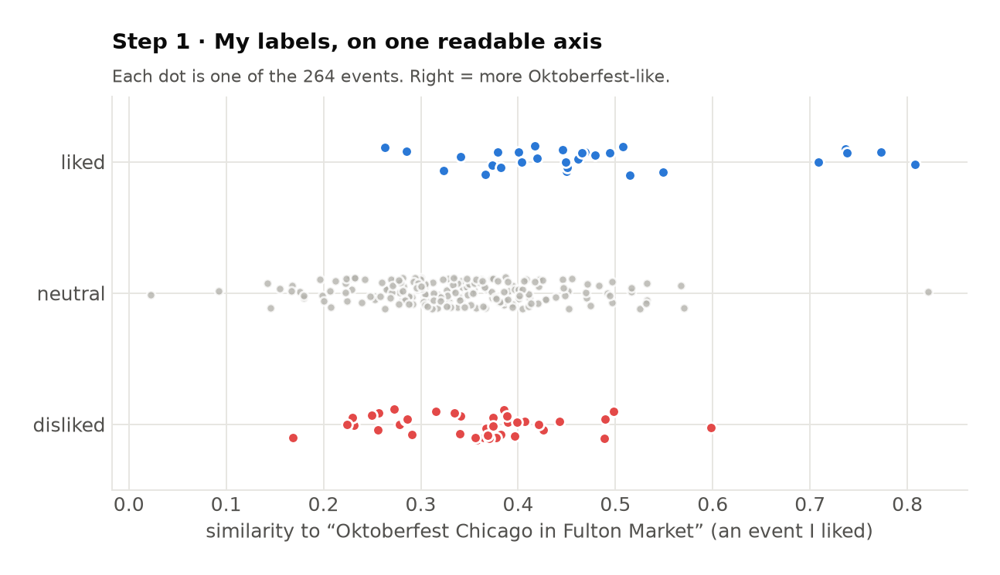
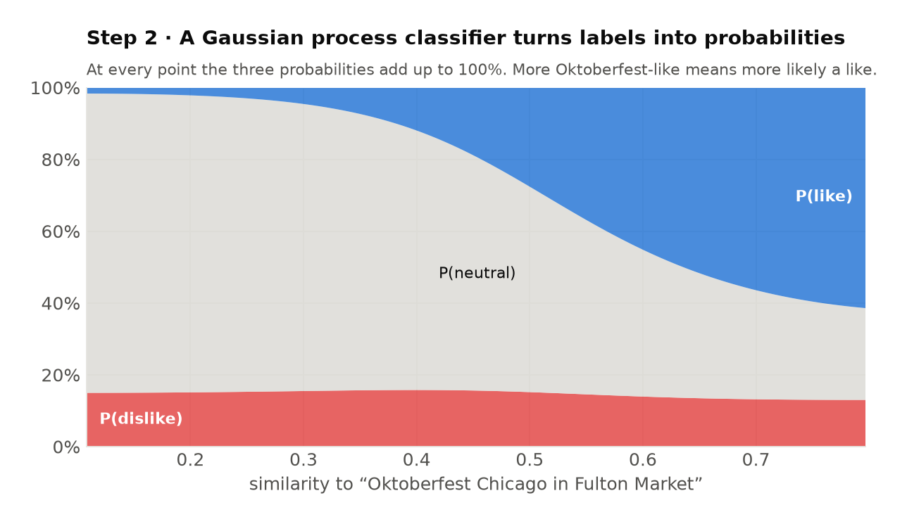
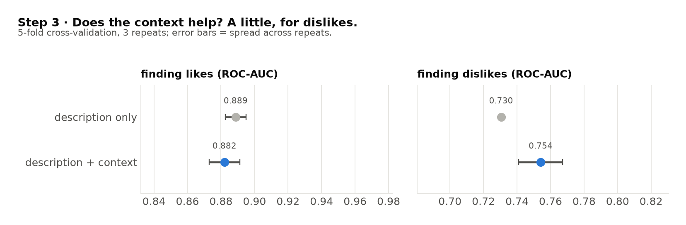
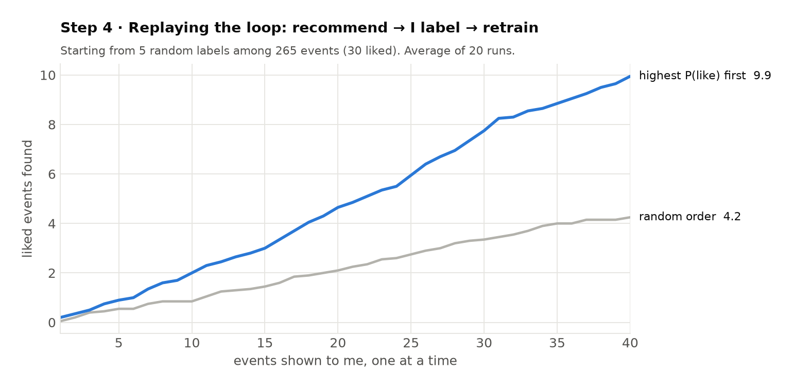
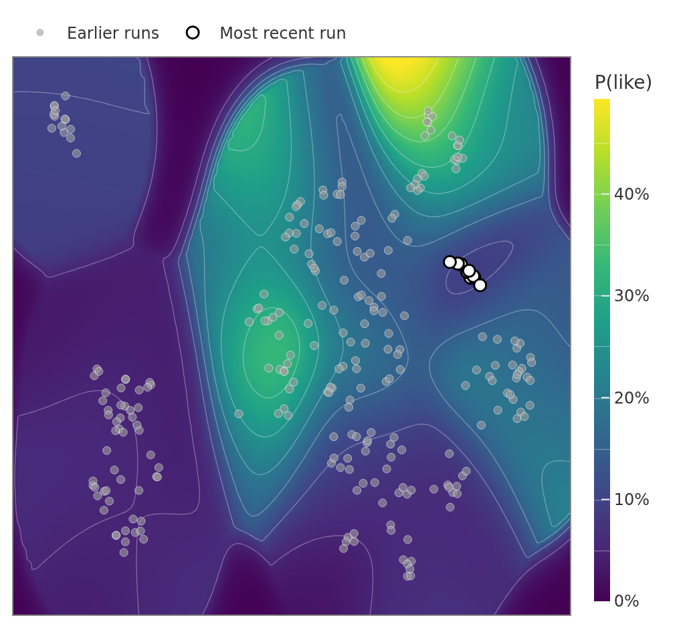

**Code:** [ZacharyCosenza/project-recommendation](https://github.com/ZacharyCosenza/project-recommendation) ·
**Live app:** [event-recommender.fly.dev](https://event-recommender.fly.dev) (read-only; it sleeps when idle,
so the first load takes a few seconds)

Every week I want to know what's going on near me that I'd actually like. The listings are out there but scattered across venue sites, ticketing pages and SEO junk, and none of them know my taste. So this project does two things: (1) an agent builds a catalog of events from web search, and (2) a small model learns my taste from a handful of 👍/👎 labels and picks what to show me next.

```{mermaid}
flowchart LR
    S["queries + city + dates"] --> A["Claude agent<br/>refines web searches"]
    A --> D["event descriptions"]
    D --> C["context<br/>(day, type, theme, city)"]
    D --> E["embedding of<br/>description + context"]
    C --> E
    E --> GP["Gaussian process<br/>classifier"]
    GP --> R["rank by P(like)"]
    R --> U["I label 👎 / 😐 / 👍<br/>and edit context"]
    U --> GP
    U --> C
```

Everything below uses the real data behind the live app: 265 events from 14 searches across Chicago, New York, Monterrey, Reno and Philadelphia.

## Building features with an agent

A search API gives you pages, not events. Ask for "comedy shows in Chicago this weekend" and you mostly get "47 best things to do" listicles. So Claude gets one tool (`brave_search`) and one instruction: start broad, and if the results are vague, search again with sharper keywords (a date, a venue, a series name it just learned) until it finds specific events. Out comes a description per event:

```json
{
  "https://www.choosechicago.com/event/jerry-seinfeld-live-2/":
    "Jerry Seinfeld Live! at The Chicago Theatre (175 N. State St.). Fri Oct 9, 2026, 7:00 PM. His tour site and Ticketmaster also list two shows on Sat Oct 10, at 5:00 PM and 8:00 PM."
}
```

That description is the main feature the model sees, so prompting the agent is basically feature engineering. It costs ~1.5¢ of Claude tokens per event.

**Context.** On top of the description, each event gets a short *context*. A cheap second pass (Claude Haiku, batches of 20 descriptions, about 5¢ per thousand events) pulls out four things: the event's first date, what kind of event it is, a theme from a fixed list (music, comedy, theater, ...) and the city. Python turns the date into a weekday, which is more reliable than asking the LLM for one, and anything it can't find stays blank. The Seinfeld show above becomes `Friday, comedy show, comedy, Chicago`.

Theme and city used to come straight from the search form, which breaks as soon as a query is something like "concerts NYC" or the location is "N/A". Now they come from the description itself; the search location is only a hint (and can be N/A). I can edit any context in the app to add what the description can't know, like "date night" or "too far from home". The app remembers the last auto-extracted context, so a re-extraction never overwrites my edits.



A small local model (`all-MiniLM-L6-v2`) then turns `description + " Context: " + context` into a 384-number embedding. Even on the description alone, events with the same theme land nearer each other than events with different themes, which is what makes learning taste possible (like one event, its neighbors are good guesses).



## Recommending with a Gaussian process classifier

I've only labeled a few dozen events, way too little for the recommenders behind big apps. Instead I use a Gaussian process classifier: it learns from a handful of labels, gives probabilities instead of a hard yes/no, and naturally becomes less confident about events unlike anything I've labeled. Every label I give makes the next pick better. The real model works in all 384 dimensions, so to make it visible I squeeze everything onto one axis: similarity to "Oktoberfest Chicago in Fulton Market", an event I liked.

**Step 1: labels.** Each dot is an event with its label: 👍 (+1), neutral (0, the default) or 👎 (−1). There's a pattern but it's noisy: in the least Oktoberfest-like third, dislikes beat likes 12 to 2, and in the most Oktoberfest-like third likes lead 21 to 12.



**Step 2: probabilities, not a score.** The labels are categories, so instead of regressing on −1/0/1 the model is a classifier: one Gaussian process per class (one-vs-rest), combined into P(dislike), P(neutral) and P(like) for every event. On this axis P(like) climbs from about 2% to 61% as events get more Oktoberfest-like. P(dislike) barely moves (13–16%): my dislikes aren't about this direction at all, which is exactly why the real model needs all 384 dimensions.



**Step 3: does the context help?** To check, I cross-validated the classifier on embeddings of the description alone vs. description + context. A little, for dislikes. Likes are found about equally well either way (ROC-AUC 0.89 vs 0.88, within noise), but dislikes improve from 0.73 to 0.75, and log loss drops from 0.647 to 0.640. My guess is the city: putting it right in the text makes "too far away" easier to pick up. Still, the auto-extracted context is pulled *from* the description, so most of it repeats what's already there. Where it should really pay off is the edits, the things only I know about an event.



**Step 4: close the loop.** The app ranks every event by P(like): show the most likely 👍, I rate it, retrain, repeat. To check this works I replayed it on all 265 events (30 liked), hiding each rating until the model "showed" me that event. Starting from 5 random labels, ranking by P(like) found 10 likes in 40 picks vs 4.2 for random order, about 2.4× as many. Right now the top unrated picks are the Chicago Tribune's Oktoberfest guide (54%), Don Giovanni at the Lyric Opera (47%) and the second Seinfeld show (37%).



## The app

The app shows the same thing in 2D: events laid out by similarity (UMAP) over a heat map of P(like). Clicking an event opens a card with its context (editable) and highlights which words push P(like) up (blue) or down (red). Labeling happens in two places. The **Review** tab flashes one unreviewed event at a time as a card: hit 👎, 😐 or 👍 (or skip) and the next one comes up, with a progress bar of how many are left. It goes newest search first by default, or most uncertain / highest P(like) first. Since 0 is also the default label, the app tracks which neutrals I actually chose, so an explicit 😐 leaves the queue and an untouched event stays in it. The **All events** table is for going back: one click on the 👍 or 👎 box, and any context can be edited in place. Editing a context re-embeds that event immediately, and the next retrain picks it up.


