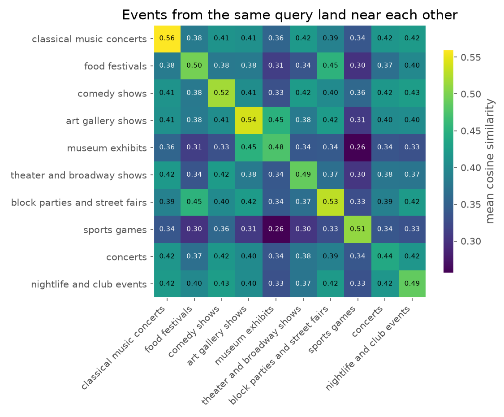
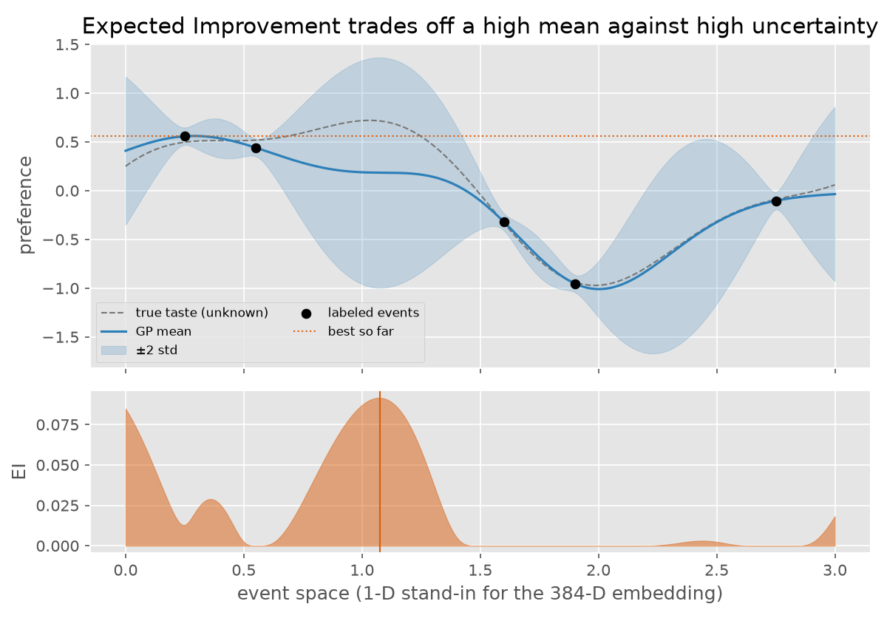

**Code:** [ZacharyCosenza/project-recommendation](https://github.com/ZacharyCosenza/project-recommendation) ·
**Live app:** [event-recommender.fly.dev](https://event-recommender.fly.dev) (read-only; it sleeps when idle,
so the first load takes a few seconds)

## The problem

Event listings are scattered across venue pages, ticketing sites and SEO round-ups, and none of them know
my taste. A recommender normally starts from a catalog of items with features. Here there's no catalog,
and only a few dozen 👍/👎 labels to learn from.

## Part 1: an agent builds the features

Claude gets a single `brave_search` tool and is told to start broad, then refine its queries with exact
dates, venues or event-series names until it finds specific events. Each result comes back as a
`url → description` pair, and the description *is* the feature. The searches behind the current database
cost about 1.6¢ per event.

Descriptions are embedded with `all-MiniLM-L6-v2`. Events from the same query cluster together even though
the model never sees which query produced them:

{width=85%}

## Part 2: Bayesian optimization ranks them

A Gaussian process over the 384-D embeddings learns my labels. **Expected Improvement** ranks every event
by how likely it is to beat the best thing I've liked so far, so it rewards both a high predicted score
and high uncertainty:

{width=85%}

The app lays events out with UMAP over an interpolated EI surface:

{width=70%}

## Stack

Anthropic SDK tool runner · Brave Search API · sentence-transformers · scikit-learn · UMAP · Streamlit ·
SQLite · Fly.io, with password-gated editing and idle self-shutdown.

The [full write-up](https://github.com/ZacharyCosenza/project-recommendation#readme) goes deeper on both
parts, with code and real outputs.
