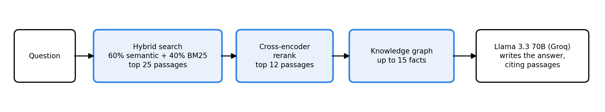
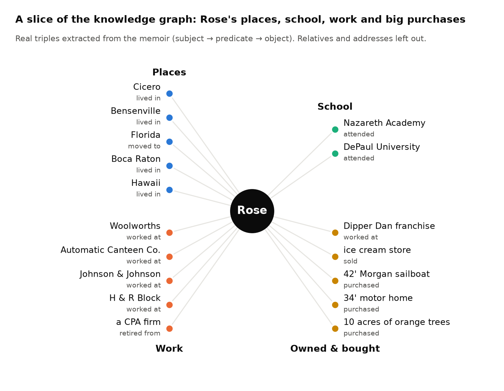

**Code:** [ZacharyCosenza/project-rose](https://github.com/ZacharyCosenza/project-rose)

My grandmother Rose (born 1936 in Cicero, Illinois) wrote a memoir about her life. This project is a way to honor her and keep her stories within reach: you can ask something like "where did Rose work?" and get an answer grounded in her own words, with the passages it came from. On 30 questions written about the memoir it answers 63% correctly. The memoir itself stays private; only the code is public.

## Answering a Question



**Figure 1.** How a question is answered, with the retrieval steps in blue. Hybrid search returns 25 passages, a cross-encoder keeps the best 12, the knowledge graph adds up to 15 facts, and Llama 3.3 70B (on Groq) writes an answer that cites the passages.

**Why a Graph:** Passages alone miss a lot. A memoir mentions the same people and places across dozens of pages, so a question like "who were Rose's cousins?" has its answer scattered everywhere. The knowledge graph collects those scattered facts in one place.

## Building the Knowledge Graph

1. **Chunk and Contextualize:** The memoir (three files) is split by line into 429 passages of at least 60 characters. Each passage gets a one- or two-sentence context written by an LLM (time period, people, topic) before it is embedded, so a short line like "We moved there that spring" still knows who "we" is and where "there" is.

2. **Extract Facts:** For each passage an LLM extracts (subject, predicate, object) triples and tags each entity as a person, place, organization or thing. The predicate has to come from a fixed list of 31 (family relations; born, lived, moved and visited; worked at and retired from; attended and graduated from; owned, purchased and sold; and a catch-all "is related to"). The prompt's own example:

```
"Rose grew up in Cicero. Her father Frank owned a department store.
 She attended Nazareth Academy for high school."

(Rose,  grew up in, Cicero)                 person → place
(Frank, owned,      department store)       person → thing
(Rose,  is child of, Frank)                 person → person
(Rose,  attended,   Nazareth Academy)       person → organization
```

3. **Filter:** LLMs improvise predicates, so every triple goes through three hard filters: the predicate must be on the list verbatim, the entity types must fit the predicate (kinship needs person to person, "lived in" needs person to place), and no triple can point at itself.

4. **Deduplicate Entities:** The same thing appears under many names, so entities are embedded and greedily clustered (unit-normalized, L2 ≤ 0.6, roughly cosine ≥ 0.82), and the most frequent spelling becomes the canonical name. Two design choices mattered. Each entity is embedded with its predicates (`Entity: DePaul\nPredicates: attended`) rather than with the passage it came from; otherwise "the Apartment" could absorb "Bob" just because they share a sentence. Subjects and objects are also clustered separately; otherwise a very common name like "Rose" pulls in unrelated places. Some real merges:

| Variant in the memoir | Canonical entity |
|---|---|
| "DePaul" | DePaul University |
| "Nazareth Academy" | Nazareth |
| "Thaddeus (Ted)" | Thaddeus (Ted) Wesolowski |
| "42' Morgan Sailboat" | 42' Sailboat |
| "Dipper Dan Franchise" | Dipper Dan |

The result is 601 facts from the 212 passages that had any, using 25 of the 31 predicates (Figure 2).



**Figure 2.** A slice of the knowledge graph centered on Rose.

## Using the Graph at Question Time

**Retrieval:** If the question names an entity in the graph (a regex match against canonical names), every fact about it is pulled and ranked by how similar its predicate is to the question, so "where did she work" brings "worked at" and "retired from" to the top. If no entity matches, retrieval falls back to the (up to 3) predicates most similar to the question, provided they clear a cosine similarity of 0.5. Either way, the top 15 unique facts go into the prompt next to the reranked passages.

**Evaluation:** On 30 questions written about the memoir and graded by an LLM judge, the system answers 63% correctly (80% of easy questions, 55% of medium and 55% of hard). A small web app, "Rose's Memories", sits on top of it.

## Limitations

1. **Deduplication:** This is the weakest link. When an entity's only predicate is "visited", its signature says almost nothing, so places can collapse together: Alaska, Key West and Las Vegas all ended up merged into "Seattle".
2. **Catch-All Predicate:** "Is related to" is used far more often than I would like.
3. **Graph Version:** The graph shown here was extracted before I added the type filters, so re-running extraction with them is the next step.
