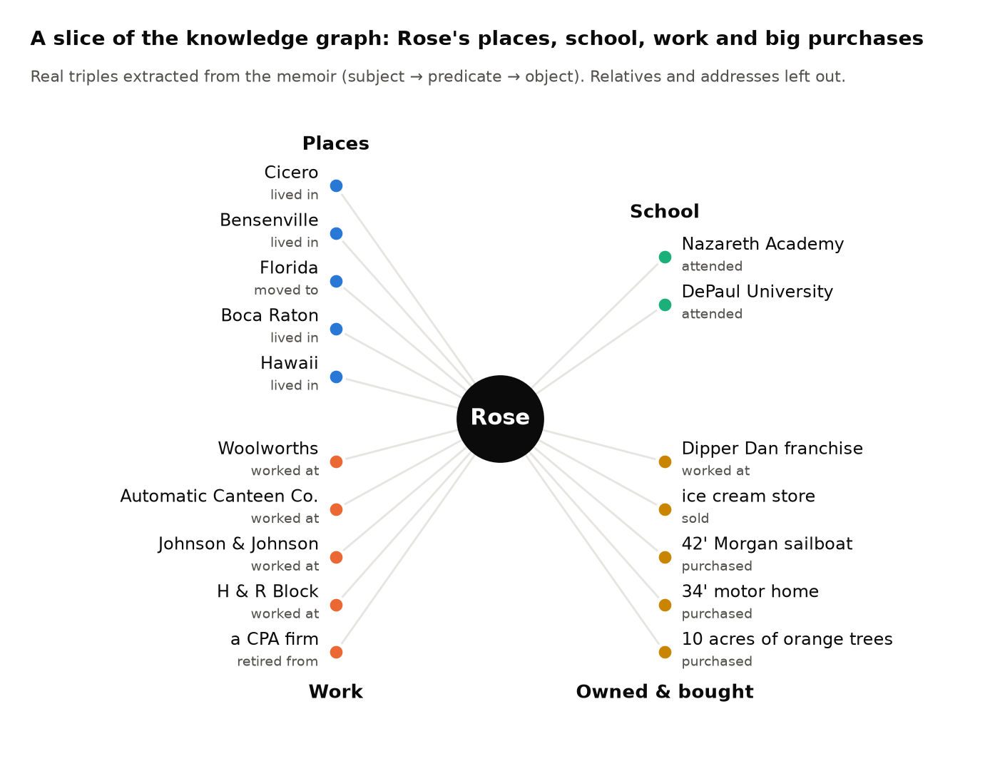

**Code:** [ZacharyCosenza/project-rose](https://github.com/ZacharyCosenza/project-rose)

My grandmother Rose (born 1936 in Cicero, IL) wrote a memoir about her life. This project is a way to honor her and keep her stories easy to reach: you can ask something like "where did Rose work?" and get an answer grounded in her own words, with the passages it came from. The memoir itself stays private; only the code is public.

## How a question gets answered

```
question
  → hybrid search: 60% semantic (MiniLM embeddings) + 40% BM25 keywords → top 25 passages
  → cross-encoder rerank → top 12 passages
  → knowledge graph → up to 15 relevant facts
  → Llama 3.3 70B (on Groq) writes the answer, citing the passages
```

Passages alone miss a lot. A memoir mentions the same people and places across dozens of pages, and a question like "who were Rose's cousins?" has its answer scattered everywhere. That's what the knowledge graph is for.

## Building the knowledge graph

**(1) Chunk and contextualize.** The memoir (three files) is split by line into 429 passages of at least 60 characters. Each passage gets a 1–2 sentence LLM-written context (time period, people, topic) before embedding, so a short line like "We moved there that spring" still knows who "we" is and where "there" is.

**(2) Extract facts.** For each passage an LLM pulls out (subject, predicate, object) triples and tags each entity as a person, place, organization or thing. The predicate has to come from a fixed list of 31 (family relations, born/lived/moved/visited, worked at/retired from, attended/graduated from, owned/purchased/sold, and a catch-all "is related to"). The prompt's own example:

```
"Rose grew up in Cicero. Her father Frank owned a department store.
 She attended Nazareth Academy for high school."

(Rose,  grew up in, Cicero)                 person → place
(Frank, owned,      department store)       person → thing
(Rose,  is child of, Frank)                 person → person
(Rose,  attended,   Nazareth Academy)       person → organization
```

**(3) Filter.** LLMs get creative with predicates, so every triple goes through three hard filters: (i) the predicate must be on the allowlist verbatim, (ii) the types must fit the predicate (kinship needs person → person, "lived in" needs person → place), and (iii) no triple can point at itself.

**(4) Deduplicate entities.** The same thing shows up under many names, so entities are embedded and greedily clustered (unit-normalized, L2 ≤ 0.6, about cosine ≥ 0.82), with the most frequent spelling becoming the canonical name. Two design choices mattered. First, embed the entity with its *predicates* (`Entity: DePaul\nPredicates: attended`) rather than the passage it came from, otherwise "the Apartment" could absorb "Bob" just because they share a sentence. Second, cluster subjects and objects separately, otherwise a very common name like "Rose" pulls in unrelated places. Some real merges:

| Variant in the memoir | Canonical entity |
|---|---|
| "DePaul" | DePaul University |
| "Nazareth Academy" | Nazareth |
| "Thaddeus (Ted)" | Thaddeus (Ted) Wesolowski |
| "42' Morgan Sailboat" | 42' Sailboat |
| "Dipper Dan Franchise" | Dipper Dan |

The result is 601 facts from the 212 passages that had any, using 25 of the predicates. Here's a slice of it, centered on Rose:



## Using the graph at question time

If the question names an entity in the graph (a regex match against canonical names), Rose pulls every fact about it and ranks them by how similar their predicate is to the question, so "where did she work" floats "worked at" and "retired from" to the top. If no entity matches, it falls back to the (up to 3) predicates most similar to the question, if any clear cosine 0.5. Either way, the top 15 unique facts go into the prompt next to the reranked passages.

## How well it works

On 30 questions written about the memoir and graded by an LLM judge, it gets 63% right (80% of easy questions, 55% of medium, 55% of hard). There's a small web app ("Rose's Memories") on top of it.

## What's still hard

Deduplication is the weakest link. When an entity's only predicate is "visited", its signature says almost nothing, so places can collapse together: Alaska, Key West and Las Vegas all ended up merged into "Seattle". "Is related to" also gets used as a catch-all far more than I'd like. The graph shown here was also extracted before I added the type filters, so re-running extraction with them is the next step.
