**Code:** [ZacharyCosenza/project-weather-dumb](https://github.com/ZacharyCosenza/project-weather-dumb)

Why do we need thermometers, pressure trends or physical models to predict the weather when we have access to the goings-on of the great people of New York City? This was a joke project for NYC Open Data Week, built to celebrate how much the city publishes for free. The rule: no weather data goes into the model. Only things that *respond* to weather. In this repo, correlation is causation.

## Shopping for data

I started by surveying every free, no-key API I could find that might react to the weather: 30 datasets, 19 of them on NYC Open Data and 5 on NY State's portal. Some didn't make it:

- DOT real-time traffic speeds store `speed` as text, so the server can't average it and a backfill means ~35k rows per day for 1,500 days (62 minutes).
- MTA hourly ridership by borough would have been perfect, except it publishes ~180 hours late.
- Some ideas were too silly even for this project, like Queens-only 311 flood complaints (Citi Field sits in flood-prone Flushing) or Bronx slippery-pavement crashes near Yankee Stadium.

What made it in: NYC grid load, subway/bus/LIRR ridership, 311 heat and snow complaints, crashes (total and "slippery pavement"), FloodNet street-flood sensors, DOT bike and pedestrian counters, congestion-zone entries, evictions, restaurant inspections, HPD housing violations, and the Mets' and Yankees' win percentages. That's 22 features from 11 sources.

The ground truth is hourly ERA5 temperature from Open-Meteo (back to 2022). It's only ever the label, never an input.

## The hard part: publication lag

Every source publishes on its own schedule. Grid load shows up within minutes, ridership after 3 days, congestion-zone data after 3 weeks. If I just joined everything on date, the model would be "predicting" today with data that won't exist for days. So each feature is shifted by its source's lag, `feature[t] = value[t − lag]`. Daily sources are first forward-filled onto the hourly grid (a published daily number doesn't change), and NYISO's hourly load is the base index everything joins onto.

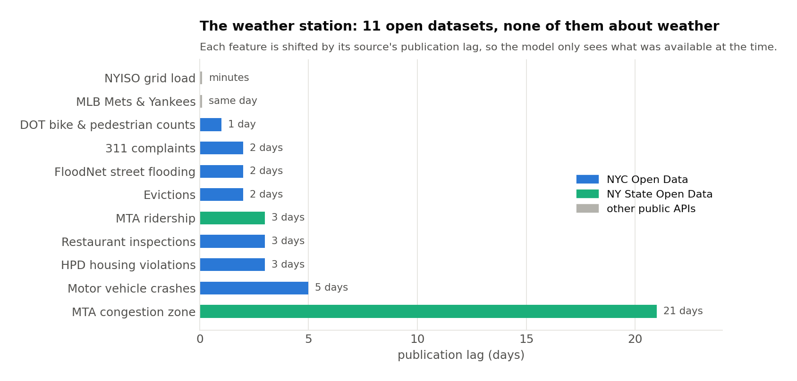

## How well does it work?

Pretty well for a model that has never seen a thermometer. On the temporal test set (July 2024 onward, data it never trained on) it tracks the seasons and most of the week-to-week swings, and mostly misses the extreme cold snaps:

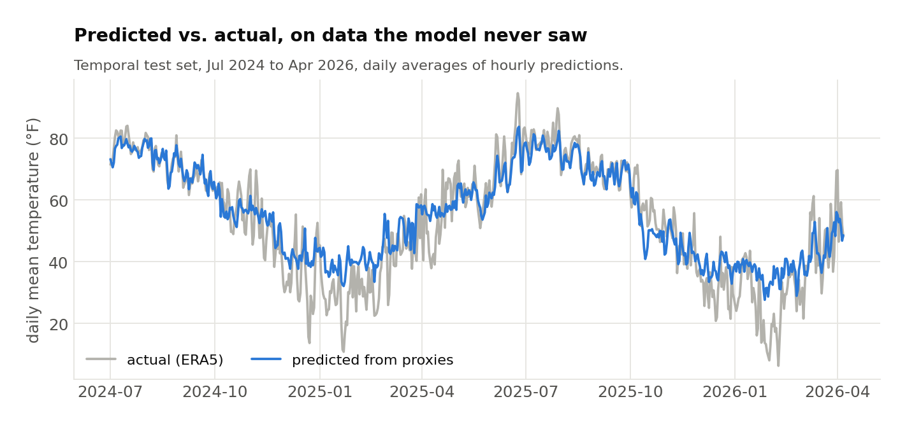

A typical hour is off by about 7 °F (9 °F RMSE, R² 0.80). Shuffling the data randomly instead flatters it a bit (7.5 °F RMSE), because neighboring hours leak into the test set.

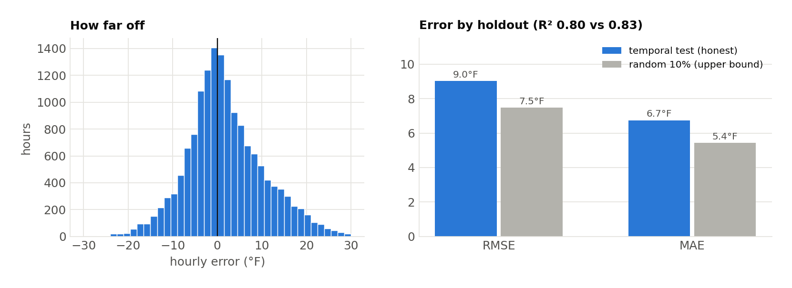

## The features

The model is an XGBoost regressor over 22 features. For each one below: the raw relationship with temperature (one dot per day) and the **partial dependence**, the model's average forecast as that one feature slides from low to high with everything else left as it was. All partial dependence plots share the same scale, so a flat line means the model barely cares. Five proxies do most of the work:

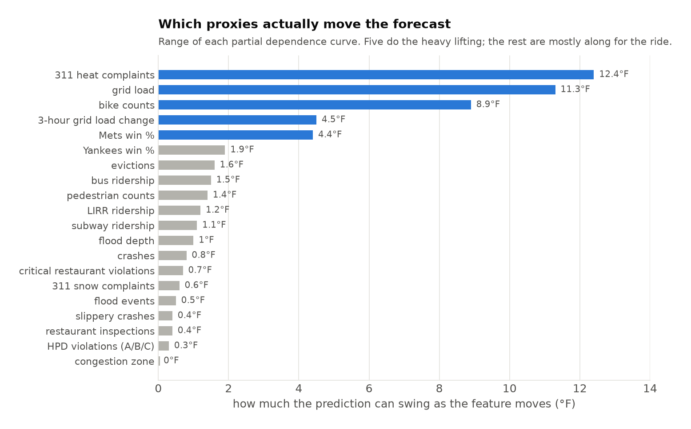

### 311 heat complaints · 12.4 °F

:::: {.columns}
::: {.column width="30%"}
<video src="features/311_heat.mp4" autoplay loop muted playsinline width="100%"></video>
:::
::: {.column width="5%"}
:::
::: {.column width="65%"}
Heat or hot-water complaints to 311 spike in winter when building heat fails during cold snaps. The model's favorite feature: going from near zero to a few hundred complaints a day drops the forecast by ~12 °F.
:::
::::

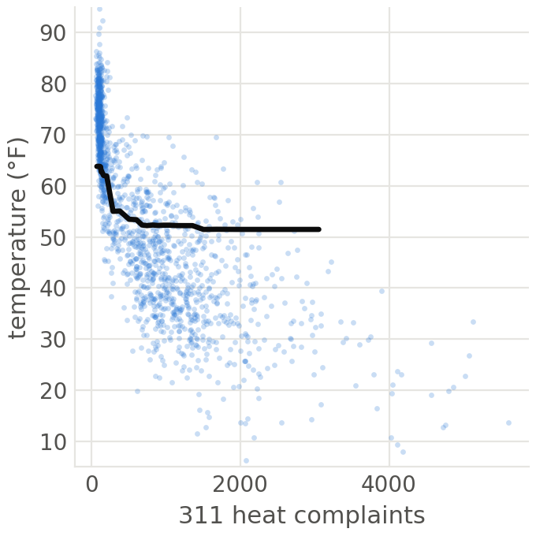

### NYC grid load · 11.3 °F

:::: {.columns}
::: {.column width="30%"}
<video src="features/nyiso_load_mw.mp4" autoplay loop muted playsinline width="100%"></video>
:::
::: {.column width="5%"}
:::
::: {.column width="65%"}
Real-time electricity use in the NYC zone. The raw data is a beautiful U (heating in winter, AC in summer), but the model mostly reads high load as warm and leans on the other features, especially heat complaints, to tell a freezing high-load day from a sweltering one.
:::
::::

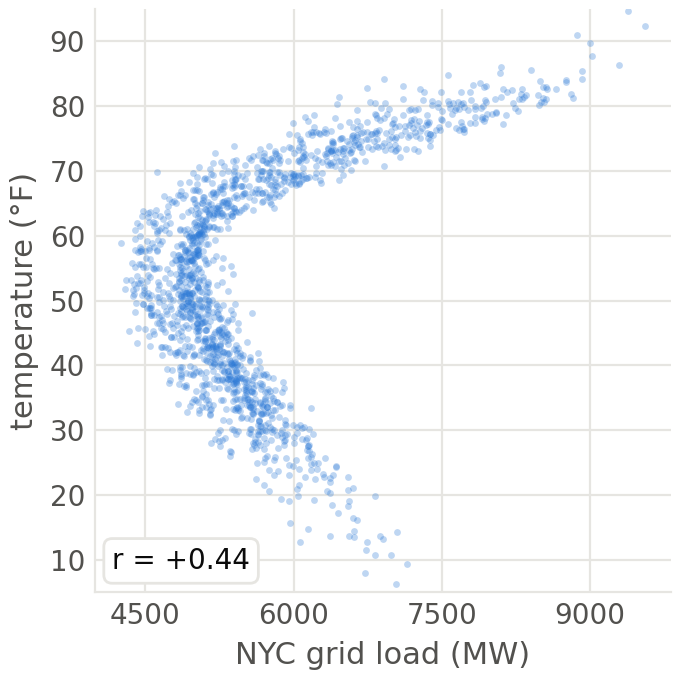

### Bike counts · 8.9 °F

:::: {.columns}
::: {.column width="30%"}
<video src="features/ped_bike.mp4" autoplay loop muted playsinline width="100%"></video>
:::
::: {.column width="5%"}
:::
::: {.column width="65%"}
DOT's citywide bike counters. Rain and cold keep New Yorkers off bikes, and once daily counts pass ~45K the forecast jumps by several degrees.
:::
::::

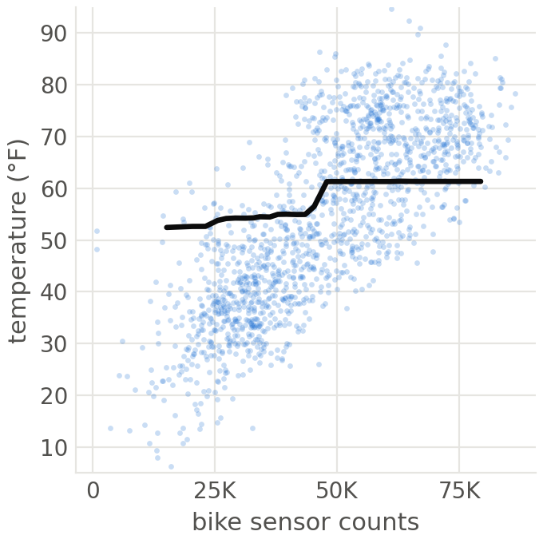

### 3-hour change in grid load · 4.5 °F

:::: {.columns}
::: {.column width="30%"}
<video src="features/nyiso_delta_3h.mp4" autoplay loop muted playsinline width="100%"></video>
:::
::: {.column width="5%"}
:::
::: {.column width="65%"}
How fast grid load is changing captures momentum within the day. Moderate increases read as warmer; very large jumps read as colder.
:::
::::

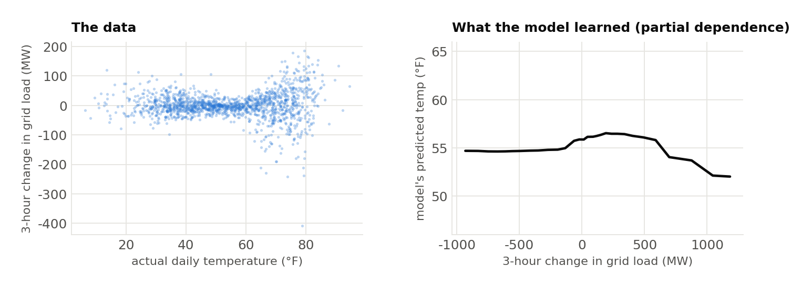

### Mets win % · 4.4 °F

:::: {.columns}
::: {.column width="30%"}
<video src="features/mets_win_pct.mp4" autoplay loop muted playsinline width="100%"></video>
:::
::: {.column width="5%"}
:::
::: {.column width="65%"}
Season win percentage (missing in the off-season). Mostly a "baseball is happening" flag, and baseball happens when it's warm. The funniest part: a 70% win rate predicts *colder* weather, because the only time the Mets win that often is a hot streak in early April.
:::
::::

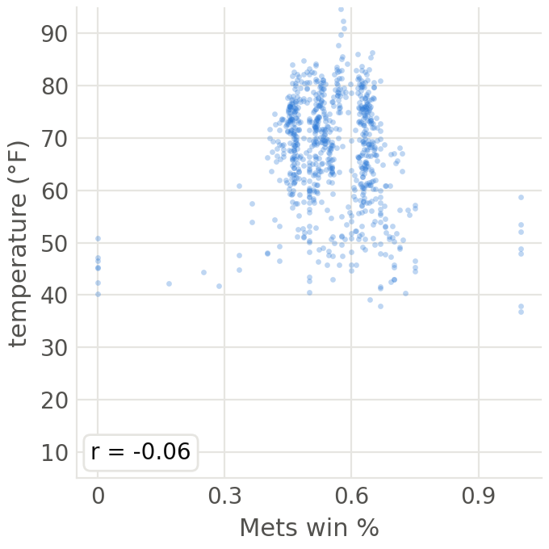

### Yankees win % · 1.9 °F

:::: {.columns}
::: {.column width="30%"}
<video src="features/yankees_win_pct.mp4" autoplay loop muted playsinline width="100%"></video>
:::
::: {.column width="5%"}
:::
::: {.column width="65%"}
Same idea, second team. Same early-season effect, just smaller.
:::
::::

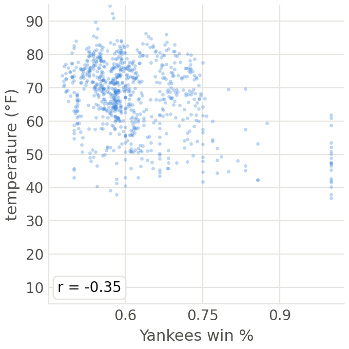

### Evictions · 1.6 °F

:::: {.columns}
::: {.column width="30%"}
<video src="features/evictions.mp4" autoplay loop muted playsinline width="100%"></video>
:::
::: {.column width="5%"}
:::
::: {.column width="65%"}
Marshal-executed evictions, weakly seasonal. The model nudges colder as evictions rise; I'd call this one mostly noise.
:::
::::

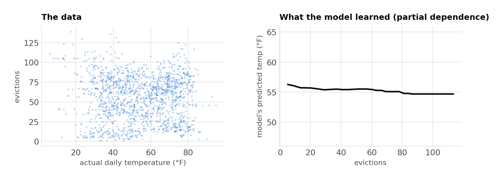

### Bus ridership · 1.5 °F

:::: {.columns}
::: {.column width="30%"}
<video src="features/mta_bus.mp4" autoplay loop muted playsinline width="100%"></video>
:::
::: {.column width="5%"}
:::
::: {.column width="65%"}
Daily bus boardings citywide. Busier days read slightly warmer.
:::
::::

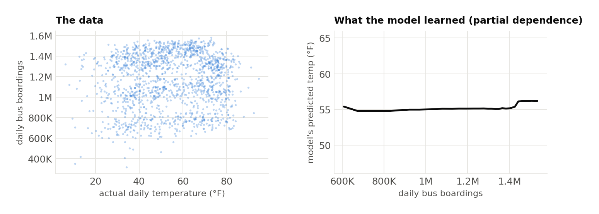

### Pedestrian counts · 1.4 °F

:::: {.columns}
::: {.column width="30%"}
<video src="features/ped_pedestrian.mp4" autoplay loop muted playsinline width="100%"></video>
:::
::: {.column width="5%"}
:::
::: {.column width="65%"}
DOT pedestrian counters. Heavy rain drives people indoors, and above ~4K counts the forecast ticks up.
:::
::::

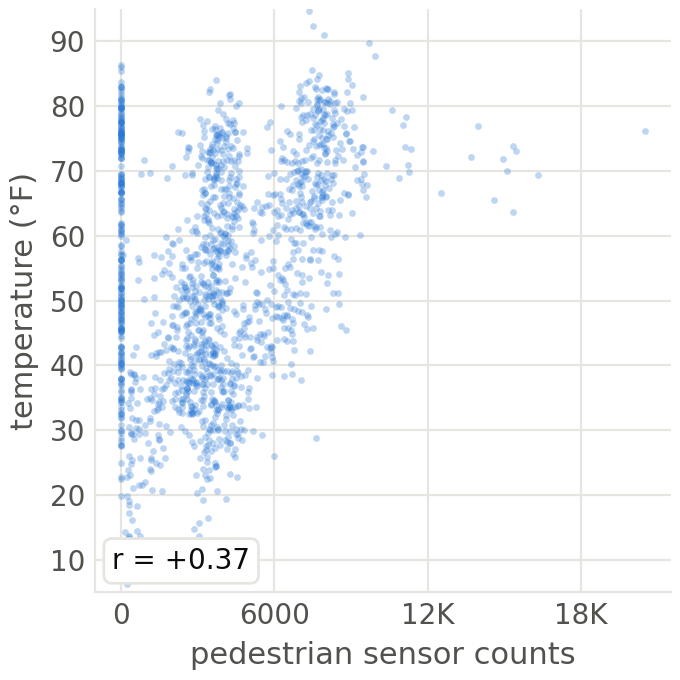

### LIRR ridership · 1.2 °F

:::: {.columns}
::: {.column width="30%"}
<video src="features/mta_lirr.mp4" autoplay loop muted playsinline width="100%"></video>
:::
::: {.column width="5%"}
:::
::: {.column width="65%"}
Long Island Rail Road boardings. Snow wrecks LIRR service, and high ridership reads a bit warmer.
:::
::::

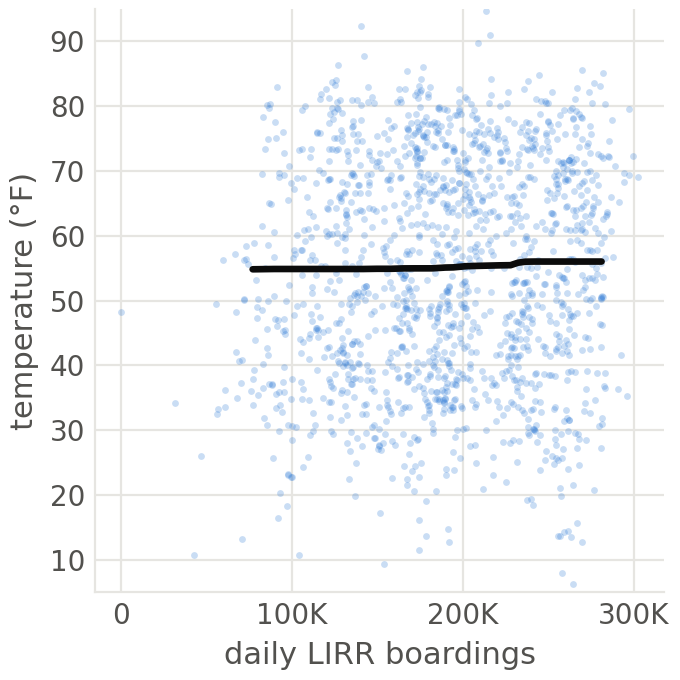

### Subway ridership · 1.1 °F

:::: {.columns}
::: {.column width="30%"}
<video src="features/mta_subway.mp4" autoplay loop muted playsinline width="100%"></video>
:::
::: {.column width="5%"}
:::
::: {.column width="65%"}
Daily subway entries. Rain and cold push riders underground and heat keeps them there, so it washes out to a small effect.
:::
::::

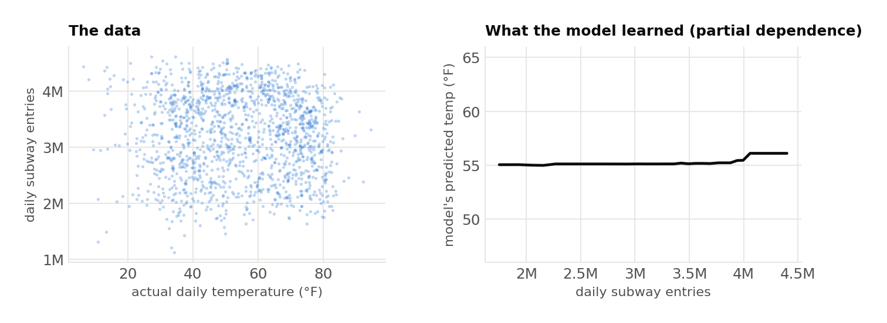

### Street flood depth · 1.0 °F

:::: {.columns}
::: {.column width="30%"}
<video src="features/floodnet_max_depth_in.mp4" autoplay loop muted playsinline width="100%"></video>
:::
::: {.column width="5%"}
:::
::: {.column width="65%"}
The deepest street flooding recorded by FloodNet's IoT sensors. A rain signal, not a temperature one, so it barely moves the forecast.
:::
::::

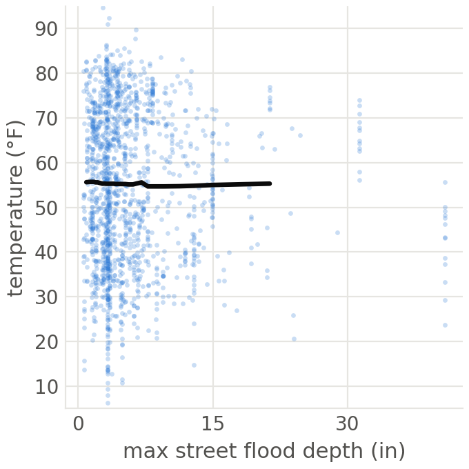

### Crashes · 0.8 °F

:::: {.columns}
::: {.column width="30%"}
<video src="features/crashes_total.mp4" autoplay loop muted playsinline width="100%"></video>
:::
::: {.column width="5%"}
:::
::: {.column width="65%"}
NYPD-reported crashes citywide. Volume drops in heavy rain and snow as fewer people drive.
:::
::::

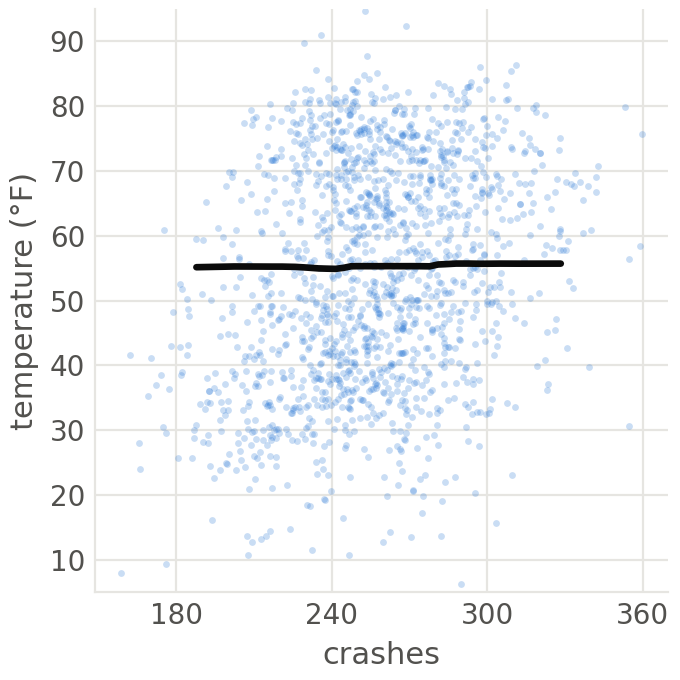

### Critical restaurant violations · 0.7 °F

:::: {.columns}
::: {.column width="30%"}
<video src="features/restaurant_critical.mp4" autoplay loop muted playsinline width="100%"></video>
:::
::: {.column width="5%"}
:::
::: {.column width="65%"}
Critical violations found during health inspections. Mostly tracks how many inspections happen.
:::
::::

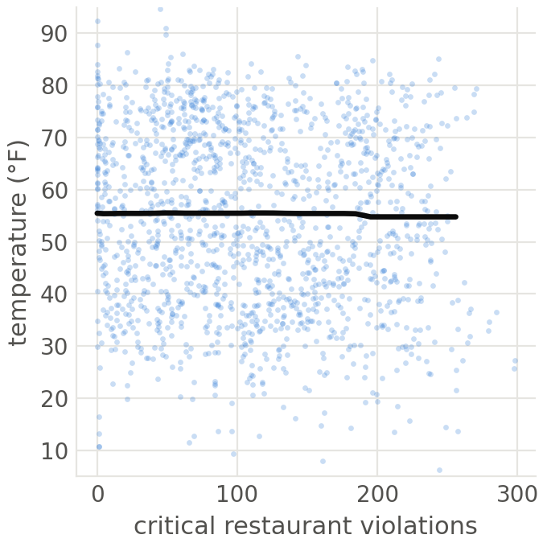

### 311 snow complaints · 0.6 °F

:::: {.columns}
::: {.column width="30%"}
<video src="features/311_snow.mp4" autoplay loop muted playsinline width="100%"></video>
:::
::: {.column width="5%"}
:::
::: {.column width="65%"}
Snow and ice complaints: a reliable sign that snow fell and stuck around, but rare enough that it hardly matters for temperature.
:::
::::

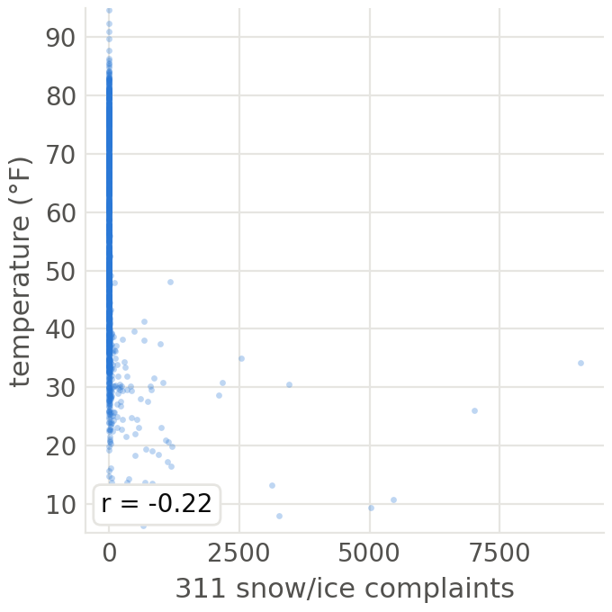

### Flood events · 0.5 °F

:::: {.columns}
::: {.column width="30%"}
<video src="features/floodnet_events.mp4" autoplay loop muted playsinline width="100%"></video>
:::
::: {.column width="5%"}
:::
::: {.column width="65%"}
How many FloodNet sensors went off. Spikes only in big storms.
:::
::::

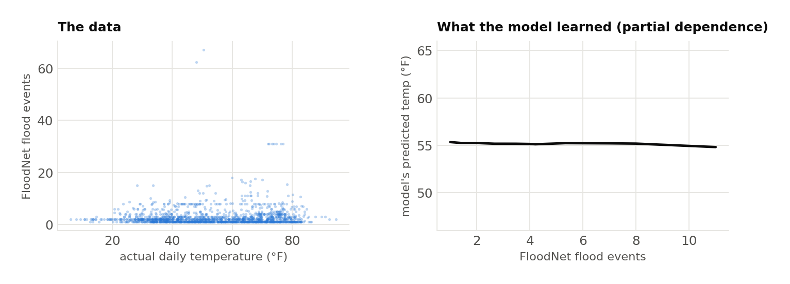

### Slippery-pavement crashes · 0.4 °F

:::: {.columns}
::: {.column width="30%"}
<video src="features/crashes_slippery.mp4" autoplay loop muted playsinline width="100%"></video>
:::
::: {.column width="5%"}
:::
::: {.column width="65%"}
Crashes blamed on slippery pavement, a direct frozen-precipitation indicator that lingers for days after snow.
:::
::::

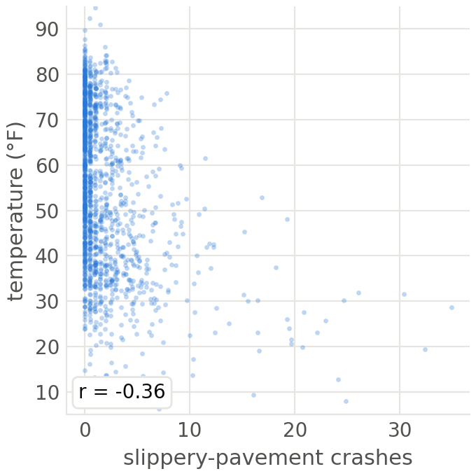

### Restaurant inspections · 0.4 °F

:::: {.columns}
::: {.column width="30%"}
<video src="features/restaurant_inspections.mp4" autoplay loop muted playsinline width="100%"></video>
:::
::: {.column width="5%"}
:::
::: {.column width="65%"}
Inspectors go out less in bad weather, which makes for a very mild proxy.
:::
::::

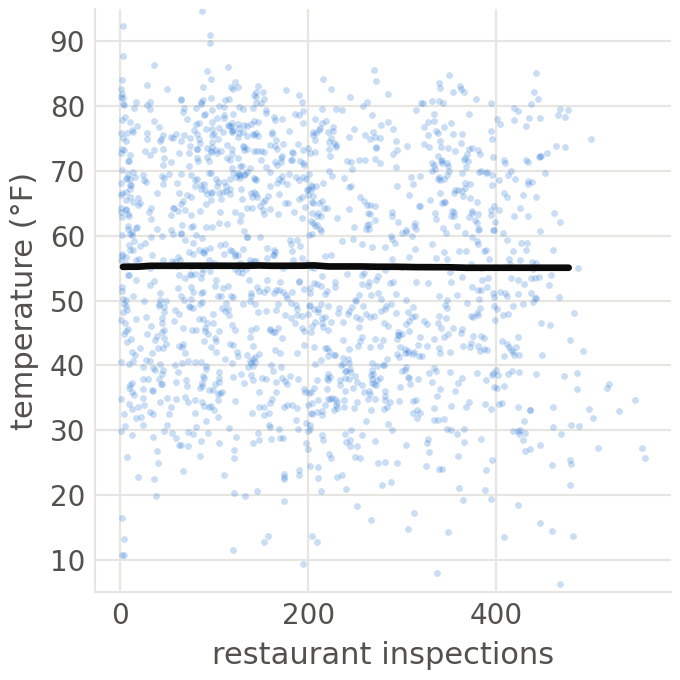

### HPD housing violations · 0.3 °F

Class A/B/C housing code violations. Included because why not; the model agrees they're useless.

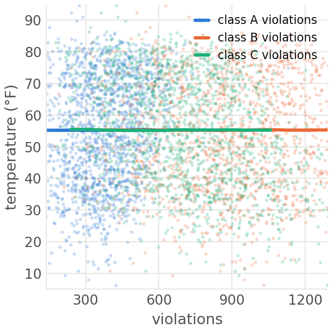

### Congestion zone entries · 0.0 °F

:::: {.columns}
::: {.column width="30%"}
<video src="features/cz_total.mp4" autoplay loop muted playsinline width="100%"></video>
:::
::: {.column width="5%"}
:::
::: {.column width="65%"}
Vehicles entering Manhattan's congestion zone. Perfectly flat because the data only starts in January 2025, after the training cutoff, so the model has never seen a single value. It rides along for the vibes.
:::
::::

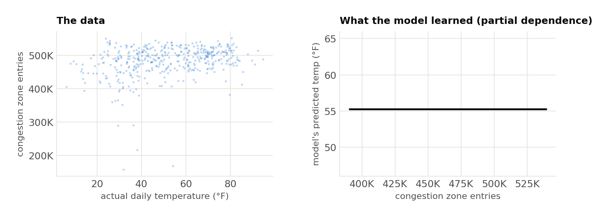

Thank you, NYC Open Data.
