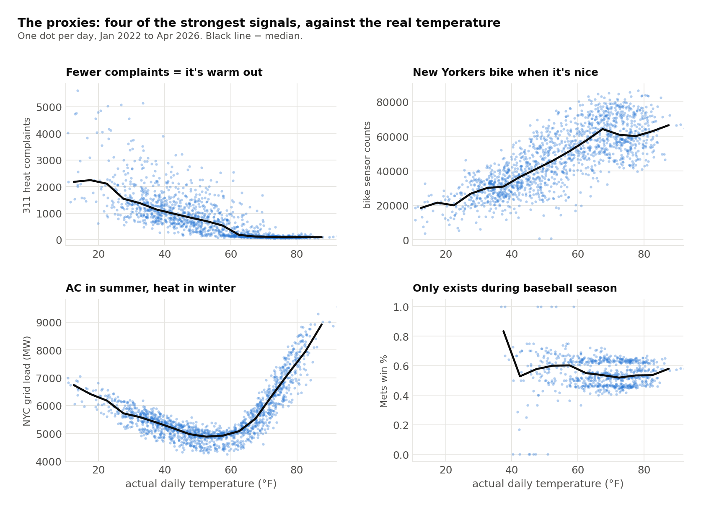

**Code:** [ZacharyCosenza/project-weather-dumb](https://github.com/ZacharyCosenza/project-weather-dumb)

Why do we need thermometers, pressure trends or physical models to predict the weather when we have access to the goings-on of the great people of New York City? This was a joke project for NYC Open Data Week, built to celebrate how much the city publishes for free. The rule: no weather data goes into the model. Only things that *respond* to weather. In this repo, correlation is causation.

{width=35%}

## Shopping for data

I started by surveying every free, no-key API I could find that might react to the weather: 30 datasets, 19 of them on NYC Open Data and 5 on NY State's portal. Some didn't make it:

- DOT real-time traffic speeds store `speed` as text, so the server can't average it and a backfill means ~35k rows per day for 1,500 days (62 minutes).
- MTA hourly ridership by borough would have been perfect, except it publishes ~180 hours late.
- Some ideas were too silly even for this project, like Queens-only 311 flood complaints (Citi Field sits in flood-prone Flushing) or Bronx slippery-pavement crashes near Yankee Stadium.

What made it in: NYC grid load, subway/bus/LIRR ridership, 311 heat and snow complaints, crashes (total and "slippery pavement"), FloodNet street-flood sensors, DOT bike and pedestrian counters, congestion-zone entries, evictions, restaurant inspections, HPD housing violations, and the Mets' and Yankees' win percentages. That's 22 features from 11 sources.

The ground truth is hourly ERA5 temperature from Open-Meteo (back to 2022). It's only ever the label, never an input.

## The hard part: publication lag

Every source publishes on its own schedule. Grid load shows up within minutes, ridership after 3 days, congestion-zone data after 3 weeks. If I just joined everything on date, the model would be "predicting" today with data that won't exist for days. So each feature is shifted by its source's lag, `feature[t] = value[t − lag]`. Daily sources are first forward-filled onto the hourly grid (a published daily number doesn't change), and NYISO's hourly load is the base index everything joins onto.

## The proxies

Here's what the model has to work with, against the actual temperature:

Heat complaints collapse once it's warm out, bikes come out when it's nice, and grid load makes a beautiful U (heating in winter, AC in summer). And the Mets' win percentage... is mostly just a "baseball is happening" flag, and baseball happens when it's warm. Still made the top 4 by SHAP importance, which I find very funny.

{width=35%}

## Model

The model is an XGBoost regressor (300 trees, depth 5, early stopping) orchestrated with Kedro: `data_engineering` fetches and merges every source, `data_science` trains and evaluates, and `inference` predicts from the most recent hour where every proxy is available. The split is temporal: train through 2023, validate on the first half of 2024, test from July 2024 on.

| Holdout | RMSE | MAE | R² |
|---|---|---|---|
| Temporal (Jul 2024 onward, the honest one) | 5.0 °C | 3.7 °C | 0.80 |
| Random 10% (leaks seasonality, upper bound) | 4.2 °C | 3.0 °C | 0.83 |

So a typical hour is off by about 7 °F (9 °F RMSE), using only subway rides, complaints and baseball. SHAP ranks 311 heat complaints first, then bike counts, grid load and the Mets.

## Running it

Two Docker containers from one image: one for the pipeline and one for a Streamlit site that shows the current guess in °F along with the SHAP contributions behind it. Cron runs inference every half hour and a full retrain nightly, and a small monitor emails me if predictions go stale or the site container dies.

Thank you, NYC Open Data.
