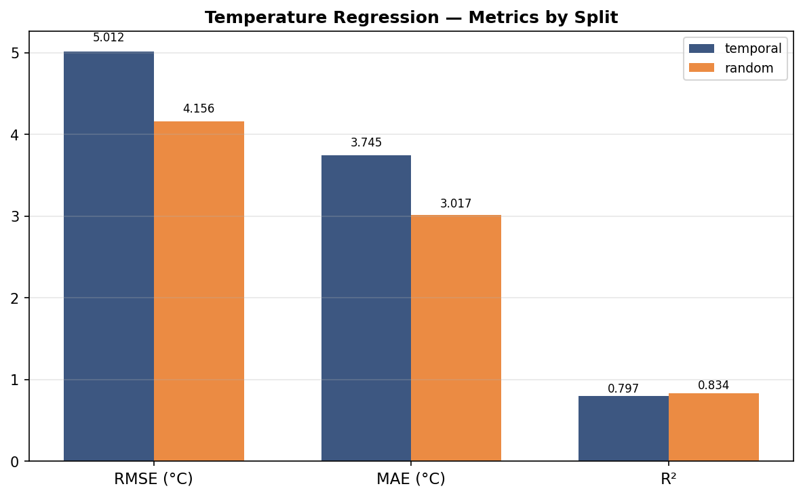
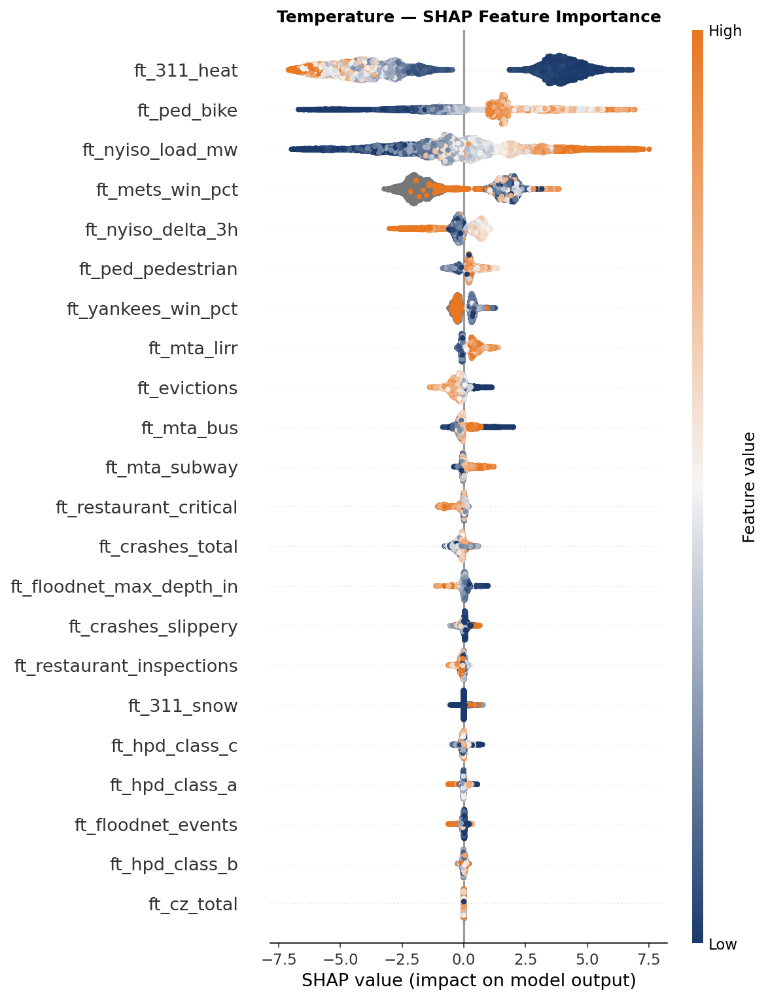

**Code:** [ZacharyCosenza/project-weather-dumb](https://github.com/ZacharyCosenza/project-weather-dumb)

## The premise

Why use thermometers when you can watch New Yorkers? This model predicts the current temperature using
only things that *respond* to weather: electricity load on the NYC grid, subway, bus and LIRR ridership,
311 heat and snow complaints, vehicle crashes, baseball standings,
street-flood sensors, bike counts and more. In this repo, correlation is causation.

{width=40%}

## The hard part: publication lag

Every source publishes on its own delay: grid load within minutes, ridership after 3 days, congestion-zone
data after 3 weeks. Each feature is shifted by its source's lag, `feature[t] = value[t − lag]`, so the model
only ever sees data that would actually have been available at prediction time. Daily sources are
forward-filled onto the hourly grid first, which is correct because a published daily value doesn't change.

## Results

The ground truth is hourly ERA5 temperature from Open-Meteo. The honest number is the temporal holdout
(July 2024 onward, data the model never saw): **RMSE 5.0 °C, R² 0.80**. A random holdout, which leaks
seasonality, gives the upper bound of 4.2 °C.

{width=75%}

SHAP shows which proxies carry the signal. The strongest is 311 heat complaints (few complaints mean it's
warm), followed by bike counts and grid load. Fourth place goes to the Mets' win percentage, most
likely because it only exists during baseball season.

{width=75%}

## Stack

Kedro pipelines · XGBoost · SHAP · Streamlit · Docker, refreshed hourly by cron.
