**Code:** [ZacharyCosenza/project-weather-dumb](https://github.com/ZacharyCosenza/project-weather-dumb)

Why use thermometers, pressure trends or physical models to predict the weather when we can watch the people of New York City instead? This was a joke project for NYC Open Data Week, built to celebrate how much the city publishes for free. The rule was that no weather data goes into the model, only things that respond to the weather. *In this project, correlation is causation.* On data it never trained on, the model is off by about 7 °F in a typical hour (R² 0.80) without ever seeing a thermometer.

## Choosing the Data

**Survey:** I started by surveying every free API without a key that might react to the weather: 30 datasets, 19 of them on NYC Open Data and 5 on New York State's portal. Some did not make it:

1. **DOT Traffic Speeds:** The real-time feed stores `speed` as text, so the server cannot average it, and a backfill means about 35,000 rows per day for 1,500 days (62 minutes).
2. **MTA Hourly Ridership by Borough:** It would have been ideal, except that it is published about 180 hours late.
3. **Too Silly Even for This Project:** Queens-only 311 flood complaints (Citi Field sits in flood-prone Flushing) and Bronx slippery-pavement crashes near Yankee Stadium.

**What Made It In:** NYC grid load, subway, bus and LIRR ridership, 311 heat and snow complaints, crashes (total and on slippery pavement), FloodNet street-flood sensors, DOT bike and pedestrian counters, congestion-zone entries, evictions, restaurant inspections, HPD housing violations, and the Mets' and Yankees' win percentages: 22 features from 11 sources. The ground truth is hourly ERA5 temperature from Open-Meteo (back to 2022), used only as the label and never as an input.

## Publication Lag

Every source publishes on its own schedule: grid load within minutes, ridership after 3 days, congestion-zone data after 3 weeks (Figure 1). Joining everything on date would let the model "predict" today with data that will not exist for days, so each feature is shifted by its source's lag, `feature[t] = value[t − lag]`. Daily sources are first forward-filled onto the hourly grid (a published daily number does not change), and NYISO's hourly load is the base index everything joins onto.

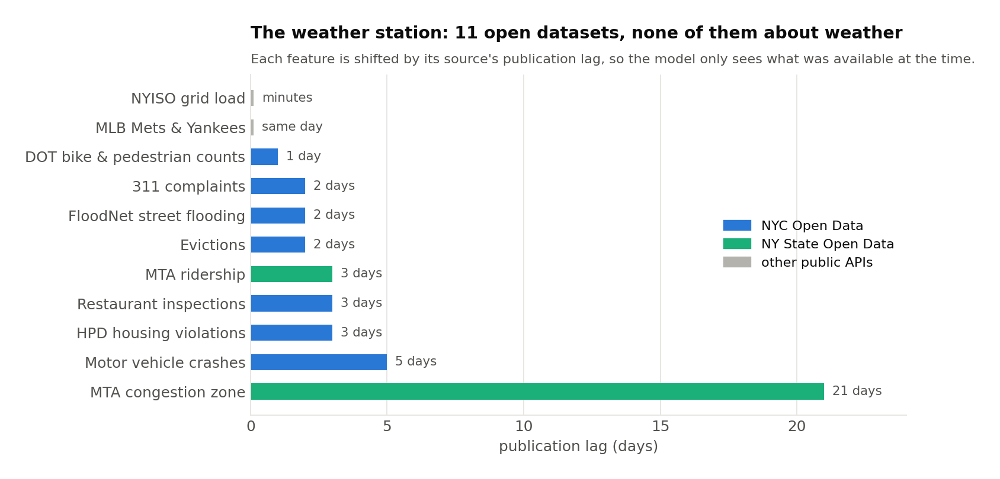

**Figure 1.** The 11 sources and their publication lags, from minutes (grid load) to 21 days (congestion-zone entries). Each feature is shifted by its lag, so the model only sees what was available at the time.

## Results

**Accuracy:** On the temporal test set (July 2024 onward, data the model never trained on) the predictions follow the seasons and most of the week-to-week swings, and mostly miss the extreme cold snaps (Figure 2). A typical hour is off by about 7 °F (9 °F RMSE, R² 0.80). Shuffling the data randomly instead flatters the model (7.5 °F RMSE), because neighboring hours leak into the test set (Figure 3).

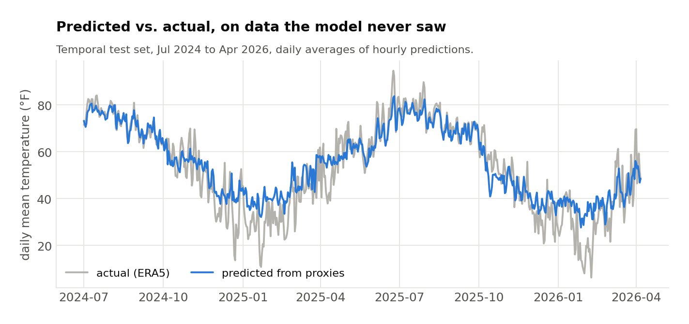

**Figure 2.** Daily averages of the hourly predictions against the actual ERA5 temperature on the temporal test set, July 2024 to April 2026.

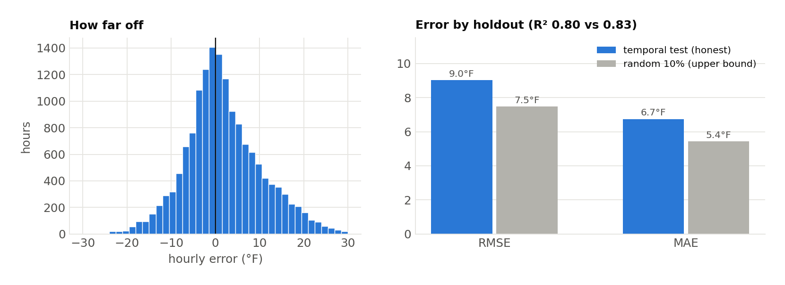

**Figure 3.** (a) Distribution of hourly errors on the temporal test set. (b) RMSE and MAE on the temporal test set against a random 10% holdout, which leaks neighboring hours and serves as an upper bound.

**Features:** The model is an XGBoost regressor over the 22 features. SHAP splits each hourly forecast into how much each feature pushed it warmer or colder, and heat complaints, bike counts, grid load and the Mets do most of the work (Figure 4).

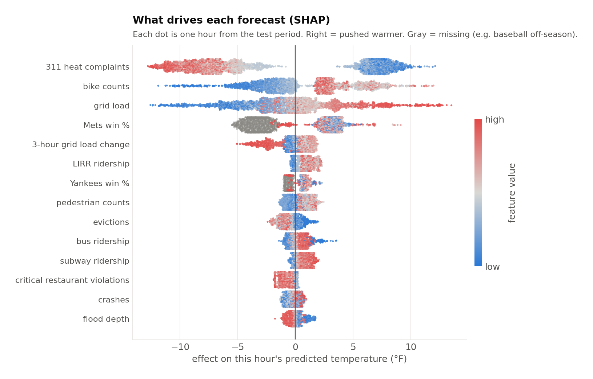

**Figure 4.** SHAP values for each hour of the test period, by feature: points to the right pushed the forecast warmer, colour shows the feature's value, and grey marks missing values (for example the baseball off-season).

## The Features One by One

Below is each feature's raw relationship with the weather: one point per day, with its correlation (r) to the actual temperature. Correlation only captures straight-line relationships, so U-shaped ones like grid load (heating in winter, air conditioning in summer) score lower than they deserve.

### 311 heat complaints

```{=html}
<div style="display:flex;gap:16px;flex-wrap:wrap;align-items:center">
<video src="features/311_heat.mp4" autoplay loop muted playsinline style="width:300px;height:300px;object-fit:cover;border-radius:4px"></video>
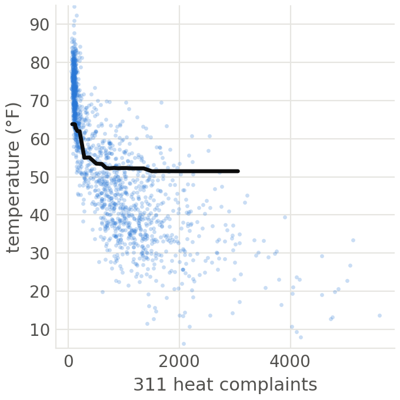
</div>
```

### NYC grid load

```{=html}
<div style="display:flex;gap:16px;flex-wrap:wrap;align-items:center">
<video src="features/nyiso_load_mw.mp4" autoplay loop muted playsinline style="width:300px;height:300px;object-fit:cover;border-radius:4px"></video>
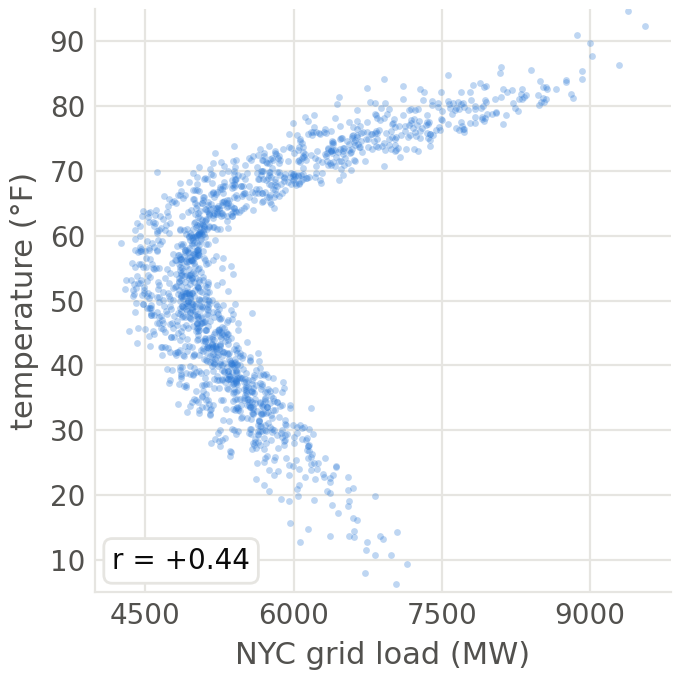
</div>
```

### Bike counts

```{=html}
<div style="display:flex;gap:16px;flex-wrap:wrap;align-items:center">
<video src="features/ped_bike.mp4" autoplay loop muted playsinline style="width:300px;height:300px;object-fit:cover;border-radius:4px"></video>
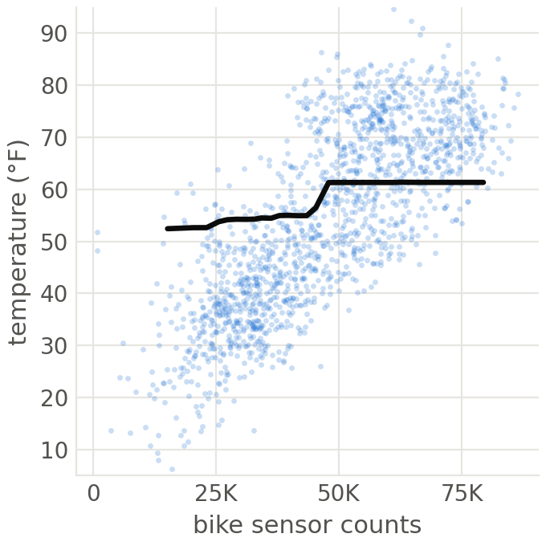
</div>
```

### 3-hour change in grid load

```{=html}
<div style="display:flex;gap:16px;flex-wrap:wrap;align-items:center">
<video src="features/nyiso_delta_3h.mp4" autoplay loop muted playsinline style="width:300px;height:300px;object-fit:cover;border-radius:4px"></video>
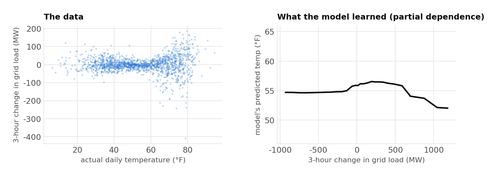
</div>
```

### Mets win %

```{=html}
<div style="display:flex;gap:16px;flex-wrap:wrap;align-items:center">
<video src="features/mets_win_pct.mp4" autoplay loop muted playsinline style="width:300px;height:300px;object-fit:cover;border-radius:4px"></video>
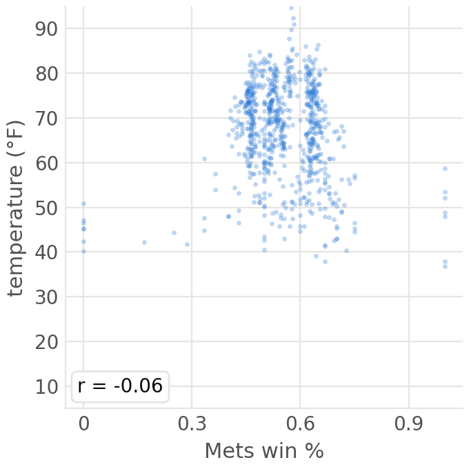
</div>
```

### Yankees win %

```{=html}
<div style="display:flex;gap:16px;flex-wrap:wrap;align-items:center">
<video src="features/yankees_win_pct.mp4" autoplay loop muted playsinline style="width:300px;height:300px;object-fit:cover;border-radius:4px"></video>
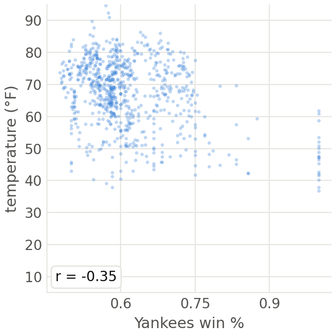
</div>
```

### Evictions

```{=html}
<div style="display:flex;gap:16px;flex-wrap:wrap;align-items:center">
<video src="features/evictions.mp4" autoplay loop muted playsinline style="width:300px;height:300px;object-fit:cover;border-radius:4px"></video>
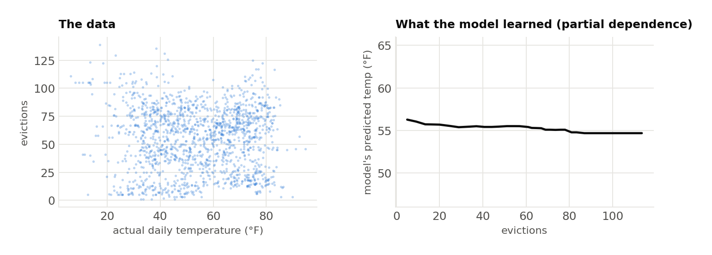
</div>
```

### Bus ridership

```{=html}
<div style="display:flex;gap:16px;flex-wrap:wrap;align-items:center">
<video src="features/mta_bus.mp4" autoplay loop muted playsinline style="width:300px;height:300px;object-fit:cover;border-radius:4px"></video>
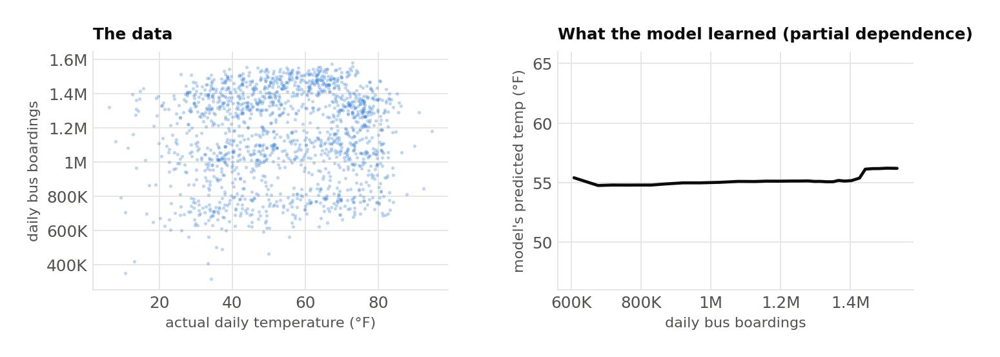
</div>
```

### Pedestrian counts

```{=html}
<div style="display:flex;gap:16px;flex-wrap:wrap;align-items:center">
<video src="features/ped_pedestrian.mp4" autoplay loop muted playsinline style="width:300px;height:300px;object-fit:cover;border-radius:4px"></video>
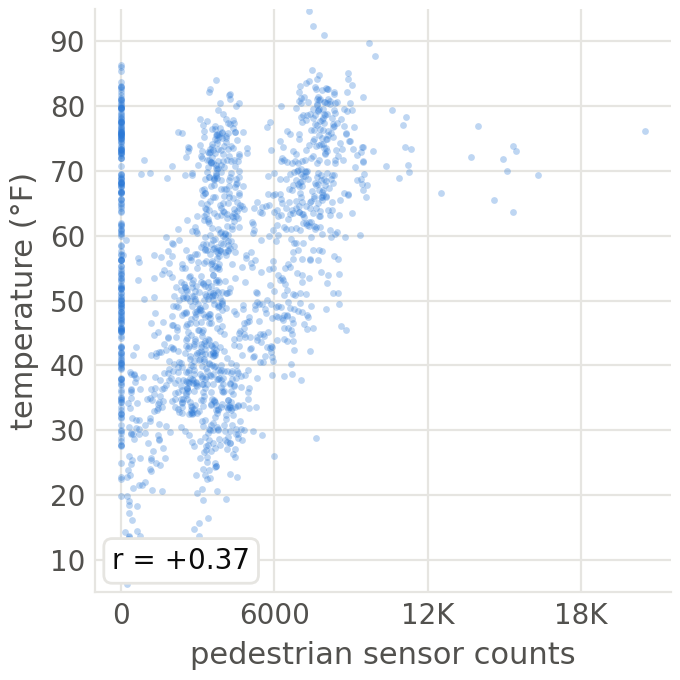
</div>
```

### LIRR ridership

```{=html}
<div style="display:flex;gap:16px;flex-wrap:wrap;align-items:center">
<video src="features/mta_lirr.mp4" autoplay loop muted playsinline style="width:300px;height:300px;object-fit:cover;border-radius:4px"></video>
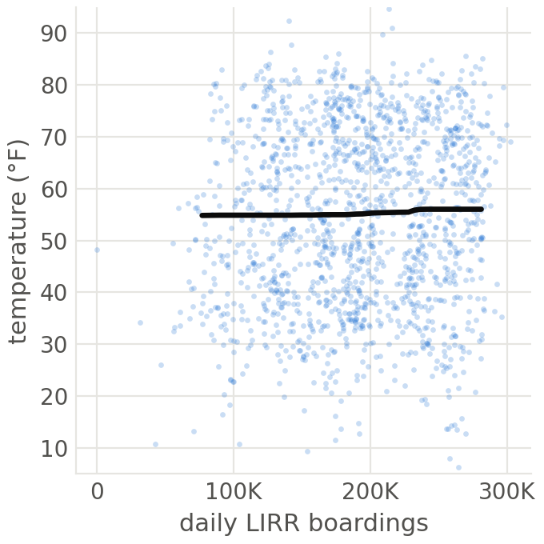
</div>
```

### Subway ridership

```{=html}
<div style="display:flex;gap:16px;flex-wrap:wrap;align-items:center">
<video src="features/mta_subway.mp4" autoplay loop muted playsinline style="width:300px;height:300px;object-fit:cover;border-radius:4px"></video>
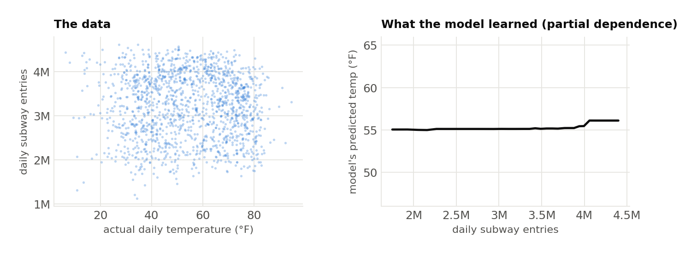
</div>
```

### Street flood depth

```{=html}
<div style="display:flex;gap:16px;flex-wrap:wrap;align-items:center">
<video src="features/floodnet_max_depth_in.mp4" autoplay loop muted playsinline style="width:300px;height:300px;object-fit:cover;border-radius:4px"></video>
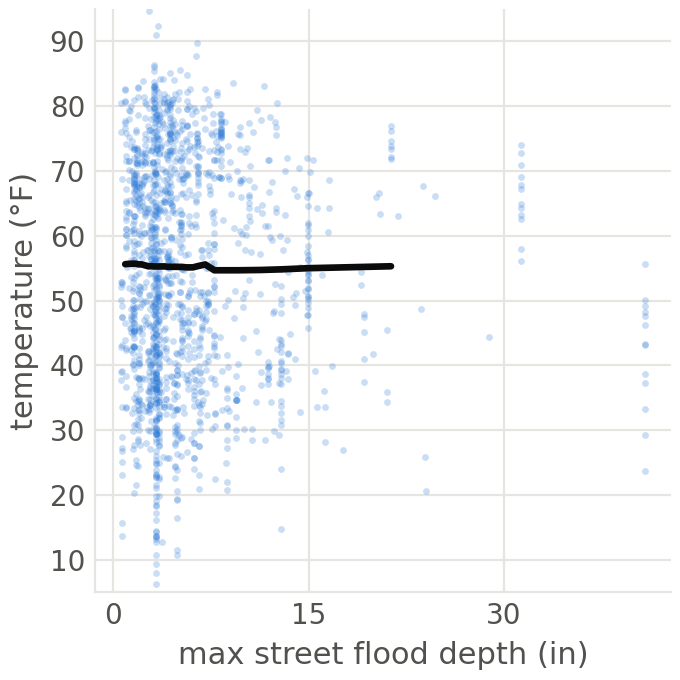
</div>
```

### Crashes

```{=html}
<div style="display:flex;gap:16px;flex-wrap:wrap;align-items:center">
<video src="features/crashes_total.mp4" autoplay loop muted playsinline style="width:300px;height:300px;object-fit:cover;border-radius:4px"></video>
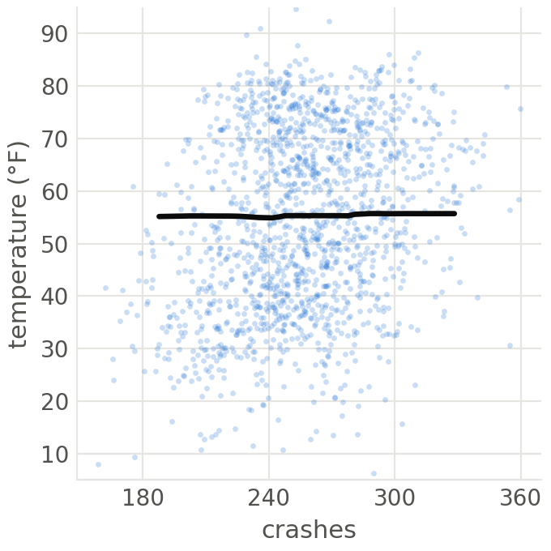
</div>
```

### Critical restaurant violations

```{=html}
<div style="display:flex;gap:16px;flex-wrap:wrap;align-items:center">
<video src="features/restaurant_critical.mp4" autoplay loop muted playsinline style="width:300px;height:300px;object-fit:cover;border-radius:4px"></video>
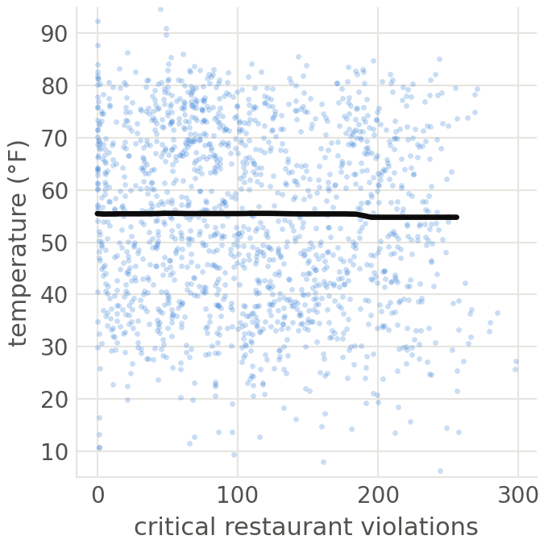
</div>
```

### 311 snow complaints

```{=html}
<div style="display:flex;gap:16px;flex-wrap:wrap;align-items:center">
<video src="features/311_snow.mp4" autoplay loop muted playsinline style="width:300px;height:300px;object-fit:cover;border-radius:4px"></video>
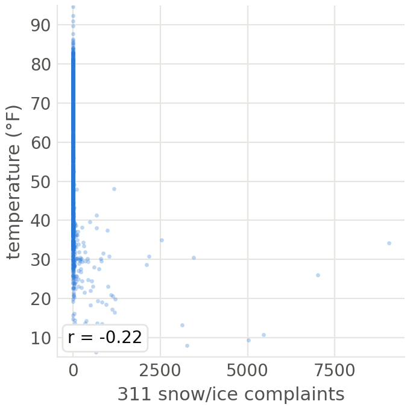
</div>
```

### Flood events

```{=html}
<div style="display:flex;gap:16px;flex-wrap:wrap;align-items:center">
<video src="features/floodnet_events.mp4" autoplay loop muted playsinline style="width:300px;height:300px;object-fit:cover;border-radius:4px"></video>
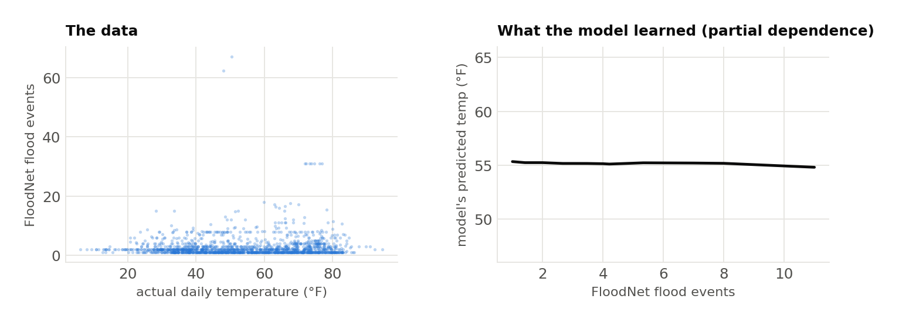
</div>
```

### Slippery-pavement crashes

```{=html}
<div style="display:flex;gap:16px;flex-wrap:wrap;align-items:center">
<video src="features/crashes_slippery.mp4" autoplay loop muted playsinline style="width:300px;height:300px;object-fit:cover;border-radius:4px"></video>
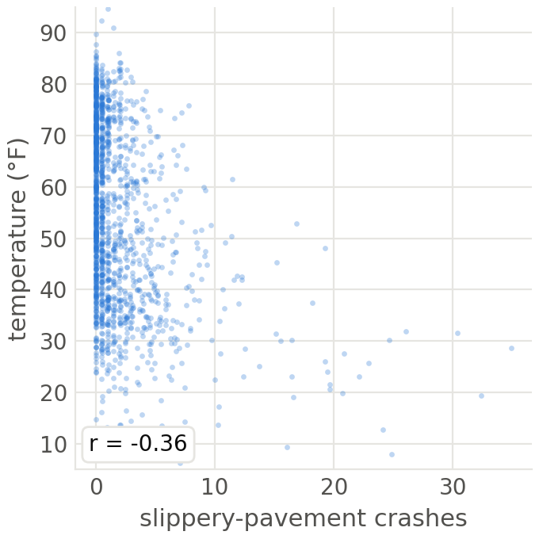
</div>
```

### Restaurant inspections

```{=html}
<div style="display:flex;gap:16px;flex-wrap:wrap;align-items:center">
<video src="features/restaurant_inspections.mp4" autoplay loop muted playsinline style="width:300px;height:300px;object-fit:cover;border-radius:4px"></video>
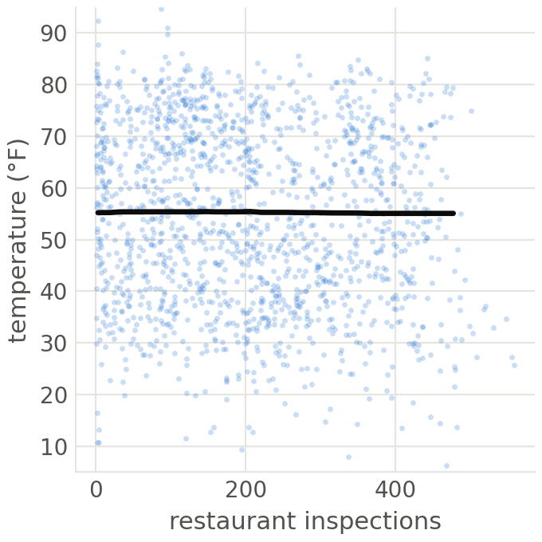
</div>
```

### Congestion zone entries

```{=html}
<div style="display:flex;gap:16px;flex-wrap:wrap;align-items:center">
<video src="features/cz_total.mp4" autoplay loop muted playsinline style="width:300px;height:300px;object-fit:cover;border-radius:4px"></video>
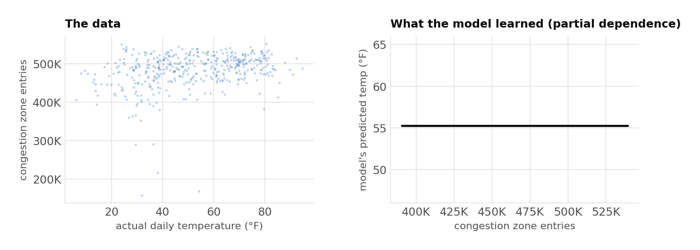
</div>
```

Thank you, NYC Open Data.
